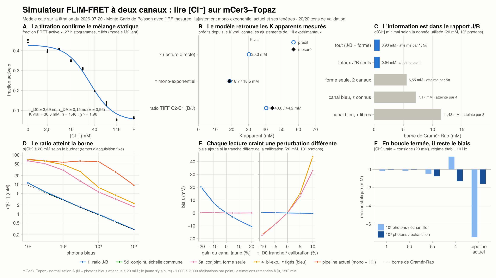
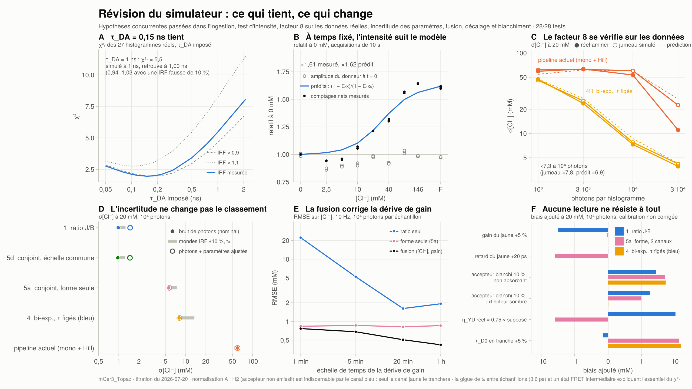
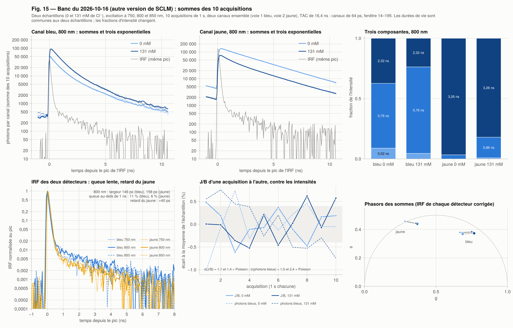
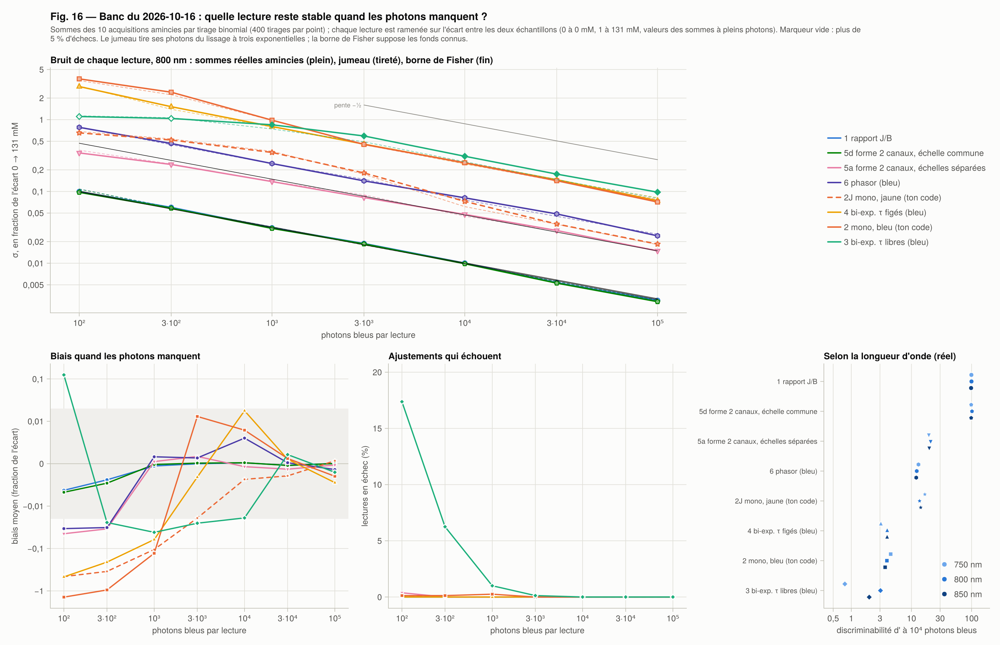

# Simulateur FLIM-FRET à deux canaux

Ce dossier implémente le plan `Simulateur FLIM-FRET à deux canaux — plan de conception.md` :
l'erreur sur [Cl⁻] (en mM) de chaque façon de lire le capteur, selon le budget de photons
et la concentration vraie, avec la borne de Cramér-Rao comme référence absolue.

- **Données et IRF** : celles de `tests/analyse_SCLM_2.jl`, soit la titration du 2026-07-20
  (`Maîtrise/Données/2026-07-20_SCLM`, 3 réplicats × 9 concentrations, canal bleu) et
  `irf_20260710_16x_sclm.sdt`, médiane soustraite comme le fait `load_irf_from_sdt`.
- **Estimateur 2** : **ton** `vec_to_lifetime` (la copie `lifetime_analysis.jl` de ce dossier),
  appelé tel quel. Le fichier n'est pas modifié ; il est chargé dans un module isolé par fil
  d'exécution.

```bash
cd Simulateurs/FLIM-FRET_2-channels
julia --project=. step0_spectres.jl             # spectres FPbase et matrice η (télécharge une fois)
julia --project=. step1_titration.jl            # ta titration → paramètres, et le test de M2 lent (20 s)
julia --project=. -t 8 step2_validation.jl      # 29 tests internes (40 s)
julia --project=. step3_calibration.jl          # calibrations, K apparents, identifiabilité, bornes (1 min)
julia --project=. -t 8 step4_monte_carlo.jl     # grille principale : 351 000 réalisations (≈ 10 min sur le M1)
julia --project=. -t 8 step5_nuisances.jl       # balayages de nuisance (≈ 45 min)
julia --project=. step6_figures.jl              # figures et résumé chiffré (2 min)
julia --project=. -t 8 step7_cible_mobile.jl    # cible mobile et boucle fermée (optionnel, ≈ 10 min)
julia --project=. step8_synthese.jl             # deux diapositives de synthèse : FR / EN, fond clair / noir (1 min)
# révision du 2026-10-15 (voir la section du même nom)
julia --project=. step9_batterie.jl             # batterie H1–H5 sur l'ingestion, IRF et t₀ sur tes données (1 min)
julia --project=. -t 8 step10_facteur8.jl       # le facteur 8 sur tes données amincies (1 min)
julia --project=. -t 8 step11_incertitude.jl    # incertitude des paramètres : bandes, variance paramétrique, classement (≈ 12 min)
julia --project=. step12_canal_jaune.jl         # canal jaune : η_YD depuis tes TIFF, ingestion testée, prédictions (1 min)
julia --project=. -t 8 step13_fusion.jl         # fusion ratio + forme sous dérive de gain (2 min)
# banc du 2026-10-16 : une autre version de SCLM, traitée seule (voir la section du même nom)
julia --project=. -t 8 step14_banc.jl           # sommes des 10 acquisitions, stabilité des techniques à bas photons (3 min)
# titration à deux canaux du 2026-10-16 (8 concentrations × 3 λ) : document « modifications du code »
julia --project=. -t 8 step15_analyse_deux_canaux.jl   # SCLM : règles de lecture et de longueur d'onde, blanchiment, carte, inconnu (15 min)
julia --project=. -t 8 step15_analyse_deux_canaux.jl --donnees Data/2026-10-16/KIRIN charger global calibrer amincir blanchir agreger   # KIRIN (13 min)
```

L'étape 5 compte désormais aussi Φ_A effectif, τ_A ±20 %, le retard du jaune, le blanchiment et un
balayage « reference » (≈ 80 min en tout) ; les étapes 9 à 13 lisent les sorties des étapes 1 à 5.

## Figures de synthèse

Deux diapositives, 16:9, 2560 × 1440 px, comme tes slides, en français et en anglais, fond clair et
fond noir : `sorties/figures/synthese_{FR,EN}{,_dark}.png` (ce que dit le simulateur) et
`sorties/figures/synthese_revision_{FR,EN}{,_dark}.png` (ce que la révision du 2026-10-15 a
vérifié et changé). Les textes ci-dessous sont écrits pour la présentation.

### Diapositive 1 — ce que dit le simulateur



> Nous avons construit un simulateur de l'imagerie FLIM à deux canaux du capteur mCer3–Topaz.
> Il est calé sur la titration en solution du 2026-07-20, et il compare les façons de lire
> [Cl⁻] à budget de photons égal, avec la borne de Cramér-Rao comme référence.
>
> **A.** Un modèle à deux états décrit la titration. Une fraction x des capteurs transfère
> presque toute son énergie (τ_DA = 0,15 ns, E = 0,96) ; dans les autres, le donneur n'est pas
> éteint (τ_D0 = 3,69 ns). Le Cl⁻ ne change que x. Ces deux durées de vie, communes aux 27
> histogrammes, suffisent à les décrire, avec un K vrai de 30 mM.
>
> **B.** Sans ajustement supplémentaire, le modèle retrouve les K apparents mesurés :
> 18,7 mM pour le τ mono-exponentiel (mesuré : 18,5) et 40,6 mM pour le ratio des images
> (mesuré : 44,2).
>
> **C.** Parce que le transfert est presque total, l'état actif est quasi éteint dans le bleu,
> et sa signature temporelle tient sous la réponse instrumentale. La forme des déclins ne porte
> qu'environ 3 % de l'information sur [Cl⁻] ; le rapport jaune/bleu en porte presque tout.
>
> **D.** Le rapport jaune/bleu atteint la borne : σ ≈ 1 mM à 20 mM pour 10⁴ photons bleus. Les
> lectures par la forme sont 6 à 8 fois moins précises, la lecture actuelle (τ
> mono-exponentiel + Hill) environ 60 fois.
>
> **E.** Le ratio dépend toutefois de l'échelle relative des deux canaux : 5 % de dérive de gain
> le biaisent de 3 à 4 mM, alors que la forme y est insensible. À l'inverse, un τ décalé de 5 %
> entre la solution et la tranche biaise la forme de 7 à 15 mM et laisse le ratio intact.
>
> **F.** En boucle fermée, l'intégrateur moyenne le bruit et il ne reste que le biais. Il est
> presque nul avec le ratio, de −0,75 mM avec la forme et de −1,6 mM avec la lecture actuelle
> (−7,5 mM à 10³ photons).
>
> **À retenir.** Pour ce capteur, l'information est dans le rapport des deux canaux FLIM. Mais
> ce rapport n'est exact que si son échelle est étalonnée et suivie : la diapositive suivante
> montre comment la forme des déclins peut la surveiller en continu. Les barres et bandes grises
> donnent l'incertitude due à l'IRF et au décalage t₀.

### Diapositive 2 — la révision : ce qui tient, ce qui change



> Nous avons ensuite cherché à mettre ce simulateur en défaut, par ordre de ce qui pouvait
> invalider ses conclusions.
>
> **A.** Le paramètre dont tout dépend est la durée de vie courte, τ_DA = 0,15 ns. Les données
> réelles la préfèrent nettement à toute valeur supérieure à 0,3 ns. Une titration simulée à 1 ns
> est retrouvée à 1,00 ns, et à 0,94–1,03 ns avec une IRF fausse de 10 % : une erreur d'IRF ne
> fabrique pas un transfert quasi total.
>
> **B.** Les acquisitions sont à temps fixé, donc l'intensité totale est une prédiction
> indépendante. Le modèle prévoit une hausse de 62 % entre 0 mM et saturation ; elle est de 61 %.
>
> **C.** Sur les histogrammes réels amincis, remplacer la lecture actuelle (τ mono-exponentiel +
> Hill) par un bi-exponentiel à durées de vie figées divise l'erreur par 7,3 à 10⁴ photons, comme
> prévu (6,9).
>
> **D.** En réajustant la titration avec une IRF plus large ou plus étroite de 10 %, ou un t₀
> décalé, les précisions changent, mais jamais l'ordre des lectures. L'incertitude des paramètres
> ajustés ajoute environ 1 mM à 20 mM, pour toutes les lectures.
>
> **E.** Si le gain relatif des détecteurs dérive, le ratio seul dérive avec lui. Un filtre de
> Kalman qui estime ce gain à partir de la forme des déclins garde l'erreur sous 0,8 mM à 10⁴
> photons par mesure, que la dérive se fasse en une minute ou en une heure.
>
> **F.** Les sensibilités sont complémentaires. Le gain et une fuite mal connue biaisent le ratio ;
> un décalage de quelques picosecondes entre détecteurs biaise la forme à deux canaux ; un τ décalé
> entre la solution et la tranche biaise les lectures de forme. Selon son produit, le blanchiment
> de l'accepteur touche toutes les lectures ou seulement le ratio.
>
> **À retenir.** Le modèle tient et ses conclusions relatives aussi. Les valeurs absolues
> demandent maintenant une mesure : celle du canal jaune à trois concentrations, qui donnera la
> fuite, le rendement de l'accepteur et le retard entre détecteurs. C'est aussi le seul test qui
> distingue un accepteur émetteur d'un accepteur sombre, que le canal bleu ne sépare pas.

Tous les paramètres sont dans `parametres.toml`, chacun avec sa provenance. Pour simuler
SCLM plutôt que mCer3_Topaz, il suffit d'y écrire `proteine = "SCLM"`, `donneur = "cerulean"`,
`Phi_D = 0.62`, puis de relancer à partir de l'étape 2.

## En bref

1. **M2 lent décrit ta titration mCer3_Topaz au premier ordre.** τ_D0 = 3,69 ns et τ_DA = 0,15 ns,
   liés sur les 27 histogrammes : χ²ᵣ = 1,96, contre 1,58 si on libère les τ. Le χ²ᵣ de ton
   ajustement mono, point par point, est celui que M2 prédit (21 contre 19 à 0 mM,
   1,35 contre 1,37 à « F »). L'amplitude du donneur à t = 0 reste constante (±5 %) ; les acquisitions
   étant à temps fixé, les comptages montent comme M2 le prédit (×1,61 contre ×1,62). Les phasors
   restent sur le segment. SCLM et M2-SCLM passent moins bien (§ 1).
2. **Le FRET actif est presque total : τ_DA = 0,15 ns, E = 0,96.** Le plan supposait τ_DA ≈ 2,1 ns.
   L'état actif est donc quasi éteint dans le bleu (3 % des photons bleus à 0 mM, dans un
   pic sous l'IRF), et l'émission sensibilisée (τ_A = 3,0 ns) ressemble au donneur qui fuit
   (τ_D0 = 3,69 ns). **La forme des déclins ne contient presque rien sur x ; le rapport jaune/bleu,
   qui varie d'un facteur 2,3 entre 0 et 150 mM, contient presque tout.**
3. **Variance : le ratio est déjà à la borne.** À 20 mM et 10⁴ photons (normalisation A), le ratio
   donne σ = 0,98 mM pour une borne de 0,93 mM. L'ajustement conjoint à échelle commune (5d) fait
   0,97 mM : la forme n'ajoute que 1 à 3 %. L'ajustement conjoint du plan (5a, échelles bleue et
   jaune libres) donne 5,6 mM, le bi-exponentiel à τ figés 8,0 mM et ton mono 59 mM.
4. **Ton pipeline actuel (mono + Hill) est le maillon faible.** τ mono ne varie que de 0,30 ns
   sur 0–150 mM, et ton ajustement libère le fond et le décalage d'IRF, ce qui triple σ_τ
   (0,157 contre 0,053 ns à 10⁴ photons, d'après la variante 2F, où ils sont figés). À bas photons,
   il surestime en outre τ de 0,2 à 0,3 ns. Jusqu'à 3·10³ photons, 74 à 89 %
   des estimations saturent à 150 mM. À 10⁴ photons, 34 % saturent encore (σ robuste 31 mM) ;
   à 3·10⁴, 3 % (σ robuste 13 mM). Voir § 6. Sur tes propres histogrammes amincis à 10⁴ photons, le
   bi-exponentiel à τ figés fait 7,3 fois mieux (révision, facteur 8).
5. **Biais : la forme achète de la robustesse sur l'intensité, pas sur les durées de vie.**
   - Une fuite η_YD fausse de 25 % biaise le ratio de −7 à +10 mM, et 5a de −4 à +5 mM.
   - Une dérive de gain du jaune ne biaise pas 5a, mais biaise le ratio d'environ 0,7 mM par %.
     5a ne devient préférable qu'au-delà de ±8 % d'incertitude sur ce gain (à 10⁴ photons).
   - Un τ_D0 faux de 5 % (l'indice de réfraction du cytoplasme, ≈ 1,37 contre 1,33 en solution,
     suffit à le produire) laisse le ratio à moins de 0,4 mM de biais. Les estimateurs à durées
     de vie figées (5b, 5c, 4) dérivent en revanche de 7 à 15 mM, et de 14 à 44 mM pour un écart
     de 10 %.
6. **K apparents : le modèle retrouve tes deux ajustements de Hill.** Avec K vrai = 30,3 mM (isotherme
   sur x), il prédit 18,7 mM pour ton τ mono (tu as mesuré 18,5 mM) et 40,6 mM pour B/J
   (ton ratio TIFF C2/C1 : 44,2 mM). Le τ mono concorde ; l'écart sur B/J disparaît si la fuite
   η_YD vaut 0,7 à 0,8 fois sa valeur des spectres (révision, changement 3). C2/C1 est bien un
   rapport bleu/jaune (étiquettes inversées).
7. **En boucle fermée à 20 mM**, à 10⁴ photons par échantillon à 10 Hz, l'erreur statique vaut
   0,0 mM avec le ratio ou 5d, −0,75 mM avec 5a et −1,6 mM avec ton pipeline (−7,5 mM à 10³ photons).

Ces chiffres comparent des estimateurs **sous un modèle contrôlé**. La révision du 2026-10-15
(section suivante) teste ce modèle contre tes données et ajoute le photoblanchiment, le décalage
entre détecteurs et l'incertitude des paramètres. Le classement tient ; les valeurs absolues
attendent la mesure du canal jaune.

## Révision du 2026-10-15 : les changements de la note

La note `Simulateur FLIM-FRET changements à apporter.pdf` ordonne les changements par ce qu'ils
peuvent invalider. Tout ce qui se fait sans banc est fait. Le canal jaune est prêt à être ingéré :
le code est testé sur des bancs simulés et attend les fichiers .sdt des deux canaux.

```bash
julia --project=. step1_titration.jl            # + le test d'intensité et le mode d'acquisition des .sdt
julia --project=. -t 8 step2_validation.jl      # 28 tests (dont 8 nouveaux)
julia --project=. -t 8 step5_nuisances.jl tau_A_relatif Phi_A_relatif decalage_jaune_ps \
      blanchiment_accepteur blanchiment_donneur blanchiment_accepteur_sombre reference   # ≈ 40 min
julia --project=. step9_batterie.jl             # batterie H1–H5, IRF et t₀ sur tes données (1 min)
julia --project=. -t 8 step10_facteur8.jl       # le facteur 8 sur tes données amincies (1 min)
julia --project=. -t 8 step11_incertitude.jl    # mondes IRF/t₀, variance paramétrique, classement (≈ 12 min)
julia --project=. step12_canal_jaune.jl         # η_YD depuis tes TIFF, ingestion du jaune, prédictions (1 min)
julia --project=. -t 8 step13_fusion.jl         # fusion ratio + forme sous dérive de gain (2 min)
julia --project=. step6_figures.jl && julia --project=. step8_synthese.jl
```

### La porte : « intensité constante » voulait dire amplitude constante, et le test passe

- **Les 27 acquisitions sont à temps fixé.** Chaque .sdt porte un temps de collecte de 10 s et
  l'arrêt sur temps (`col_t`, `stopt`, lus par `lire_acquisition`). L'intensité totale garde donc
  son information.
- La mention « intensité constante » de l'ancienne figure portait sur l'**amplitude du donneur à
  t = 0** (le A de l'ajustement), pas sur l'intensité totale. Le libellé est corrigé.
- **Le test :** les comptages nets (fond retiré) montent de **×1,609** entre 0 mM et « F ».
  M2 prédit (1 − E·x_sat)/(1 − E·x₀) = **×1,619**. La courbe complète est dans le panneau en haut
  à droite de `titration_mCer3_Topaz.png`. Le modèle à deux états n'est pas falsifié sur ce point.
- SCLM et M2-SCLM échouent (×2,32 et ×2,30 mesurés, ×1,40 et ×1,45 prédits), ce qui confirme le
  choix de mCer3_Topaz.

### Changement 1 — la batterie H1–H5 (`step9_batterie.jl`, fig. 9)

Chaque jeu est une titration complète simulée avec la même IRF, les mêmes photons et fonds par
histogramme et la même grille de concentrations que le 2026-07-20. Elle passe dans le même
ajustement global que tes données. « Biais du ratio » désigne la lecture par J/B calibrée sur les
paramètres retrouvés, appliquée au monde vrai, à 20 mM. Moyenne de 3 tirages ; bruit de Poisson
sur χ²ᵣ : ± 0,018.

| Jeu | Hypothèse générée | χ²ᵣ | τ_DA retrouvé (vrai) | x₀ retrouvé (vrai) | Biais du ratio | Ce que ça dit |
| --- | --- | ---: | ---: | ---: | ---: | --- |
| H1 | modèle actuel | 0,99 | 0,152 (0,151) | 0,426 (0,429) | −0,6 mM | l'ingestion retrouve ses paramètres |
| H2 | transfert vers un accepteur non émissif | 0,99 | 0,151 (0,151) | 0,430 (0,429) | hors plage | **indiscernable par le canal bleu** |
| H2b | complexe statique non émissif | 0,99 | — | ≈ 0 (0) | — | exclu : pas de déclin court, alors que tes données en ont un |
| H3a | 20 % de x à τ = 1,5 ns | 1,29 | 0,223 | 0,348 (0,429) | −8,6 mM | discernable ; reproduit les signatures de tes données |
| H3b | 10 % de donneur nu (4,1 ns) | 0,99 | 0,151 | 0,384 (0,386) | +0,3 mM | indiscernable, sans conséquence (τ_D0 absorbe : 3,735 ns) |
| H4 | τ_DA = 1,0 ns, x × 1,32 (même x·E) | 0,99 | 1,000 (1,000) | 0,561 (0,564) | −0,2 mM | retrouvé |
| H5 | H4 ajusté avec l'IRF ×0,9 / ×1,1 | 1,13 / 1,81 | 1,03 / 0,94 | 0,559 / 0,568 | −1,5 / +3,1 mM | une IRF fausse ne fabrique pas E = 0,96 |
| — | H1 ajusté avec l'IRF ×0,9 / ×1,1 | 1,02 / 1,32 | 0,165 / 0,115 | 0,393 / 0,517 | −6,1 / +28 mM | IRF trop étroite invisible au χ²ᵣ |
| — | H1 avec la gigue de t₀ observée | 1,15 | 0,143 | 0,426 | +4,4 mM | explique ≈ 0,15 du χ²ᵣ |

**Ce que disent les résultats**

1. **τ_DA = 0,15 ns tient.** Sur tes données, χ²ᵣ vaut 1,96 à 0,15 ns, 2,42 à 0,3 ns et 5,46 à
   1 ns (Δχ² ≈ 21 000). Simulée à 1 ns, la titration est retrouvée à 1,000 ns. Ajustée avec une IRF
   fausse de 10 %, elle donne 0,94 à 1,03 ns : une erreur d'IRF ne fabrique pas un transfert quasi
   total.
2. **Le chiffre clé : x₀ sous perturbation de l'IRF.** Tes données ne distinguent pas une IRF de
   5 à 15 % plus étroite que la mesurée (χ²ᵣ de 1,958 à 1,971). Elles rejettent une IRF plus large
   (×1,02 : 2,10 ; ×1,1 : 2,76). Dans la plage permise, x₀ va de 0,363 à 0,429 (−15 % à 0) et x₀·E
   de 0,344 à 0,411. Décaler t₀ d'un canal entier (48,8 ps) est rejeté sans appel (χ²ᵣ de 20 à 22).
   La barre d'erreur systématique du signal est donc dissymétrique : de −0,07 à 0 sur x₀.
3. **Ce que vaut χ²ᵣ = 1,96.** Ni l'IRF (×0,9 ne change pas le χ²ᵣ de tes données, ×1,1
   l'aggrave) ni un donneur nu (H3b, invisible) ne l'expliquent. Deux contributions sont
   identifiées.
   - **La gigue de t₀ entre échantillons** vaut environ 0,15 à 0,17 (voir ci-dessous).
   - **Un état FRET intermédiaire** (H3a : 20 à 40 % de la population active vers 1,5 à 2,5 ns)
     donne de 1,1 à 1,65. H3a reproduit en plus deux signatures que l'IRF ne reproduit pas.
     D'abord l'écart du τ mono de ton code entre les données et le modèle ajusté : −0,11 ns à 0 mM
     et +0,07 ns à saturation, contre −0,08 et +0,07 ns pour H3a. Le modèle à deux états
     sous-estime d'un tiers la plage du τ mono (0,31 ns contre 0,52 ns mesurés). Ensuite la
     distance des phasors au segment : 0,11 %, contre 0,12 % pour H3a.

   Avec un état intermédiaire et la gigue (« H3a 30 % + gigue »), χ²ᵣ = 1,78.
4. **Le mécanisme à nommer dans toute figure : H2.** Un transfert vers un accepteur qui n'émet pas
   donne exactement les mêmes 27 histogrammes bleus. Seul le canal jaune le tranche : sous H2,
   J/B ne varie pas avec [Cl⁻] (fig. 12).
5. **Conséquence pour les valeurs absolues.** Sous H3a, une lecture par le ratio calibrée sur les
   paramètres ingérés serait biaisée de −5 à −13 mM à 20 mM. Le classement des estimateurs ne
   dépend pas de ces paramètres ; leurs valeurs absolues, si. Une calibration empirique du ratio
   (titration à deux canaux) supprime ce biais.

**t₀ libre par histogramme** (le diagnostic du changement 2, panneau en bas à droite de la fig. 9)

- **Pas de tendance avec [Cl⁻]** : ρ de Spearman = +0,35, p ≈ 0,33 par permutation des
  9 concentrations. τ_DA n'est pas contaminé par un artefact corrélé au signal.
- **Mais une vraie gigue** : 3,6 ps entre échantillons, contre 0,6 ps entre réplicats, ce qui est le
  bruit statistique. Libérer t₀ fait passer χ²ᵣ de 1,96 à 1,79.
- **Effet sur x.** La gigue déplace le x de chaque concentration de ±0,04. Avec t₀ libre, les
  deux non-monotonies de x (5 mM, 146 mM) disparaissent, et l'isotherme passe de K = 30,3 mM,
  n = 1,46 à K = 24,8 mM, n = 1,13.
- **Mais ces paramètres prédisent moins bien tes K apparents** (τ mono : 16,0 mM contre 18,5
  mesuré ; B/J : 35,5 contre 44,2).
- Les deux traitements encadrent donc K vrai. Le t₀ commun reste le nominal, et le monde
  « t₀ par histogramme » entre dans les bandes du changement 2.
- **À l'acquisition :** enregistrer une IRF par échantillon, ou libérer t₀ par échantillon dans
  l'ingestion.

### Le facteur 8 sur tes données (`step10_facteur8.jl`, fig. 10)

Tes 27 histogrammes (≈ 10⁶ photons) sont amincis par tirage binomial, 200 tirages par histogramme et
par budget. Deux lectures sont comparées : 4R, bi-exponentiel à τ_D0, τ_DA et t₀ figés (fond libre,
calibré par l'isotherme sur les histogrammes complets), et 2H, ton pipeline (mono + Hill, calibré
comme le tien). Le jumeau refait tout sur des tirages du modèle ajusté. σ est le bruit de photons
seul, à 20 mM :

| N | 4R réel | 4R jumeau | 4 simulateur | 2H réel | 2H jumeau | 2H simulateur | facteur réel / jumeau / prédit |
| --- | ---: | ---: | ---: | ---: | ---: | ---: | ---: |
| 10³ | 47,2 | 45,8 | 47,5 | 59,4 | 61,9 | 54,5 | 1,3 / 1,4 / 1,1 |
| 3·10³ | 23,6 | 25,4 | 27,3 | 63,3 | 62,7 | 61,5 | 2,7 / 2,5 / 2,3 |
| 10⁴ | 7,3 | 7,8 | 8,7 | 53,4 | 60,2 | 59,7 | **7,3 / 7,8 / 6,9** |
| 3·10⁴ | 3,9 | 4,2 | 4,3 | 11,1 | 22,5 | 26,8 | 2,8 / 5,4 / 6,3 |

**Ce que disent les résultats**

- **Le facteur se matérialise à 10⁴ photons** : 7,3 sur tes données, 7,8 sur le jumeau, 6,9 prédit.
- **Le bi-exponentiel à τ figés se comporte sur tes données exactement comme prévu.** À 10⁴ et
  3·10⁴ photons, son σ réel vaut 0,93 à 0,94 fois celui du jumeau à 20 mM, et 0,92 à 0,99 fois à
  5 mM. Le modèle à deux états décrit donc aussi le bruit de tes données, pas seulement leur forme
  moyenne.
- **Le facteur vient surtout de la saturation du mono + Hill.** Sur tes données à 10⁴ photons, 21 %
  des lectures sont ramenées à 150 mM (36 % pour le jumeau). À 3·10⁴ photons, ton mono fait
  mieux que prévu (11 mM contre 22 à 27) : sur tes données, il voit un τ qui varie de 0,52 ns entre
  0 mM et saturation, contre 0,31 à 0,34 ns prédits. C'est la signature de H3a.
- **Gain immédiat, sans changer d'acquisition** : remplacer mono + Hill par 4R divise σ par
  environ 7 à 10⁴ photons et par environ 3 à 3·10⁴.

### Changement 2 — l'incertitude des paramètres (`step11_incertitude.jl`, fig. 1, 2, 5, 11)

- **L'IRF et t₀ : des bandes sur les figures 1, 2 et 5.** La titration est réajustée avec l'IRF
  ×0,9 et ×1,1, t₀ ± 3,5 ps (la gigue observée, plutôt qu'un canal entier, que les données rejettent)
  et t₀ libre par histogramme. Chaque réajustement définit un monde cohérent : ses paramètres, son
  IRF, et la même IRF donnée à ton code mono. On y refait les cellules des figures 1 et 2 et les
  K apparents de la figure 5.
  - À 20 mM et 10⁴ photons, σ vaut 0,91 à 1,26 mM pour le ratio (0,98 au nominal), 5,6 à 7,4 pour
    5a, 7,7 à 13,5 pour 4 et 54 à 60 pour 2H. **Le classement ne change dans aucun monde.**
  - Les K apparents prédits pour le τ mono vont de 16,0 à 22,6 mM (18,5 mesuré). Ceux de B/J vont de
    35,5 à 41,4 mM : la valeur mesurée (44,2) sort de la plage, ce que le changement 3 explique par
    η_YD.
- **La covariance des ajustements : la variance paramétrique.** Les incertitudes ajustées valent
  σ(τ_D0) = 0,003 ns et σ(τ_DA) = 0,002 ns (covariance multipliée par χ²ᵣ), puis σ(x₀) = 0,008,
  σ(x_sat) = 0,010, σ(K) = 2,4 mM et σ(n) = 0,14. On tire 200 vecteurs, que chaque estimateur,
  calibré sur le point estimé, lit sans bruit.
  - Le σ paramétrique vaut environ 1,1 mM à 20 mM (0,8 à 5–12 mM, 2,3 à 40, 4,3 à 60), **le même
    pour tous les estimateurs**, puisque c'est la calibration x → C qui est incertaine.
  - Pour le ratio à 10⁴ photons, il est comparable au bruit de photons (0,98) : σ total = 1,48 mM.
    Pour les lectures de forme, il est négligeable.
  - Vérification par un vrai Monte-Carlo sur 40 vecteurs : pour le ratio, 1,97 mM² obtenus contre
    2,19 prédits (l'estimation à 40 vecteurs est à ±23 % près).
  - `resultats_principaux.csv` porte désormais des colonnes séparées : `variance_photonique_mM2`,
    `variance_parametrique_mM2`, `biais_parametrique_moyen_mM`, `sigma_total_mM`.
- **Les paramètres supposés** (τ_A ±20 %, Φ_A ±30 %, η_YD ±50 % ; fig. 11, `classement.csv`).
  - Le classement en précision survit : τ de Kendall moyen de 0,99 en calibration exacte, et le
    meilleur estimateur est inchangé dans 72 cas sur 72 (5, 20 et 40 mM ; 10³ et 10⁴ photons).
  - En revanche, si l'on garde la valeur supposée alors qu'elle est fausse, le meilleur change dans
    17 cas sur 72. Un η_YD ou un Φ_A faux de 15 à 50 % porte la RMSE du ratio calibré sur le modèle à
    5 à 30 mM à 20 mM (jusqu'à 110 mM à 40 mM), et les lectures de forme passent devant.
  - L'avantage du ratio suppose donc sa calibration mesurée, c'est le changement 3.

### Changement 3 — le canal jaune (`step12_canal_jaune.jl`, `src/Jaune.jl`, fig. 12)

- **`parametres.toml` à trois statuts.** Chaque paramètre est « ajusté », « supposé » ou
  « mesuré » ; le chargeur refuse un « mesuré » sans date ni incertitude, et `decrire_provenance`
  les liste.
- **η_YD tiré de tes images, sans banc.** Le K apparent de B/J (44,2 mM mesuré contre 40,6 prédit)
  donne η_YD × **0,80** (0,62 à 0,83 selon les mondes IRF/t₀). La plage dynamique de B/J (×2,99
  mesurée contre ×2,48 prédite) donne indépendamment η_YD × **0,71** (0,52 à 0,75). Les deux
  inversions placent la fuite 20 à 30 % sous la valeur des spectres (0,130 et 0,116 contre 0,164),
  et la sortie est écrite dans `sorties/calibration/eta_YD_inverse.toml`.
  - Réserve : tes TIFF Bliq ne sont pas photoniques, et un décalage d'intensité déplacerait les deux
    nombres. La valeur nominale n'est donc pas remplacée.
  - Si la fuite vaut vraiment 0,75 fois la valeur supposée, un ratio calibré sur le modèle est biaisé
    de +10 mM à 20 mM (fig. 11).
- **L'ingestion du jaune est prête : `ajuster_bleu_jaune`.** C'est un ajustement conjoint du bleu
  et du jaune aux trois concentrations, avec τ_D0 et τ_DA de la titration. Il rend
  ρ_D = η_YD/η_BD, ρ_A = η_YA·Φ_A/(η_BD·Φ_D) (d'où Φ_A effectif), τ_A, ε (borné à [0 ; 0,15]), le
  retard Δt du jaune et les fonds.
  - Aller-retour sur 20 bancs simulés dont les valeurs vraies diffèrent des supposées (η_YD × 0,8,
    τ_A = 2,8 ns, Φ_A = 0,50, ε = 0,04, Δt = 30 ps) : sans biais, écarts normés de 0 ± 1.
  - Précision à 10⁶ photons bleus par concentration : ρ_D à ±1,3 %, ρ_A à ±1,6 %, τ_A à
    ±0,011 ns, Δt à ±0,7 ps. ε n'est connu qu'à ±0,016, donc seulement borné.
  - L'ajustement en deux temps (bleu, puis jaune) sous-estime l'erreur sur ρ_D d'un facteur 12 : il
    ne faut pas l'utiliser.
  - `parametres_mesures` écrit le bloc TOML au statut « mesuré » (exemple dans
    `sorties/canal_jaune/parametres_mesures_exemple.toml`).
- **Ce que la mesure confrontera.**
  - **J/B (gains égaux)** vaut 1,36 à 0 mM, 0,85 à 30 mM et 0,55 à saturation, soit une plage de
    ×2,48. L'enveloppe des paramètres supposés va de ×1,72 à ×4,32. Sous H2, J/B reste constant à
    0,49 (×1,00), et sous H3a la plage vaut ×2,30. La plage ne dépend pas du gain relatif des
    détecteurs : c'est le test qui sépare M2 de H2.
  - **Le jaune à saturation** est presque pure fuite : il doit décroître en ⟨τ⟩ = 3,62 ns, proche de
    τ_D0 et non de τ_A, contre 3,30 ns à 0 mM.
  - **La montée** de 0,15 ns tient dans la largeur de l'IRF (130 ps à mi-hauteur), mais elle n'est
    pas statistiquement inobservable. Le jaune seul à 0 mM la mesure à ±0,018 ns avec 10⁵ photons
    jaunes (±0,024 si Δt est inconnu), et à ±0,006 ns avec 10⁶. Une montée ≥ 0,5 ns (H4 : 1 ns,
    ±0,13 ns) serait sans ambiguïté. La limite pratique est la connaissance de l'IRF du jaune, à
    mesurer au diffuseur.

### Changement 4 — fusionner le ratio et la forme (`step13_fusion.jl`, `src/Fusion.jl`, fig. 7b)

**Ce qui a été ajouté**

- L'**estimateur 7** (`DeuxLectures`) rend les deux lectures, ratio et forme 5a, avec leurs
  variances de Fisher.
- La **dérive de gain** du jaune est simulée dans le générateur (`derive_gain`) : une marche
  aléatoire sur log g, d'écart-type 5 % après τ_g.
- Un **filtre de Kalman étendu** suit l'état ([Cl⁻], log g). La mesure z₁ = log(N_J/N_B) a pour
  modèle h₁ = log g + log R(C), et la mesure z₂ = x̂ de 5a a pour modèle h₂ = x(C).

**Deux leçons de mise au point**

- **La forme doit entrer en x, pas en mM.** Inverser l'isotherme à N fini ajoute un biais de Jensen
  (−1,5 mM à 10⁴ photons, −4,8 à 10³), et la fusion en héritait.
- **Le bruit de processus de [Cl⁻] doit dominer celui du gain**, en unités de log R. Sinon le
  filtre attribue au gain toute variation du ratio et jette sa précision. q_C correspond ici à
  1 mM/s.

**Résultats** ([Cl⁻] = 20 + 8·sin(2πt/5 min) mM, 10 Hz pendant 30 min ; RMSE en mM sur la
seconde moitié, moyenne de 6 réalisations) :

| τ_g de la dérive | ratio seul, 10⁴ | forme seule, 10⁴ | **fusion, 10⁴** | gain : dérive / erreur de la fusion | fusion, 10³ |
| --- | ---: | ---: | ---: | ---: | ---: |
| 1 min | 22,2 | 0,84 | **0,77** | 9,8 % / 1,2 % | 2,07 |
| 5 min | 5,2 | 0,86 | **0,68** | 3,8 % / 0,9 % | 1,69 |
| 20 min | 1,6 | 0,82 | **0,51** | 1,8 % / 0,7 % | 1,07 |
| 1 h | 1,9 | 0,86 | **0,42** | 1,5 % / 0,5 % | 0,93 |

- **La fusion bat les deux lectures seules dans tous les cas.** Après un saut de gain de 5 % à 10⁴
  photons, le ratio seul reste biaisé de −3,1 mM. La fusion revient à 1/e de son pic en **13 s**
  (130 mesures) pour mCer3_Topaz, et en 9 s pour le capteur hypothétique à E = 0,43. L'estimation de
  la note (40 à 60 mesures) est optimiste d'un facteur 2 à 3 pour ce réglage. Toute dérive plus lente
  que la minute est néanmoins observée et corrigée.
- **La forme seule, filtrée, devient compétitive** dès que le gain dérive de plus de 1 à 2 % : la
  moyenne glissante de 5a, sans biais en x, récupère la précision. Pour le capteur à E = 0,43, la
  fusion n'apporte presque rien sur la forme seule (0,56 à 0,69 mM contre 0,70 à 0,74), ce qui
  confirme la note : avec un transfert moins total, la forme suffit.

### Changement 5 — les deux biais exclus (`step5_nuisances.jl`, fig. 13, 14)

- **Les modèles.** Le blanchiment fait décroître exponentiellement, pendant l'acquisition, le
  nombre de donneurs et d'accepteurs intacts, indépendamment, β étant la fraction blanchie en fin
  d'acquisition. L'histogramme accumulé est celui des populations moyennées. Pour l'accepteur
  blanchi, deux produits sont simulés. Soit il n'absorbe plus : le donneur devient nu, à 4,1 ns. Soit
  il reste extincteur sans émettre : le bleu est inchangé. Le retard Δt du détecteur jaune va de
  −200 à +200 ps. Les biais sont **ajoutés**, c'est-à-dire mesurés contre le monde nominal avec les
  mêmes germes (balayage « reference »).

Biais ajouté à 20 mM et 10⁴ photons (mM) :

| Perturbation | 1 ratio | 5d | 5a | 4 bi-exp. | 2H |
| --- | ---: | ---: | ---: | ---: | ---: |
| gain du jaune +5 % | −3,1 | −3,0 | 0,0 | 0 | 0 |
| retard du jaune +20 ps | 0,0 | −0,1 | **−3,8** | 0 | 0 |
| 10 % d'accepteurs blanchis, non absorbants | +2,7 | +2,8 | +5,0 | +5,3 | +9,5 |
| 10 % d'accepteurs blanchis, extincteurs sombres | **+1,8** | +1,7 | +1,0 | 0,0 | ≈ 0 |
| 10 % de donneurs blanchis | −0,1 | −0,1 | +0,3 | +0,2 | +0,6 |
| η_YD réel = 0,75 × supposé | **+10,3** | +9,8 | −3,8 | 0 | 0 |
| τ_D0 en tranche +5 % | −0,2 | +0,1 | +13,0 | **+15,2** | +60 |

- **Δt.** Le ratio, 5d et les estimateurs à un canal n'y sont pas sensibles : moins de 0,07 mM pour
  le ratio à 200 ps, et 1 mM pour 5d au-delà de 130 ps. Les ajustements de forme à deux canaux le
  lisent comme de l'amplitude : 2 à 3 mM par 10 ps pour 5a et 5c.
  - **Tolérance à exiger du banc : ±4 à 5 ps si la fusion utilise 5a** (±3 ps pour 5c).
    L'ajustement conjoint du jaune mesure Δt à ±0,7 ps, et un diffuseur vu par les deux canaux
    devrait faire aussi bien.
- **Blanchiment : tout dépend du produit.**
  - *S'il n'absorbe plus*, le donneur se déséteint et x baisse pour tous. La forme est alors **plus**
    biaisée que le ratio (5,3 contre 2,7 mM par 10 %) : elle n'est pas protégée.
  - *S'il reste extincteur sombre*, le bleu ne change pas : 4, 3 et le phasor sont immunisés, et seul
    le ratio (1,8 mM par 10 %) et, à moitié, 5a sont touchés. C'est le cas où le blanchiment joue
    contre la recommandation actuelle, comme le craignait la note, et c'est aussi ce que suggèrent
    tes tranches (ratio instable, durée de vie stable).
  - Le blanchiment du donneur est négligeable pour tous.
- **Mesure décisive :** la durée de vie du donneur sous illumination répétée à 594 nm. Si elle monte,
  l'accepteur blanchi n'absorbe plus ; si elle reste stable, c'est un extincteur sombre, et la baisse
  de J/B se comporte comme une dérive de gain que la fusion peut suivre (à vérifier en simulation).

### Ce que la révision change dans la conclusion

1. **Le cœur du modèle tient.** τ_DA = 0,15 ns survit à la batterie, et le test d'intensité passe.
   L'excès de χ²ᵣ s'explique surtout par la gigue de t₀ entre échantillons et par une hétérogénéité
   du FRET (un état intermédiaire), pas par l'IRF.
2. **Le facteur 8 est réel** à 10⁴ photons (7,3 sur tes données). Recommandation immédiate :
   remplacer mono + Hill par 4R dans le pipeline actuel.
3. **Les valeurs absolues d'un ratio calibré sur le modèle ne sont pas défendables.** η_YD est
   probablement 20 à 30 % sous les spectres, et H3a ainsi que l'IRF pèsent aussi. Seule une
   calibration du ratio mesurée au banc l'est. Le classement des estimateurs, lui, est robuste.
4. **La recommandation devient la fusion** (ratio et forme, gain dans l'état du filtre) plutôt que
   « ratio, en surveillant le gain ».
5. **Le banc, par priorité :**
   1. le canal jaune à trois concentrations : la plage de J/B tranche entre M2 et H2, et la mesure
      donne η_YD, Φ_A effectif, τ_A et Δt ;
   2. un diffuseur vu par les deux canaux : Δt à ±3–5 ps, et l'IRF du jaune ;
   3. la durée de vie du donneur sous blanchiment de l'accepteur ;
   4. une IRF par échantillon, ou t₀ libre par échantillon.

### Écarts à la note

| Note | Ici | Pourquoi |
| --- | --- | --- |
| les changements dans les modules existants | nouveaux fichiers `Batterie.jl`, `Reel.jl`, `Incertitude.jl`, `Jaune.jl`, `Fusion.jl` et étapes 9 à 13 ; les modules existants reçoivent les briques (Φ_A effectif, Δt du jaune, IRF dilatée, états du donneur, blanchiment, dérive de gain, t₀ par histogramme) | lisibilité ; aucune refonte |
| t₀ décalé d'un canal (48,8 ps) | calculé, mais exclu des bandes ; remplacé par ± la gigue observée (3,5 ps) | χ²ᵣ de 20 à 22 : un décalage d'un canal n'est pas un monde plausible |
| inversion de η_YD dans `Ingest.jl` | dans `Jaune.jl`, sortie dans `sorties/calibration/` | elle utilise l'interface des estimateurs, définie après `Ingest.jl` |
| blanchiment par fluorophore | deux produits possibles pour l'accepteur blanchi | ils mènent à des conclusions opposées |
| la forme comme seconde mesure du filtre | lue en x, avec h₂ = x(C) | biais de Jensen sinon |
| facteur 8 : bi-exponentiel à τ figés | 4R, avec un fond libre | tes histogrammes ont ≈ 1 % de fond |
| — | une deuxième inversion de η_YD, par la plage dynamique du TIFF | indépendante de la première, elle la confirme |
| — | des signatures en plus du χ²ᵣ dans la batterie (τ mono, phasors) | le χ²ᵣ seul ne distingue pas l'IRF d'un état intermédiaire |

## Banc du 2026-10-16 : une autre version de SCLM (`step14_banc.jl`, fig. 15 et 16)

Ces mesures viennent d'une autre version de SCLM et sont traitées seules : rien ici n'est comparé à
la titration du 2026-07-20 ni aux paramètres du simulateur. Seules les méthodes sont reprises : les
estimateurs, l'amincissement, le jumeau simulé et la borne de Fisher. Pour la précision, chaque
échantillon est représenté par la somme de ses 10 acquisitions. Cette somme est ensuite amincie
pour comparer la stabilité des techniques à bas photons.

```bash
julia --project=. -t 8 step14_banc.jl            # ≈ 3 min ; sorties dans sorties/banc_2026-10-16/
```

### Les données

- **Échantillons.** `Data/2026-10-16` contient `test_0` et `test_131` : 0 et 131 mM de Cl⁻, d'après
  les noms de dossiers. Chacun est excité à 750, 800 et 850 nm.
- **Acquisitions.** 10 acquisitions de 1 s par échantillon et par longueur d'onde, à temps fixé
  (`col_t` = 1 s, arrêt sur temps). Les deux canaux sont dans le même .sdt : voie 1 bleu (donneur),
  voie 2 jaune (accepteur), voie 3 vide.
- **IRF.** Une IRF par longueur d'onde (`IRF_<λ>_16X.sdt`, 30 s), vue par les deux détecteurs à la
  fois. Chaque canal a donc sa propre IRF, et le retard entre détecteurs est dans ces IRF.
- **TAC.** 16,4 ns sur 256 canaux, soit un pas de 64,0 ps. Seuls les canaux 14 à 196 reçoivent des
  photons, et le canal 196 est partiel. La fenêtre d'analyse est 14–195 : 11,6 ns d'une période
  laser de 12,5 ns (195,3 canaux).
- **J/B** est le rapport brut des photons des deux canaux dans la fenêtre, sans retrait du fond.

### Méthode

1. **Les 10 acquisitions.** Photons de chaque canal, J/B, dispersion d'une acquisition à l'autre
   comparée à Poisson, et dérive.
2. **Les IRF.** Fond retiré (moyenne avant le pic), largeur à mi-hauteur, queue lente, et retard du
   jaune sur le bleu (front montant à 50 %).
3. **La somme des 10 acquisitions de chaque échantillon.** Elle couvre 10 s, avec 0,9 à 2,0·10⁶
   photons bleus et 2,6 à 7,3·10⁶ photons jaunes. On en tire :
   - trois exponentielles libres par canal : τ et t₀ communs aux deux échantillons, amplitudes et
     fond par échantillon, montée libre pour le jaune ;
   - les phasors, avec l'IRF de chaque détecteur corrigée ;
   - J/B ;
   - la lecture de chaque technique à pleins photons, qui sert de référence.
4. **La stabilité des techniques quand les photons manquent.**
   - Chaque somme est amincie par tirage binomial à N = 10², 3·10², …, 10⁵ photons bleus. Le jaune
     est aminci avec la même probabilité, ce qui conserve J/B.
   - On fait 400 tirages par point, et chaque technique lit chaque tirage.
   - Chaque lecture o est ramenée sur l'écart entre les deux échantillons :
     f = (o − o₀)/(o₁₃₁ − o₀), où o₀ et o₁₃₁ sont les lectures des sommes.
   - On en tire σ, le biais, le taux d'échec et la discriminabilité d' = |Δf moyen|/σ, tous en
     fraction de l'écart 0 → 131 mM.
5. **Contrôles.**
   - Un jumeau simulé : les mêmes lectures, sur des tirages de Poisson du lissage à trois
     exponentielles.
   - La borne de Fisher (bruit de Poisson seul, fonds connus), pour 1, 5a et 5d.

**Pourquoi sommer, puis amincir.**
- La somme donne à chaque technique une référence à environ 10⁶ photons. Son bruit propre vaut au
  plus 2 à 3 % de l'écart, pour les techniques les plus bruitées.
- Amincir une somme réelle garde tout ce que contiennent les données : IRF, fond, composantes et
  détecteurs. Aucun modèle n'est nécessaire.
- L'amincissement ne voit pas la variation d'une acquisition à l'autre. Elle est mesurée à part
  (étape 1).

**Pourquoi des fractions de l'écart.** C'est la seule échelle commune à des lectures en ns, en
rapport ou en fraction. Avec deux concentrations, on ne peut pas convertir en mM (voir les réserves).

**Les techniques** sont celles du simulateur.

| | Technique | Ce qu'elle lit |
| --- | --- | --- |
| 1 | rapport J/B | photons jaunes / photons bleus dans la fenêtre |
| 2 | ton mono, bleu | τ de ton `vec_to_lifetime` (inchangé) sur le bleu, avec l'IRF du bleu sur une période (195 canaux, gating 14–195) |
| 2J | ton mono, jaune | la même chose sur le jaune, avec l'IRF du jaune |
| 3 | bi-exp. à τ libres, bleu | fraction d'amplitude de la composante courte ; fond et t₀ fixés |
| 4 | bi-exp. à τ figés, bleu | la même fraction, τ figés à ceux de la bi-exponentielle des sommes (0,52–0,58 et 1,47–1,71 ns selon λ) |
| 5a | forme des deux canaux, échelles séparées | f dans μ = A·[(1 − f)·état₀ + f·état₁] + fond, avec un A libre par canal |
| 5d | forme des deux canaux, échelle commune | la même chose avec un seul A : J/B entre dans la lecture |
| 6 | phasor, bleu | projection du phasor brut sur l'axe état₀ → état₁ |

- **Les états.** Les états₀ et ₁ de 5a, 5d et 6 sont les sommes lissées par les trois exponentielles,
  fond retiré, et normalisées par le même total bleu.
- **Les fonds** sont supposés connus et remis à l'échelle de N.
- **Pourquoi des états mesurés plutôt que M2.** Le modèle à deux états du simulateur ne décrit pas
  le bleu de cette version (voir le point 3 ci-dessous). Un mélange des deux états mesurés, lui, est
  exact aux deux bouts sans rien supposer sur les durées de vie, et c'est tout ce que demande une
  comparaison de stabilité.

### Ce que montrent les données



Fig. 15 : sommes à 800 nm et leurs trois exponentielles (bleu, jaune), fractions d'intensité, IRF des
deux détecteurs aux trois longueurs d'onde, J/B et photons bleus d'une acquisition à l'autre,
phasors des sommes.

**1. Le Cl⁻ divise J/B par 4 à 4,4, et J/B est limité par Poisson d'une acquisition à l'autre.**

| λ | J/B, 0 mM | J/B, 131 mM | plage | σ(J/B) / Poisson | σ(photons bleus) / Poisson | σ(photons jaunes) / Poisson |
| --- | --- | --- | --- | --- | --- | --- |
| 750 nm | 6,92 | 1,73 | ×3,99 | 0,95 ; 1,04 | 1,9 ; 3,3 | 4,3 ; 3,6 |
| 800 nm | 7,03 | 1,60 | ×4,39 | 1,06 ; 1,37 | 1,5 ; 2,4 | 2,3 ; 2,2 |
| 850 nm | 7,12 | 1,66 | ×4,28 | 1,33 ; 1,19 | 1,9 ; 2,0 | 3,9 ; 2,7 |

Les paires se lisent « 0 mM ; 131 mM » (10 acquisitions de 1 s).

- **σ(J/B) est compatible avec Poisson partout.** Avec 10 acquisitions, un σ ne s'estime qu'à
  ±24 % près.
- **Les intensités fluctuent 1,5 à 4,3 fois plus que Poisson.** La puissance d'excitation ou la mise
  au point varient d'une seconde à l'autre, et le rapport annule ces variations.
- **J/B ne dérive pas** : au plus 0,08 % par acquisition, soit moins de 1 % sur les dix secondes.

**2. Les IRF font 140 à 160 ps, avec une queue lente, et le jaune est en retard de 26 à 40 ps.**

| λ | largeur à mi-hauteur, bleu / jaune | aire au-delà de 1 ns | aire au-delà de 4 ns | retard du jaune |
| --- | --- | --- | --- | --- |
| 750 nm | 151 / 138 ps | 9,2 / 6,5 % | 3,5 / 2,4 % | +26 ps |
| 800 nm | 146 / 158 ps | 11,1 / 6,1 % | 3,8 / 2,3 % | +40 ps |
| 850 nm | 143 / 159 ps | 11,4 / 6,2 % | 4,3 / 2,4 % | +39 ps |

- **La queue lente.** Une queue qui garde 2 à 4 % de l'aire au-delà de 4 ns n'est pas celle d'un
  diffuseur pur. Il faut en trouver l'origine (fluorescence de l'échantillon d'IRF, détecteur ou
  fond) avant de citer des durées de vie absolues.
- **Ici, elle est gardée telle quelle.** La comparaison des techniques en dépend peu, parce que
  chaque lecture est normalisée par sa propre valeur à pleins photons.
- **Le retard du jaune** est déjà dans les modèles, puisque chaque canal est ajusté avec l'IRF de son
  détecteur.

**3. Le bleu des sommes a au moins trois composantes, et sa durée de vie répond peu.**

Trois exponentielles à 800 nm (τ communs aux deux échantillons ; fractions d'intensité) :

| canal | τ (ns) | 0 mM | 131 mM | χ²ᵣ (0 / 131 mM) |
| --- | --- | --- | --- | --- |
| bleu | 0,02 / 0,76 / 2,32 | 0,09 / 0,54 / 0,37 | 0,05 / 0,72 / 0,24 | 10 / 14 |
| jaune | 0,07 / 0,86 / 3,26 | 0,00 / 0,03 / 0,97 | 0,01 / 0,17 / 0,82 | 2,7 / 2,0 |

À 750 et 850 nm, on retrouve les mêmes composantes : 0,05–0,10, 0,72–0,86 et 2,04–2,31 ns pour le
bleu ; 0,82–0,84 et 3,17–3,25 ns pour le jaune.

Lectures des sommes, de 0 à 131 mM :

| | 750 nm | 800 nm | 850 nm |
| --- | --- | --- | --- |
| τ mono du bleu (ton code) | 1,073 → 0,987 ns (−8,0 %) | 1,022 → 0,941 ns (−7,9 %) | 1,083 → 0,999 ns (−7,7 %) |
| τ_φ du bleu | 1,10 → 1,00 ns (−9,4 %) | 1,07 → 0,97 ns (−9,3 %) | 1,13 → 1,02 ns (−10,1 %) |
| τ mono du jaune (ton code) | 3,020 → 2,380 ns (−21,2 %) | 3,061 → 2,358 ns (−23,0 %) | 3,068 → 2,407 ns (−21,6 %) |
| τ_φ du jaune | 3,18 → 2,43 ns (−23,7 %) | 3,20 → 2,37 ns (−25,7 %) | 3,23 → 2,45 ns (−24,2 %) |

- **Le bleu.** Une bi-exponentielle ne suffit pas (χ²ᵣ de 17 à 58). Trois exponentielles laissent
  encore un χ²ᵣ de 5 à 15 à 10⁶ photons ; une part de cet excès vient probablement de la forme de
  l'IRF. Le jaune est bien mieux décrit (χ²ᵣ de 2 à 4).
- **La composante la plus courte du bleu** (0,02 à 0,10 ns, 3 à 9 % de l'intensité) est sous la
  résolution. Elle ne se sépare pas d'une erreur de forme de l'IRF.
- **L'effet du Cl⁻ sur le bleu.** Le Cl⁻ déplace l'intensité de la composante à 2,3 ns vers celle à
  0,76 ns, d'où un τ qui ne baisse que de 8 à 10 %. En photons, à 800 nm, la composante à 0,76 ns
  est multipliée par 2,6 et celle à 2,3 ns par 1,2 ; la plus courte ne change pas, et le bleu gagne
  ×1,9 au total.
- **Ce que cela suggère, sans le montrer.** Ce gain de photons ne vaut que si les deux échantillons
  ont la même quantité de capteur et la même puissance. Dans ce cas, l'intensité gagnée viendrait
  d'un état plus court que la moyenne. C'est l'inverse d'un donneur qui se libère simplement du FRET,
  dont le τ monterait avec l'intensité. Un état quasi éteint qui deviendrait l'état à 0,76 ns
  l'expliquerait, mais deux concentrations ne suffisent pas pour le montrer.
- **Le jaune.** Sa composante à 0,82–0,86 ns passe de 3 % à 15–17 % de l'intensité. Sa durée de vie
  est proche de celle de la composante moyenne du bleu. Le rapport de leurs photons est à peu près
  le même dans les deux échantillons : 0,44 et 0,38 à 800 nm, 0,31 et 0,34 à 750 nm, 0,50 et 0,42 à
  850 nm.
- **Ce que cela indique.** C'est ce qu'on attend de la fuite du donneur dans le canal jaune, à
  coefficient fixe. Quand l'émission de l'accepteur baisse, la fuite pèse plus, et la durée de vie
  apparente du jaune baisse avec elle. La baisse de 21 à 26 % du τ du jaune lit donc surtout J/B,
  par un détour.

**4. La stabilité des techniques quand les photons manquent (800 nm).**



Fig. 16 : σ selon N (réel, jumeau, Fisher), biais, échecs, et d' à 10⁴ photons selon la longueur
d'onde.

Bruit σ en fraction de l'écart 0 → 131 mM (sommes réelles amincies, 400 tirages par point et par
échantillon) :

| Technique | 10² | 10³ | 10⁴ | 10⁵ | photons pour σ = 0,1 | photons pour égaler le rapport |
| --- | --- | --- | --- | --- | --- | --- |
| 1 rapport J/B | 0,099 | 0,031 | 0,010 | 0,0030 | ≈ 100 | ×1 |
| 5d forme, échelle commune | 0,097 | 0,031 | 0,010 | 0,0029 | ≈ 100 | ×1 |
| 5a forme, échelles séparées | 0,34 | 0,14 | 0,048 | 0,015 | ≈ 2 000 | ×23 |
| 2J ton mono, jaune | 0,65 | 0,35 | 0,073 | 0,019 | ≈ 6 600 | ×53 |
| 6 phasor, bleu | 0,78 | 0,24 | 0,081 | 0,024 | ≈ 6 400 | ×66 |
| 2 ton mono, bleu | 3,7 | 0,98 | 0,25 | 0,071 | ≈ 55 000 | ×630 |
| 4 bi-exp. τ figés, bleu | 2,9 | 0,80 | 0,25 | 0,074 | ≈ 59 000 | ×630 |
| 3 bi-exp. τ libres, bleu | 1,1 | 0,85 | 0,31 | 0,098 | ≈ 95 000 | ×950 |

La dernière colonne est (σ/σ du rapport)² à 10⁴ photons.

Biais moyen en % de l'écart, « 0 mM / 131 mM ». Un biais négatif tire la lecture vers 0 mM (ou
au-delà), un biais positif vers 131 mM :

| Technique | 10² | 3·10² | 10³ | 3·10³ | échecs |
| --- | --- | --- | --- | --- | --- |
| 1 rapport J/B | −1,0 / −0,3 | −0,6 / −0,2 | 0,0 / −0,1 | 0,0 / 0,0 | 0 |
| 5d | −1,1 / −0,2 | −0,8 / −0,1 | +0,1 / −0,1 | 0,0 / 0,0 | 0 |
| 5a | −1,8 / −7,2 | −4,3 / −2,6 | +0,9 / −0,8 | +0,5 / −0,2 | ≤ 0,4 % |
| 2J | −47 / −45 | −31 / −39 | −4 / −17 | 0 / −4 | ≤ 0,1 % |
| 6 | −9,6 / +2,8 | −4,2 / −2,2 | +0,4 / −0,1 | +0,2 / 0,0 | 0 |
| 2 | −137 / −144 | −60 / −130 | −4 / −22 | +3 / 0 | ≤ 0,5 % |
| 4 | −67 / −27 | −20 / −22 | −6 / −6 | +1 / −1 | 0 |
| 3 | +67 / −43 | +43 / −47 | +12 / −21 | +6 / −11 | 17 % à 10², 6 % à 3·10², 1 % à 10³ |

Discriminabilité d' à 10⁴ photons bleus (réel) selon la longueur d'onde :

| | 1 | 5d | 5a | 2J | 6 | 2 | 4 | 3 |
| --- | --- | --- | --- | --- | --- | --- | --- | --- |
| 750 nm | 99 | 99 | 20 | 17 | 13 | 4,5 | 3,1 | 0,8 |
| 800 nm | 100 | 102 | 21 | 14 | 12 | 3,9 | 4,0 | 3,1 |
| 850 nm | 98 | 99 | 20 | 14 | 12 | 3,7 | 3,9 | 2,0 |

**Contrôles.**
- **Le rapport et 5d sont sur la borne de Fisher** à tout N, entre −8 et +3 %. C'est le bruit d'un σ
  estimé sur 400 tirages (±3,5 %), plus l'effet du tirage sans remise à 10⁵ photons. Celui-ci prend
  alors 5 à 10 % de la somme, et sous-estime le bruit de 3 à 5 %.
- **5a rejoint la borne vers 3·10³ photons.** En dessous, il passe sous la borne (−27 % à 100
  photons), ce qu'un estimateur biaisé peut faire.
- **Le jumeau rend les mêmes σ** à ±12 % près pour 1, 5d, 5a, 6, 2 et 4, à toutes les longueurs
  d'onde. Pour 2J et 3, le réel est jusqu'à 18 et 25 % plus bruité que son jumeau.
- **Ce que disent ces contrôles.** Le bruit des données est celui de Poisson. Seuls les ajustements
  les plus fragiles sentent ce que le lissage à trois exponentielles ne capture pas, et rien ne
  change le classement.

### Conclusions

1. **Lire ce capteur par le rapport J/B, ou par 5d, qui lui est équivalent.**
   - Le rapport est limité par Poisson d'une acquisition à l'autre, et il est sur la borne de Fisher à
     tout N.
   - Il n'a pas de biais mesurable dès 100 photons bleus (≤ 1 % de l'écart), et il n'échoue jamais.
   - Il annule les fluctuations d'intensité, qui valent 1,5 à 4,3 fois Poisson.
   - Son bruit vaut 10 % de l'écart 0 → 131 mM à 100 photons bleus, 3 % à 10³ et 1 % à 10⁴ (d' ≈ 100).
2. **La forme n'ajoute rien au rapport.** 5d fait comme le rapport, à 2 % près. Sans le rapport, la
   forme seule (5a, échelles séparées) a un σ 4,8 fois plus grand : il lui faut 23 fois plus de
   photons.
3. **La durée de vie du bleu porte peu d'information dans cette version.**
   - Elle ne baisse que de 8 à 10 % entre 0 et 131 mM.
   - Ton mono sur le bleu a un σ 25 fois plus grand que le rapport : il lui faut environ 630 fois plus
     de photons pour la même précision.
   - Il est biaisé sous 3·10³ photons : −140 % de l'écart à 100 photons, et encore −22 % à 131 mM pour
     10³ photons.
   - Les bi-exponentielles du bleu ne font pas mieux. À τ figés (4), le σ est celui du mono. À τ libres
     (3), c'est pire : la plage est écrasée, et 17 % des lectures échouent à 100 photons.
4. **Pour une lecture de durée de vie, prendre le phasor du bleu ou le mono du jaune.**
   - Leur σ est 3 à 3,5 fois plus petit que celui du mono du bleu, mais encore 7 à 8 fois plus grand
     que celui du rapport.
   - Le phasor n'a plus de biais dès 10³ photons. Le mono du jaune reste biaisé jusque vers 3·10³
     photons (−46 % à 100 photons).
   - La baisse du τ du jaune vient surtout de la fuite du donneur (point 3) : c'est J/B, lu moins bien.
5. **Les trois longueurs d'onde se valent par photon** (d' du rapport : 98 à 100).
   - 800 nm donne la plus grande plage de J/B : ×4,39, contre ×3,99 à 750 nm et ×4,28 à 850 nm.
   - 800 nm donne aussi le plus de photons bleus par seconde (+13 à +32 %). La puissance laser à
     chaque longueur d'onde n'est toutefois pas connue : c'est à vérifier à puissance égale.
6. **À l'échelle du pixel (10² à 10³ photons), seuls le rapport et 5d sont utilisables** : σ de 3 à
   10 % de l'écart, et biais ≤ 1 %.
   - Les lectures de durée de vie demandent de regrouper au moins 3·10³ photons pour perdre leur biais.
   - Pour un σ de 10 % de l'écart, il faut environ 6·10³ photons au phasor et au mono du jaune, et 5 à
     6·10⁴ au mono et à la bi-exponentielle à τ figés du bleu.

### Réserves

- **Deux concentrations seulement.** Les résultats sont en fraction de l'écart 0 → 131 mM, pas en mM.
  Il faudrait une titration d'au moins 6 concentrations pour convertir. 1 % de l'écart ne vaut
  1,3 mM que si la réponse est linéaire, ce qu'une isotherme n'est pas.
- **Les intensités absolues** (le bleu ×1,9 avec le Cl⁻) supposent la même quantité de capteur et la
  même puissance dans les deux échantillons. J/B, les fractions et les durées de vie n'en dépendent
  pas.
- **Le bleu n'est pas à deux états.** Les techniques de forme sont donc lues sur des états mesurés,
  pas sur M2. Le simulateur ne prédira ce capteur qu'avec un modèle propre (au moins trois
  composantes), ajusté sur une titration.
- **La queue lente des IRF** est à expliquer avant de citer des durées de vie absolues.
- **Le retard du jaune (26 à 40 ps) dépend de la longueur d'onde.** Toute lecture de forme à deux
  canaux doit utiliser l'IRF de chaque détecteur, mesurée à la même longueur d'onde, comme ici.
- **L'amincissement ne voit que le bruit de Poisson.** La variation d'une acquisition à l'autre est
  mesurée à part (point 1). Elle n'ajoute rien au rapport, mais elle s'ajouterait à toute lecture
  d'intensité seule.
- **Protéine en solution, un seul banc.** Ces données ne disent rien des tranches (autofluorescence,
  diffusion, pH).

### Ce que l'étape a ajouté au simulateur

- **Un champ `pas` dans `InstrumentParams`.** C'est le pas du TAC, T_rep/n_bins par défaut.
  - Quand n·pas ≠ T_rep, comme ici (16,4 ns de TAC pour une période de 12,5 ns), la convolution
    devient linéaire : FFT de longueur 2n, noyau périodisé sur la période, retards négatifs en fin de
    tableau.
  - Quand n·pas = T_rep, comme dans les étapes 1 à 13, rien ne change.
  - Le test 20 le vérifie.
- **`src/Banc.jl`** : lecture des .sdt à trois voies, IRF par détecteur, instrument du banc, trois
  exponentielles à τ communs, gabarits, et lectures des huit techniques.
- **`ajuster_bleu_jaune` (`src/Jaune.jl`)** accepte une IRF par détecteur, des τ de départ et une
  montée libre. L'étape 14 ne s'en sert pas, puisque le bleu n'est pas à deux états.
- **Validation : 29 tests sur 29.**

### Sorties (`sorties/banc_2026-10-16/`)

| Fichier | Contenu |
| --- | --- |
| `acquisitions.csv` | les 10 acquisitions : photons, J/B, dispersion contre Poisson, pente |
| `irf.csv` | IRF des deux détecteurs à chaque longueur d'onde : fond, largeur, queue, retard |
| `sommes_trois_exponentielles.csv` | trois exponentielles par canal et par longueur d'onde, τ communs aux deux échantillons |
| `sommes_phasors.csv` | phasors des sommes (IRF corrigée) et τ_φ |
| `references_pleins_photons.csv` | lecture de chaque technique sur les sommes |
| `stabilite.csv` | σ, σ robuste, biais, échecs et d' par technique, N et longueur d'onde ; réel, jumeau, Fisher |
| `tirages_amincis.csv` | toutes les lectures des tirages (6 Mo, ignoré par git) |
| `resume.toml` | J/B des sommes |
| `sorties/figures/fig15_banc_2026-10-16_declins.png`, `fig16_banc_2026-10-16_stabilite.png` | figures 15 et 16 |

## Étape 15 — analyse FLIM à deux canaux de la titration du 2026-10-16 (`step15_analyse_deux_canaux.jl`, fig. 17 à 23)

Ce script applique le document « Analyse FLIM à deux canaux : modifications du code » (2026-10-16).
- **Données.** La titration SCLM `Data/2026-10-16/SCLM` (l'ancien dossier `calib`) compte 24 cellules : 8 concentrations (0, 2,5, 5,
  10, 20, 40, 80 et 131 mM) × 3 longueurs d'onde (750, 800 et 850 nm). Chaque cellule a 10
  acquisitions de 1 s, avec les deux canaux.
- **L'échantillon inconnu.** Le dossier `unknown` est traité à part, à la dernière étape (`inconnue`,
  point 9). Comme à l'étape 14, ces données sont traitées seules.
- **Ce que le script rend.** Deux réponses, chacune avec une règle de décision écrite dans le code avant
  de voir les courbes : la meilleure lecture (RMSE en mM) et la meilleure longueur d'onde.

```bash
julia --project=. -t 8 step15_analyse_deux_canaux.jl              # tout, échantillon inconnu compris (15 min sur le M1)
julia --project=. -t 8 step15_analyse_deux_canaux.jl inconnue     # l'inconnu seul, à partir des sorties persistées (2 min)
julia --project=. -t 8 step15_analyse_deux_canaux.jl --essai      # 800 nm, 3 concentrations, peu de tirages (2 min)
julia --project=. -t 8 step15_analyse_deux_canaux.jl --donnees Data/2026-10-16/KIRIN charger global calibrer amincir blanchir agreger   # un autre capteur
julia --project=. -t 8 step15_analyse_deux_canaux.jl agreger      # une étape, à partir des sorties persistées
julia --project=. step15_analyse_deux_canaux.jl rejouer 800 20 1000 17 [jumeau] [A 0.05]   # un tirage seul
```

**Le mode essai.** Il suit le conseil du document : faire tourner toute la chaîne sur une longueur
d'onde et trois concentrations. Ses sorties vont dans `sorties/deux_canaux_2026-10-16_SCLM_essai/` et
`sorties/figures/essai_*` (ignorés par git).

**La puissance laser.** `parametres_deux_canaux.toml` attend la puissance mesurée au wattmètre à chaque
longueur d'onde. Tant qu'elle manque, la comparaison à temps égal reste conditionnelle.

### Sept modules, une sortie persistée après chaque étape

| Module (`src/deux_canaux/`) | Entrée | Sortie (`sorties/deux_canaux_2026-10-16_SCLM/`) |
| --- | --- | --- |
| `Charger.jl` | .sdt bruts, IRF, fond | 24 `Cellule`, les 10 acquisitions gardées séparées ; `controles_cellules.csv`, `acquisitions.csv` |
| `Global.jl` | cellules d'une longueur d'onde | durées de vie liées, amplitudes, et par point χ²ᵣ, t₀, mélange à deux états, résidus : `global_*.csv` |
| `Lectures.jl` | couple d'histogrammes + modèle global | les neuf observables et leurs codes d'échec |
| `Calibrer.jl` | observables aux 8 concentrations | courbes, monotonie, K apparents, borne de Fisher : `lectures_pleins_photons.csv`, `calibration.csv`, `fisher.csv`, `kalman_R.csv` |
| `Amincir.jl` | cellule + budget + graine | tirages amincis et jumeau : `estimations_tirages.csv` (ignoré par git) |
| `Blanchir.jl` | cellule + scénario + taux | signature mesurée `tendances_blanchiment.csv` ; tirages blanchis `estimations_blanchiment.csv` (ignoré par git) |
| `Agreger.jl` | toutes les estimations | le fichier plat `resultats_deux_canaux.csv`, les règles, la carte finale ; figures 17 à 22 par `Dessins.jl` (dans le module `Figures`) |

- **Reprise.** Chaque étape se relance seule. Les objets Julia intermédiaires (`modeles_globaux.jls`,
  `courbes.jls`) sont ignorés par git : un clone neuf repart de l'étape `global`.
- **Graines.** Elles sont dérivées de (λ, concentration, budget, n° de tirage, source, scénario, taux),
  jamais d'un compteur global. Deux exécutions donnent les mêmes tirages, et `rejouer` reconstruit un
  tirage seul.

### Les règles, écrites dans le code avant de voir les courbes

**La meilleure lecture** (`regle_lecture`, `Agreger.jl`). La règle s'applique à chaque longueur
d'onde et à chaque budget. Elle enchaîne trois critères, dans l'ordre ; chacun est éliminatoire.
1. Le taux d'échec reste sous 1 % à chaque concentration jugée. Un échec est une non-convergence, un
   paramètre sur une borne ou une observable hors de la plage calibrée.
2. Le |biais| reste sous 1 mM à chaque concentration jugée.
3. Parmi les survivantes, la gagnante a la plus petite RMSE médiane sur la fenêtre de clamping
   (5–35 mM). Le pire cas est rapporté à côté.

- **RMSE retenue.** C'est la RMSE vraie : √(biais² + σ² + σ_calibration²). σ est corrigé de
  l'amincissement (σ_tirages/√(1 − p)), et σ_calibration propage l'incertitude des 8 points.
- **Second classement.** Le même, avec le biais qu'ajoute le blanchiment au taux mesuré.

**La meilleure longueur d'onde** (`regle_longueur_onde`). Trois quantités par longueur d'onde :
- la plage de J/B ;
- la RMSE médiane 5–35 mM de la gagnante, de deux façons :
  - à photons bleus égaux (10⁴) : la comparaison ne dépend d'aucune hypothèse ;
  - à temps égal : la durée qui donne 10⁴ photons au débit bleu médian de la titration ; chaque cellule
    reçoit alors son débit × cette durée. La comparaison mélange rendement et puissance laser ;
- les photons bleus par seconde (et par milliwatt une fois la puissance mesurée).

### Ce que disent les données

#### 1. Les sommes sont légitimes, et J/B est poissonien

- **J/B suit Poisson.** Sa dispersion d'une acquisition à l'autre vaut 0,60 à 2,30 × Poisson. Une seule
  cellule dépasse 2 × Poisson (750 nm, 20 mM, 2,30) ; elle est marquée dans le fichier plat.
- **Les intensités ne le suivent pas.** Elles fluctuent 1,1 à 4,6 × Poisson (bleu) et 1,4 à 8,2 ×
  Poisson (jaune) : l'excitation varie d'une seconde à l'autre, et le rapport l'annule.
- **Les tendances.** 13 cellules sur 24 en montrent une, presque toujours sur les deux intensités à la
  fois. J/B dérive dans 4 cellules seulement, de 0,06 à 0,17 % par acquisition.

#### 2. L'ajustement global : la composante rapide du jaune n'est pas de la fuite pure (fig. 21)

Le modèle, par longueur d'onde : bleu = diffusion + τ₂ + τ₃ ; jaune = diffusion + τ_J + τ_A. Les
durées de vie sont communes aux 8 concentrations et aux deux canaux, les amplitudes libres par point,
le t₀ propre à chaque canal, le fond figé.

| | 750 nm | 800 nm | 850 nm |
| --- | --- | --- | --- |
| τ₂ (bleu) | 0,755 ns | 0,721 ns | 0,655 ns |
| τ₃ (bleu) | 2,74 ns | 2,72 ns | 2,57 ns |
| τ_J (jaune, libre) | 1,10 ns | 1,06 ns | 1,02 ns |
| τ_A (jaune) | 3,24 ns | 3,25 ns | 3,22 ns |
| χ²ᵣ global, lié / libre | 3,64 / 3,32 | 4,61 / 4,11 | 4,82 / 4,34 |
| Δdéviance / χ²ᵣ (seuil 3,84) | 276 | 347 | 315 |
| λ_fuite, 0 → 131 mM | 0,54 → 0,83 | 0,44 → 0,72 | 0,40 → 0,86 |
| diffusion bleue (photons/s, 8 points) | 5 550–6 495 | 7 759–8 791 | 6 405–7 007 |

- **La composante « 0,02 ns » est de la diffusion.** Laissée libre, elle part vers τ → 0, et son
  intensité absolue ne dépend pas de [Cl⁻] (variation de 3,5 à 4,8 % entre les 8 points). Elle est
  modélisée comme une IRF décalée et exclue des fractions d'amplitude. Le document y voyait déjà de la
  diffusion ou un résidu de déconvolution.
- **Le lien τ_J = τ₂ force, aux trois longueurs d'onde.** Il augmente la déviance de 276 à 347 fois
  le χ²ᵣ (seuil : 3,84). Laissée libre, la composante rapide du jaune vaut 1,02 à 1,10 ns, contre
  0,65 à 0,76 ns pour τ₂. Le modèle retenu en aval est donc le modèle libre.
- **Le coefficient de fuite dérive avec le Cl⁻**, d'un facteur 1,5 à 2,2. L'interprétation « fuite
  pure » tombe : la composante rapide du jaune contient autre chose, et η_YD ne peut pas en être tiré.
- **Les populations.** La fraction d'amplitude de τ₂ (l'état FRET du bleu) baisse avec le Cl⁻ : de 0,70
  à 0,54 (750 nm), de 0,71 à 0,58 (800 nm), de 0,65 à 0,50 (850 nm). En intensité, la même composante
  passe de 0,30–0,37 à 0,20–0,26. Les deux représentations sont dans `global_cellules.csv`.
- **Le défaut de forme est le même à toutes les concentrations.** Les χ²ᵣ par point (bleu 2,8 à 6,3,
  jaune 2,5 à 4,0) ne dessinent ni cloche ni pente. Le premier vecteur singulier des résidus porte 61 à
  73 % de leur somme des carrés, avec le même poids à toutes les concentrations : c'est l'IRF (front
  montant, fin de fenêtre), pas le modèle de capteur.
- **Le mélange statique à deux états ne décrit pas 5 et 10 mM.** On ajuste chaque point comme un
  mélange des deux états extrêmes. L'excès de χ²ᵣ sur le modèle global vaut 5,4 à 5,7 à 5 mM et 7,7 à
  8,3 à 10 mM, aux trois longueurs d'onde, contre 0,8 à 2,5 ailleurs. Ce n'est pas la cloche centrée
  sur K_D (28 à 33 mM) qu'attendait le document : c'est un écart localisé à ces deux échantillons.
- **Le t₀ saute d'une cellule à l'autre, sans dérive monotone.** Ajusté par point (durées de vie
  figées), il varie de 8 à 11 ps (bleu) et jusqu'à 30–32 ps (jaune, 800 et 850 nm). Le front montant
  brut le confirme :
  - dans une cellule, il ne bouge pas (1 à 2 ps d'une acquisition à l'autre, pente < 0,3 ps par
    acquisition) ;
  - entre cellules, il est décalé de +3 à +6 ps à 5 et 10 mM, et de −3 ps à 20 mM, aux trois
    longueurs d'onde.
  Ces sauts sont invisibles au Monte-Carlo, puisque chaque tirage hérite du t₀ de sa référence.

#### 3. Les courbes de calibration et les K apparents (fig. 22)

| Lecture | 750 nm | 800 nm | 850 nm | σ_calibration à 20 mM |
| --- | --- | --- | --- | --- |
| 1 rapport J/B | K 33 mM | K 28 | K 29 | 0,06–0,16 mM |
| 5d forme, échelle commune | 33 | 28 | 29 | 0,06–0,15 |
| 1c J/B corrigé de la fuite | 41 | 33 | 36 | 0,10–0,16 |
| 5a forme, échelles séparées | 41 | 34 | 33 | 0,20–0,43 |
| 6 phasor, bleu | 41 | 38 | 35 | 0,27–0,72 |
| 2 mono-exp., bleu (ton code) | 41 | 35 | 38 | 0,53–0,73 |
| 3 bi-exp. τ libres | 46 | non monotone | non monotone | — |
| 4 bi-exp. τ figés | non monotone | non monotone | 59 | — |
| 2J mono-exp., jaune (ton code) | non monotone | 237 | 275 | 1,16 |

- **Les lectures non monotones sont marquées, pas inversées.** C'est la règle du document, appliquée
  strictement.
  - 2J à 750 nm : de 0 à 2,5 mM, la violation reste dans le bruit des points (0,3 σ).
  - 3 à 800 et 850 nm : de 2,5 à 5 mM, à la limite du bruit (1,1 à 1,4 σ).
  - 4 à 750 et 800 nm : de 2,5 à 5 mM, hors du bruit (2,6 à 2,8 σ). Ces deux lectures figent t₀, et
    c'est le point où il saute.
- **Les K apparents divergent d'une lecture à l'autre**, comme le document l'annonçait :
  - 28 à 33 mM pour J/B et 5d ;
  - 33 à 41 mM pour 1c, 5a, le phasor et le mono-exponentiel bleu ;
  - 46 à 65 mM pour les lectures de population (3, 4) ;
  - 237 à 275 mM pour le mono-exponentiel jaune, qui ne bouge presque pas sous 20 mM.
- **La Langmuir décrit mal J/B** (χ²ᵣ de 37 à 157). La courbe est plus raide qu'une Langmuir : le K
  apparent la résume, il n'est pas une constante du capteur.

#### 4. La meilleure lecture (fig. 17, 18 et 20)

Au budget visé (10⁴ photons bleus), la règle donne :

| Lecture | 750 nm | 800 nm | 850 nm |
| --- | --- | --- | --- |
| 1 rapport J/B | **0,56 mM** (pire 2,0 à 80 mM) — gagnante | 0,49 (2,1) — 2ᵉ | 0,52 (2,2) — 2ᵉ |
| 5d forme, échelle commune | 0,57 (1,9) — 2ᵉ | **0,48** (2,1) — gagnante | **0,51** (2,1) — gagnante |
| 1c J/B corrigé de la fuite | 1,11 (5,1) — 3ᵉ | 0,87 (5,6) — 3ᵉ | éliminée : 1,0 % d'échecs à 2,5 mM |
| 5a forme, échelles séparées | éliminée : 1,0 % d'échecs à 5 mM | éliminée : 4 % à 2,5 mM | éliminée : 8 % à 2,5 mM |
| 6 phasor, bleu | éliminée : 10 % à 80 mM | éliminée : 25 % à 80 mM | éliminée : 32 % à 80 mM |
| 2 mono-exp., bleu | éliminée : 14 % à 80 mM | éliminée : 24 % à 80 mM | éliminée : 30 % à 80 mM |
| 2J mono-exp., jaune | non monotone | éliminée : 49 % à 2,5 mM | éliminée : 44 % à 2,5 mM |
| 3 bi-exp. τ libres | éliminée : 52 % à 2,5 mM | non monotone | non monotone |
| 4 bi-exp. τ figés | non monotone | non monotone | éliminée : 35 % à 2,5 mM |

Les chiffres sont la RMSE vraie médiane sur 5–35 mM ; entre parenthèses, le pire cas sur 2,5–80 mM.

- **Le verdict de la règle.** 5d à 800 et 850 nm, J/B à 750 nm.
- **Remarque a posteriori, hors de la règle.** J/B et 5d sont à 1 à 3 % l'un de l'autre à tous les
  budgets, sous l'incertitude des σ (5 %) : ils sont à égalité. À égalité, J/B ne demande ni modèle ni
  ajustement.
- **Selon le budget, pour J/B et 5d** (RMSE médiane 5–35 mM, 800 nm) : 0,9 mM à 3·10³ photons, 0,5 à
  10⁴, 0,3 à 3·10⁴, 0,17 à 10⁵. 850 nm fait jusqu'à 7 % de plus, 750 nm jusqu'à 20 %.
- **Sous 3·10³ photons, aucune lecture ne passe la règle.** À 10³ photons, 2 à 5 % des tirages de J/B
  à 2,5 mM sortent déjà de la plage calibrée : le pas entre 0 et 2,5 mM est à peine plus grand que le
  bruit.
- **Les lectures de durée de vie tombent toutes sur les échecs, par sortie de plage.** La durée de vie
  ne bouge presque pas entre 0 et 2,5 mM, ni entre 80 et 131 mM : un tirage à 2,5 ou 80 mM franchit
  la borne voisine.
  - Le mono-exponentiel bleu ne passe qu'à 750 nm et 10⁵ photons (1,8 mM).
  - 5a passe à partir de 3·10⁴ photons (10⁵ à 850 nm), à 0,8–1,8 mM.
  - 1c passe à partir de 10⁴ photons (3·10⁴ à 850 nm), avec une RMSE 1,7 à 2,1 fois celle de J/B.
- **Le second classement, sous blanchiment au taux mesuré, est identique** (point 7).

#### 5. Pourquoi : l'information est dans J/B (borne de Fisher, jumeau)

Borne de Cramér-Rao à 20 mM et 10⁴ photons bleus, sur le modèle global (amplitudes interpolées
entre les points, fonds figés, échelle libre) :

| Information | 750 nm | 800 nm | 850 nm |
| --- | --- | --- | --- |
| J/B seul | 0,77 mM | 0,69 | 0,69 |
| toute (deux canaux, une échelle) | 0,76 | 0,68 | 0,68 |
| forme seule (une échelle par canal) | 5,5 | 4,9 | 6,0 |
| bleu seul | 6,5 | 6,5 | 8,4 |
| jaune seul | 10,5 | 7,5 | 8,5 |

- **La forme n'ajoute presque rien au rapport.** Elle gagne au plus 1,5 % sur la borne de J/B, et le
  déclin du bleu seul est 8 à 12 fois moins précis (70 à 150 fois moins de photons utiles).
- **L'efficacité, (borne / σ)², tranche entre « la lecture est mauvaise » et « l'information n'existe
  pas ».** Valeurs médianes sur 5–35 mM, à 10⁴ :
  - **J/B et 5d sont sur leur borne** (1,04 à 1,13).
  - **Les lectures du déclin bleu sont près de la leur** (2 : 0,66 à 1,20 ; 6 : 0,69 à 1,50 ; 4 à
    850 nm : 1,10). Ce n'est pas l'ajustement qui manque, c'est l'information.
  - **1c gaspille** 3 à 4 fois les photons (0,24 à 0,34), parce qu'il estime λ sur chaque mesure.
  - **5a dépasse sa borne** (1,1 à 2,5). La borne de forme dépend de l'interpolation entre 8 points,
    et les sauts de t₀ ajoutent aux gabarits une « forme » qui n'est pas du Cl⁻. Cette efficacité-là
    est donc optimiste.
- **Le jumeau reproduit le bruit des données.** σ_réel / σ_jumeau vaut 0,97 à 1,03 en médiane (0,85
  à 1,20 sur 80 % des points), sauf pour 3 (1,13). Le bruit est poissonien, et le classement ne dépend
  d'aucun modèle.
- **Le R du Kalman** (`kalman_R.csv`) : la borne au nombre de photons d'une acquisition de 1 s (0,9 à
  2,4·10⁵ photons bleus) vaut 0,11 à 0,21 mM de 0 à 20 mM, 0,25 à 0,30 mM à 40 mM et 0,46 à
  0,51 mM à 80 mM. D'où R = 0,014 à 0,045 mM² dans la fenêtre de clamping (5, 10 et 20 mM).

#### 6. La meilleure longueur d'onde

| | 750 nm | 800 nm | 850 nm |
| --- | --- | --- | --- |
| plage de J/B (0 → 131 mM) | ×3,28 | **×3,56** | ×3,49 |
| RMSE médiane 5–35 mM, photons bleus égaux (10⁴) | 0,56 mM (J/B) | **0,48 mM** (5d) | 0,51 mM (5d) |
| RMSE médiane 5–35 mM, temps égal (72 ms) | 0,63 mM | **0,46 mM** | 0,52 mM |
| photons bleus par seconde à 20 mM | 128 000 | **156 000** | 139 000 |
| photons bleus par seconde et par mW | — | — | — |
| jaune : composante rapide, 0 → 131 mM | 3,3 → 11,0 % | 2,7 → 11,2 % | 1,9 → 9,8 % |

- **À photons égaux, 800 nm gagne,** de 7 % sur 850 nm et de 17 % sur 750 nm. Cette comparaison ne
  dépend d'aucune hypothèse.
- **À temps égal, 800 nm gagne aussi** (0,46 contre 0,52 et 0,63 mM). Ce résultat reste conditionnel
  tant que la puissance n'est pas mesurée.
- **La prédiction du document** (plus d'excitation directe de l'accepteur à 850 nm, qui comprime J/B) :
  - la plage de J/B va dans son sens (×3,56 à 800 nm, ×3,49 à 850 nm) ;
  - mais la part du jaune due à l'excitation directe n'est pas séparable dans ces données : aucune
    montée n'est visible dans le jaune, et il n'y a pas d'échantillon d'accepteur seul. Le code rend à
    la place la décomposition du jaune (diffusion, composante rapide, accepteur).

#### 7. Le photoblanchiment (fig. 19)

**Mesuré sur les 10 acquisitions.**
- Aucune cellule ne montre la signature A.
- 3 cellules ont celle de C : les deux intensités baissent, J/B reste stable. C'est aussi la signature
  d'une baisse d'excitation.
- 4 cellules montrent l'inverse (les deux intensités montent : une dérive d'excitation).
- 4 ont celle de B, avec J/B en baisse de 0,06 à 0,17 % par acquisition (t ≈ −2,4 à −2,9).
- 11 cellules ne dérivent pas, et 2 restent indéterminées.
- **Le taux mesuré le plus fort vaut 0,26 % par seconde.** Une mesure de 10⁴ photons dure 0,04 à
  0,11 s : elle blanchit au plus ≈ 0,03 %, et le second classement est identique au premier.

**Injecté** (0 à 10 %, décroissance exponentielle pendant l'acquisition). Le taux tolérable pour
|biais| < 1 mM, à 10⁴ photons, sur 5–35 mM :

| Lecture | A : l'accepteur n'absorbe plus | B : l'accepteur éteint encore | C : le donneur blanchit |
| --- | --- | --- | --- |
| 1 rapport J/B | 1,7–1,8 % | 2,9–3,2 % | 43–50 % |
| 5d forme, échelle commune | 1,6–1,8 % | 3,0–3,2 % | 86–90 % |
| 1c J/B corrigé de la fuite | 1,8–1,9 % | 3,2–3,5 % | 48–50 % |
| 5a forme, échelles séparées | 1,0–1,4 % | 14–17 % | 4,4–5,8 % |
| 6 phasor, bleu | 0,55–0,65 % | aucun biais | 8–9 % |
| 2 mono-exp., bleu | 0,58–0,68 % | aucun biais | 5,2–5,3 % |
| 2J mono-exp., jaune | 8–11 % | 3,4–4,5 % | 19–26 % |

- **A biaise tout**, et les lectures de durée de vie plus que le rapport (jusqu'à 1,5 à 1,8 mM par %
  blanchi, contre ≈ 0,6 mM pour J/B). C'est la signature du Cl⁻ : aucune lecture ne la distingue.
- **B biaise les lectures qui utilisent le rapport** (0,3 mM par %), et laisse intactes celles qui ne
  lisent que la forme du bleu (2, 6, 4). C'est le cas où la forme rattrape le rapport, comme le
  prévoyait le document.
- **C épargne le rapport** (≤ 0,02 mM par %). Il déplace un peu les lectures de forme (0,1 à 0,2 mM par
  %), parce que la diffusion et le fond ne blanchissent pas.
- **La spécification pour J/B ou 5d** : rester sous ≈ 1,7 % de molécules blanchies par acquisition si
  le blanchiment est de type A, sous ≈ 3 % s'il est de type B.

#### 8. La carte finale (fig. 20)

- **Partout où une lecture passe, c'est 5d ou J/B**, à égalité statistique.
- **Aucune lecture ne passe à 131 mM.** C'est la borne de la calibration, où le biais de troncature
  domine.
- **Aux faibles budgets, les cases vides se concentrent près des bornes.** À 0 et 2,5 mM, il faut 10³
  à 3·10³ photons ; à 5 et 80 mM, 3·10² à 10³. À 20 et 40 mM, 5d ou J/B passent dès 10² photons
  (la carte ne juge que les échecs et le biais : la RMSE y vaut alors plusieurs mM).
- **La conclusion est simple** : une seule lecture (ou sa jumelle 5d) gagne partout, sans région où
  une autre prendrait le relais.

#### 9. L'échantillon inconnu (`SCLM/unknown`, étape `inconnue`, fig. 23)

**Méthode.** La somme des 10 acquisitions de l'inconnu est lue par chaque lecture, puis inversée par la
courbe de calibration de cette lecture. L'inconnu tombe entre les nœuds de 40 et 80 mM. Quatre sources
d'incertitude, en mM :
- **mesure** : la dispersion des 10 acquisitions de l'inconnu (/√10), propagée par Monte-Carlo
  (20 000 tirages) à travers la courbe ;
- **calibration** : le bruit des 8 points ; la courbe est reconstruite à chaque tirage ;
- **t₀** : le changement de lecture quand les histogrammes de l'inconnu sont décalés de ± l'écart-type
  des t₀ par point de la titration (bleu ≈ 3 ps, jaune 2 à 13 ps) ;
- **interpolation** : la moitié de l'écart entre l'inversion monotone (Hermite) et l'inversion linéaire
  entre 40 et 80 mM.

Le total est la somme quadratique des quatre. La valeur par lecture est la moyenne des trois longueurs
d'onde, pondérée par 1/σ², avec un σ gonflé par √χ²ᵣ quand elles ne s'accordent pas. Les lectures non
monotones (*) ne donnent qu'une valeur indicative, exclue de la moyenne.

| Lecture | 750 nm | 800 nm | 850 nm | Moyenne des λ |
| --- | --- | --- | --- | --- |
| 1 rapport J/B | 42,2 ± 0,5 | 43,4 ± 0,7 | 45,3 ± 0,9 | **43,1 ± 0,8** |
| 5d forme, échelle commune | 42,0 ± 0,5 | 43,2 ± 0,7 | 45,2 ± 0,9 | **42,8 ± 0,8** |
| 1c J/B corrigé de la fuite | 41,8 ± 0,6 | 43,4 ± 2,2 | 44,6 ± 2,8 | 42,0 ± 0,6 |
| 2J mono-exp., jaune | 47,6 ± 1,9 * | 46,9 ± 3,1 | 47,2 ± 3,4 | 47,0 ± 2,3 (800 et 850 nm) |
| 5a forme, échelles séparées | 34,4 ± 1,7 | 37,4 ± 4,3 | 39,9 ± 4,6 | 35,3 ± 1,5 |
| 2 mono-exp., bleu | 28,6 ± 1,3 | 28,4 ± 1,0 | 35,2 ± 3,0 | 28,9 ± 1,2 |
| 6 phasor, bleu | 27,2 ± 1,0 | 27,9 ± 1,3 | 33,1 ± 2,1 | 28,1 ± 1,3 |
| 4 bi-exp. τ figés | 25,3 ± 0,8 * | 24,3 ± 1,1 * | 29,6 ± 1,9 | 29,6 ± 1,9 (850 nm) |
| 3 bi-exp. τ libres | 16,4 ± 2,3 | 16,8 ± 2,2 * | 29,0 ± 6,5 * | 16,4 ± 2,3 (750 nm) |

- **Le budget d'incertitude de J/B.** Mesure 0,07 à 0,12 mM, calibration 0,06 à 0,14 mM, t₀ 0 (le
  rapport ignore le temps), interpolation 0,5 à 0,9 mM. C'est l'interpolation entre 40 et 80 mM qui
  domine : un point de calibration à 60 mM la réduirait.
- **Les trois longueurs d'onde ne s'accordent pas tout à fait** pour J/B (42,2 → 45,3 mM, χ²ᵣ = 4,3).
  Un écart de gain relatif entre les deux détecteurs d'environ 1 % entre la calibration et la mesure de
  l'inconnu suffit : 1 % de J/B vaut 1 à 1,3 mM ici. D'où le σ gonflé (0,8 mM).
- **Les lectures ne s'accordent pas entre elles.** Celles qui lisent le rapport ou le jaune (1, 5d, 1c,
  2J) donnent 42 à 47 mM ; celles qui lisent le déclin du bleu (2, 6, 4, 3) donnent 16 à 30 mM ; 5a,
  qui mélange les deux formes, tombe entre (35 mM). L'écart (≈ 15 mM) dépasse de loin les incertitudes.
- **L'inconnu n'est pas un point de la titration.** Ajustons-le comme un mélange des deux états
  extrêmes. Imposer le J/B que dicte la forme dégrade l'ajustement de 44 à 62 fois le χ²ᵣ : c'est la
  « tension rapport/forme ». Sur les 24 cellules de la titration, elle vaut 1 à 2 en médiane et 17 au
  plus. Ce que montre le déclin de l'inconnu :
  - la fraction de population de l'état FRET (τ₂ du bleu : 0,649 à 800 nm) le place vers 20–25 mM ;
  - son J/B le place vers 43 mM ;
  - sa diffusion (8 600 photons/s à 800 nm) et son t₀ restent dans les valeurs de la titration ;
  - mesuré 3 min après le point à 131 mM, à la même cadence que la titration, il ne trahit pas de saut
    de l'instrument.
- **Ce qu'on peut en dire.** L'échantillon inconnu diffère des étalons par autre chose que le Cl⁻.
  Quelque chose éteint l'accepteur sans changer le FRET vu par le donneur : pH, autre anion, accepteur
  devenu « sombre », lot de protéine… Chaque famille de lectures est alors biaisée à sa façon.
- **Valeur à retenir.** Pour la lecture prévue du capteur, J/B : **43 ± 1 mM**. L'incertitude réelle
  sur [Cl⁻], tant que la cause de l'écart n'est pas connue, couvre plutôt **25 à 47 mM**. À vérifier : le
  pH et la composition de l'inconnu, ou un étalon de composition connue mesuré comme un inconnu.

### Conclusions

1. **Lire ce capteur par J/B.** 5d fait aussi bien, à 1 à 3 % près, mais demande un modèle.
   - Le rapport est sur la borne de Fisher, et la forme du déclin n'y ajoute pas plus de 1,5 %.
   - À 800 nm, la RMSE médiane sur 5–35 mM vaut 0,9 mM à 3·10³ photons bleus, 0,5 mM à 10⁴ et
     0,17 mM à 10⁵.
2. **Sous 3·10³ photons, aucune lecture ne satisfait la règle.** Le pas de 0 à 2,5 mM n'est plus résolu.
3. **Les durées de vie ne valent pas la peine dans cette version.**
   - Le déclin du bleu porte 70 à 150 fois moins d'information par photon que J/B.
   - Les lectures qui l'exploitent sont déjà près de leur borne.
   - Elles ne passent la règle qu'à 10⁵ photons au mieux.
4. **La correction de fuite (1c) n'aide pas.**
   - λ n'est pas constant : il varie d'un facteur 1,5 à 2,2 avec le Cl⁻.
   - L'estimer sur chaque mesure gaspille 3 à 4 fois les photons.
   - Avec un λ constant, 1c redonne exactement J/B en mM.
5. **800 nm est la meilleure longueur d'onde à photons égaux**, de 7 à 17 %. À temps égal, elle gagne
   aussi, mais il faut la puissance pour le citer.
6. **Le blanchiment est négligeable dans ces données.** Pour J/B, la spécification est de rester sous
   ≈ 1,7 % blanchi par acquisition.
7. **Le modèle à mélange statique est à revoir.**
   - La composante rapide du jaune n'est pas de la fuite pure.
   - Les points à 5 et 10 mM ne sont pas un mélange des deux extrêmes.
   - Le t₀ saute d'une cellule à l'autre.

### Réserves

- **La référence est la somme des 10 acquisitions.** Elle mesure la reproductibilité, pas la justesse :
  un biais commun à la référence et aux tirages est invisible. L'en-tête du fichier plat et de chaque
  figure le dit.
- **Les sauts de t₀ entre cellules échappent au Monte-Carlo.** Les lectures qui lisent la forme (3, 4,
  5a, 6, 2) y paraissent donc plus précises qu'elles ne le seraient sur une mesure nouvelle. J/B n'en
  dépend pas.
- **Les points à 5 et 10 mM s'écartent du reste**, à la fois par le mélange à deux états et par le t₀.
  Ils sont à remesurer avant toute conclusion sur le mécanisme.
- **Le fond vient de l'IRF**, faute de tampon seul. Laissé libre et commun aux 8 points, il retombe
  pourtant sur ce niveau (à 800 nm, en 10 s : bleu 109 contre 103, jaune 204 contre 180 photons par
  canal). Le code prend le tampon dès qu'un dossier `tampon/` existe à côté des concentrations.
- **Les K apparents décrivent les courbes**, ils ne sont pas des constantes : la Langmuir décrit mal
  J/B.
- **La puissance laser n'est pas mesurée** : la comparaison à temps égal reste conditionnelle.
- **Les deux bornes de la calibration (0 et 131 mM) ne sont pas jugées** par les règles. La moitié des
  tirages y sort de la plage par construction, et le biais de troncature y domine.

### Écarts au document

| Document | Ici | Pourquoi |
| --- | --- | --- |
| fond figé depuis le tampon seul | niveau plat mesuré avant le pic de l'IRF de chaque détecteur, ramené à la durée d'acquisition | pas de mesure de tampon seul (voir les réserves) |
| trois durées de vie dans le bleu, dont « 0,02 ns » | diffusion (IRF décalée, τ figé à 1 ps) + τ₂ + τ₃ ; jaune : diffusion + τ_J + τ_A | laissée libre, la composante rapide part vers τ → 0, et son intensité ne dépend pas de [Cl⁻] |
| 3 durées de vie liées par longueur d'onde | τ₂, τ₃, τ_A, plus τ_J quand le lien τ_J = τ₂ force | le lien est testé (Δdéviance / χ²ᵣ, seuil 3,84), et il force |
| λ = f_J(rapide)/f_B(rapide)·J/B | photons de la composante rapide du jaune / photons de τ₂ du bleu | c'est la même quantité, sans passer par les fractions |
| 1c, 0 paramètre libre | λ estimé sur chaque histogramme lu (4 amplitudes, durées de vie et t₀ figés) | avec un λ constant, 1c est exactement 1 en mM : soustraire une constante ne change ni le bruit ni la pente. Le gain de plage ne se traduit pas en précision |
| 2, 2J : 2 paramètres | ton `vec_to_lifetime` (τ, décalage, fond) | c'est la lecture de ton pipeline |
| 5a : 4 paramètres ; 5d : 3 | 5a : f + une échelle par canal ; 5d : f + une échelle ; fonds figés | mélange des deux états mesurés, comme à l'étape 14 |
| « hors plage » = échec ; règle « sur toute la plage 0–131 mM » | règles jugées de 2,5 à 80 mM ; les bornes sont rapportées dans le fichier plat | à 0 et 131 mM, la moitié des tirages sort de l'intervalle calibré par construction |
| RMSE médiane sur 5–35 mM | médiane des nœuds 5, 10 et 20 mM | ce sont les seuls points de la titration dans la fenêtre |
| χ²ᵣ par point, en cloche sous mélange statique | χ²ᵣ du global, plus l'excès de χ²ᵣ d'un mélange des deux extrêmes | avec des amplitudes libres par point, le χ²ᵣ global ne teste pas le mélange ; le mélange des extrêmes le teste |
| injecter le scénario identifié | les trois scénarios, à 1, 2, 5 et 10 % ; le second classement prend le scénario et le taux mesurés | la figure demandée est « par scénario » |
| fraction du jaune due à l'excitation directe | non séparable ; décomposition du jaune à la place | aucune montée visible, pas d'échantillon d'accepteur seul |
| borne de Fisher sur le modèle de chaque cellule | sur le modèle global, composantes rapportées au total bleu et interpolées entre les points | la borne demande la dérivée en concentration, que seule l'interpolation entre points fournit |
| sept modules | les sept, plus `Dessins.jl` (les figures, dans le module `Figures`) | les figures suivent la charte des autres étapes |

### Sorties (`sorties/deux_canaux_2026-10-16_SCLM/`)

| Fichier | Contenu |
| --- | --- |
| `resultats_deux_canaux.csv` | **le fichier plat** : une ligne par (λ, concentration, lecture, budget, scénario, taux). Colonnes du document, plus σ_tirages, p, σ_calibration, RMSE vraie, échecs d'ajustement et hors plage, drapeaux des contrôles. En-tête « # » : la référence et les garde-fous |
| `controles_cellules.csv`, `acquisitions.csv` | contrôles de Poisson et de tendance ; photons et J/B de chaque acquisition |
| `global_parametres.csv`, `global_lien.csv`, `global_cellules.csv`, `global_residus_*.csv` | ajustement global (lié et libre), test du lien, par point (amplitudes et intensités, λ_fuite, t₀, mélange, χ²ᵣ), résidus |
| `tendances_blanchiment.csv` | signature mesurée et taux de blanchiment par cellule |
| `lectures_pleins_photons.csv`, `calibration.csv` | les neuf lectures à pleins photons (et leur incertitude), courbes, monotonie, K apparents |
| `fisher.csv`, `kalman_R.csv`, `efficacites.csv`, `jumeau_contre_reel.csv` | bornes de Cramér-Rao, R du Kalman, efficacité de chaque lecture, accord réel/jumeau |
| `regle_lecture.csv`, `regle_lecture_blanchie.csv`, `regle_longueur_onde.csv`, `carte_finale.csv` | les deux règles, le second classement, la carte finale |
| `pentes_blanchiment.csv`, `blanchiment_tolerable.csv` | biais par point de pourcentage blanchi, taux tolérable |
| `resume.toml` | gagnantes par longueur d'onde et budget |
| `inconnue.csv`, `inconnue_combinee.csv`, `inconnue_diagnostics.csv` | l'échantillon inconnu : valeur et incertitudes par lecture et par longueur d'onde, moyenne des longueurs d'onde, contrôles, t₀ et tension rapport/forme |
| `sorties/figures/fig17_deux_canaux_SCLM_…` à `fig23_…` | RMSE et concentration, RMSE et budget à 20 mM, blanchiment, carte finale, ajustement global, calibration, échantillon inconnu |

## Étape 15 appliquée au capteur KIRIN (titration du 2026-10-16, fig. `…_KIRIN_…`)

La même chaîne, sans changer l'analyse, tourne sur `Data/2026-10-16/KIRIN` : 8 concentrations (0, 2,5,
5, 10, 20, 40, 80 et 150 mM) × 3 longueurs d'onde × 10 acquisitions de 1 s. Le dossier `unknown` est
ignoré, et les données sont traitées seules.

```bash
julia --project=. -t 8 step15_analyse_deux_canaux.jl --donnees Data/2026-10-16/KIRIN charger global calibrer amincir blanchir agreger
```

Les sorties vont dans `sorties/deux_canaux_2026-10-16_KIRIN/` et `sorties/figures/fig17_deux_canaux_KIRIN_…`
à `fig22_…`. Pour que deux capteurs ne s'écrasent pas, le nom du jeu de données entre désormais dans les
noms de sortie (SCLM : `…_SCLM`).

### Ce que disent les données

- **KIRIN répond à l'envers de SCLM et sature tôt.**
  - J/B augmente avec le Cl⁻ : ×2,2 (750 nm), ×2,4 (800 nm), ×2,3 (850 nm).
  - Les K apparents valent 2 à 4 mM pour toutes les lectures utilisables.
  - Au-delà de 40 mM, la courbe est presque plate : à 800 nm, J/B vaut 3,61 à 40 mM, 3,71 à 80 mM et
    3,76 à 150 mM.
- **Le mélange statique à deux états décrit bien KIRIN.**
  - L'excès de χ²ᵣ d'un mélange des deux extrêmes est ≈ 0 à tous les points, sauf à 2,5 mM (1,4 à 2,7).
  - La population de l'état FRET (amplitude de τ₂ du bleu) passe de 0,12–0,19 à 0 mM à 0,56–0,59 à
    150 mM.
- **La composante rapide du jaune est une montée, pas une fuite.**
  - Son amplitude est négative (τ_J = 0,53 à 0,57 ns) : c'est l'émission sensibilisée.
  - Le lien τ_J = τ₂ est rejeté (Δdéviance/χ²ᵣ de 18 à 189), et λ_fuite est négatif.
  - La lecture 1c n'a donc pas de sens ici ; elle est non monotone aux trois longueurs d'onde.
- **La règle ne désigne aucune gagnante, sauf à 850 nm et 10⁵ photons (J/B et 5d).** Elle juge les
  points de 2,5 à 80 mM, et KIRIN ne distingue pas 80 de 150 mM. À 80 mM, 2 à 12 % des tirages de J/B
  sortent de la plage calibrée à 10⁴ photons. À 750 nm, J/B et 5d sont même non monotones (J/B baisse
  de 80 à 150 mM, 3,7 σ) et sont écartés entièrement.
- **Dans sa plage utile, KIRIN se lit très bien par J/B ou 5d** (ex aequo, sur la borne de Fisher ; le
  jumeau rend les mêmes σ à 0,4 % près en médiane). RMSE vraie de J/B à 800 nm et 10⁴ photons bleus :

  | [Cl⁻] | 2,5 mM | 5 mM | 10 mM | 20 mM | 40 mM | 80 mM |
  | --- | --- | --- | --- | --- | --- | --- |
  | RMSE | 0,15 mM | 0,31 | 0,93 | 3,0 | 10 | 23 |

  - Médiane sur 5–35 mM à 800 nm : 3,6 mM à 10³ photons, 2,1 à 3·10³, 0,9 à 10⁴, 0,5 à 3·10⁴,
    0,3 à 10⁵. À 850 nm, c'est 5 à 15 % de plus.
  - Le déclin du bleu porte 3 fois moins d'information que J/B à 5–10 mM. Les lectures de durée de vie
    (2, 6, 4) sont ~3 fois moins précises et biaisées au-dessus de 20 mM.
- **La carte finale** donne 5d ou J/B de 0 à 40 mM à 800 et 850 nm, à partir de 10⁴ photons pour 20 et
  40 mM. Aucune lecture ne passe à 80 et 150 mM (sauf 850 nm, 80 mM, 10⁵ photons). À 750 nm, faute de
  J/B, ce sont les lectures de forme (5a, 4) qui gagnent, et seulement sous 40 mM.
- **Le blanchiment.** Les intensités baissent dans 9 cellules sans que J/B bouge (signature C, ou baisse
  d'excitation), au plus 1,4 % par seconde. Taux tolérable pour J/B à 800 et 850 nm (|biais| < 1 mM sur
  5–35 mM, 10⁴ photons) : 0,85 % (A), 1,1–1,2 % (B), 15–18 % (C).
- **La longueur d'onde.** À photons égaux, sur 5–35 mM, 800 nm fait un peu mieux que 850 nm (0,93
  contre 1,06 mM à 10⁴), et donne le plus de photons bleus (193 000/s à 20 mM). 750 nm est écarté.

- **L'échantillon inconnu** (`KIRIN/unknown`, étape `inconnue`, `fig23_deux_canaux_KIRIN_inconnue.png`).
  - Il tombe dans la zone saturée, entre 40 et 80 mM.
  - Valeurs moyennées sur les longueurs d'onde : J/B **54 ± 2** mM, 5d 54 ± 3, mono-exponentiel bleu
    54 ± 4, phasor 57 ± 4, bi-exp. à τ figés 59 ± 4, 5a 58 ± 10.
  - Les lectures s'accordent : la tension rapport/forme vaut 1 à 10, dans la plage des étalons.
  - L'interpolation entre 40 et 80 mM domine l'incertitude (2 à 3,5 mM) : un étalon à 60 mM la
    réduirait.
  - 2J, 3 et 1c sont inutilisables ici : courbes plates ou non monotones.
  - Son J/B dérive pendant l'acquisition à 800 nm (−0,17 % par acquisition, t = −5,7), et disperse à
    2 × Poisson à 750 et 800 nm.

### Réserves propres à KIRIN

- **Les règles du document jugent la plage 2,5–80 mM**, que KIRIN ne couvre pas : il est fait pour les
  faibles concentrations. Jugé sur 2,5–20 mM, J/B et 5d passeraient dès quelques milliers de photons.
  Ce critère n'est pas celui écrit d'avance : à décider avant de l'appliquer.
- **La non-monotonie de 80 à 150 mM** (750 nm surtout) écarte des lectures entières pour un défaut
  situé hors de leur plage utile. Un étalon à 150 mM n'apporte rien à ce capteur.
- **La diffusion n'est pas constante** d'un échantillon à l'autre (écart-type relatif de 21 à 27 %,
  contre moins de 5 % pour SCLM). Elle reste exclue des populations, mais son niveau varie.

## 1. Ta titration et le test de M2 lent (`step1_titration.jl`)

Ajustement global du canal bleu, sur les canaux 14–242 (ton gating ; les canaux 1–13 et 245–256 de tes .sdt
sont vides, limites du TAC). Le modèle de chaque histogramme est
μ = A·[x·B(τ_DA) + (1 − x)·B(τ_D0)] + fond, où B est l'IRF convoluée avec le noyau du § 4.
τ_D0, τ_DA et le décalage t₀ sont liés sur les 27 histogrammes ; x, A et le fond sont libres pour
chacun.

| | mCer3_Topaz | SCLM | M2-SCLM |
| --- | ---: | ---: | ---: |
| τ_D0 (ns) | 3,689 ± 0,002 | 2,824 ± 0,003 | 2,749 ± 0,003 |
| τ_DA (ns) | 0,151 ± 0,001 | 0,426 ± 0,002 | 0,375 ± 0,002 |
| χ²ᵣ, τ liés (27 histogrammes) | **1,96** | 2,96 | 2,71 |
| χ²ᵣ, τ libres par histogramme | 1,58 | 2,63 | 2,38 |
| χ²ᵣ de ton mono (moyenne) | 7,5 | 19,3 | 18,4 |
| intensité A du donneur selon [Cl⁻] | constante (CV 5 %, sans tendance) | monte de 0,70 à 1,2 | monte de 0,74 à 1,4 |
| isotherme sur x : x₀ / x_sat | 0,43 / 0,05 | 0,52 / 0,26 | 0,54 / 0,26 |
| K_D vrai, n (isotherme sur x) | **30,3 mM, 1,46** | 15,1 mM, 1,18 | 19,5 mM, 1,23 |

Les incertitudes sont statistiques ; l'erreur systématique due à l'IRF est plus grande (τ_DA libre
varie de 0,08 à 0,35 ns d'un histogramme à l'autre). Tout est dans
`sorties/titration/` ; la figure `sorties/figures/titration_mCer3_Topaz.png` réunit
les déclins avec le modèle global, les résidus, x selon [Cl⁻], ton χ²ᵣ mono observé et prédit,
l'intensité et les phasors.

**Pourquoi mCer3_Topaz est la protéine par défaut.** C'est la seule des trois que M2 lent décrit
proprement. C'est aussi celle dont parle le plan : donneur mCer3, Φ_D = 0,87, et ton χ²ᵣ mono
moyen de 7,5. Le K_D de 14,4 mM et le n de 1,21 cités par le plan sont en revanche ceux de SCLM. Le
donneur de SCLM est vraisemblablement Cerulean, dont le déclin est multi-exponentiel par lui-même,
ce qui expliquerait ses χ² plus élevés et son intensité qui dérive.

**Les diagnostics du plan, sur mCer3_Topaz :**

- *Profil de χ²ᵣ mono.* Le plan attendait un profil en cloche, pire au mélange 50/50. Il supposait
  x₀ ≈ 1 ; or x₀ = 0,43, donc le mélange le plus prononcé est à 0 mM, et M2 lent prédit un profil
  **monotone**. C'est ce que tu observes, et quantitativement : prédit 21,4, 13,3, 14,9, 9,8, 7,7,
  2,8, 2,0, 1,3, 1,35 ; observé 18,7, 12,6, 11,9, 9,0, 6,4, 3,1, 2,1, 2,1, 1,37 (0 mM → F, moyennes
  des réplicats).
- *Validation croisée par les photons.* M2 prédit que l'amplitude du donneur à t = 0 ne dépend pas
  de [Cl⁻] : seule la répartition entre τ_DA et τ_D0 change. Ajustée librement, elle reste constante
  à 5 % près, sans tendance. Les acquisitions étant à temps fixé (10 s, arrêt sur temps), les
  comptages nets doivent alors monter comme (1 − E·x)/(1 − E·x₀) : ×1,619 prédit entre 0 mM et
  « F », ×1,609 mesuré. Le modèle explique donc à lui seul la hausse des comptages.
- *Phasors.* Les 27 points restent à 0,1 % (médiane), et au plus 0,32 %, de la longueur du segment
  τ_D0–τ_DA. Ils ne le parcourent toutefois que sur 4,5 %. Une vraie dérive de τ_D0 de 0,3 ns, comme
  celle des ajustements à τ libres (3,53 ns à 0 mM, 3,83 ns à 146 mM), écarterait les points de
  1,4 à 1,6 %, soit 5 à 15 fois plus. Cette dérive est donc plus probablement un artefact de
  corrélation entre paramètres libres (pic court sous l'IRF) qu'un vrai glissement.
- *τ_D0 contre mCer3 nu.* Pas de mCer3 seul dans ce jeu. FPbase donne 4,1 ns pour mCerulean3, contre
  3,69 ns ici. L'écart de 0,4 ns peut venir d'un transfert résiduel vers la forme protonée, ou de
  conditions de mesure différentes. Dans M2, il est absorbé par τ_D0 ; il n'est pas mis dans x_sat.
- *« F » compté comme C = ∞*, comme dans tes scripts. Sans ce point, x_sat n'est plus déterminé
  (l'isotherme donne x_sat < 0) : si « F » est du fluorure et non une saturation en Cl⁻, il faudra
  une titration qui monte plus haut.

## 2. Le modèle et ses paramètres

Sous M2 lent, chaque canal est une somme de trois exponentielles constantes (τ_DA, τ_D0, τ_A) dont
les amplitudes sont affines en x ; le Cl⁻ n'agit que sur x. Les formules du plan sont reprises telles
quelles (`src/Photophysics.jl`), plus le terme de risque ε_dark·Φ_dark·(1 − x), émis comme
l'accepteur. Le commutateur `mecanisme = "M2_rapide"` (un seul τ qui glisse) est en place : il est
testé et il fait sortir les phasors de la droite (test 8).

| Paramètre | Valeur | Provenance |
| --- | --- | --- |
| τ_D0, τ_DA | 3,689 ns ; 0,1515 ns | ta titration, ajustement global (§ 1) |
| x₀, x_sat, K_D, n | 0,429 ; 0,049 ; 30,3 mM ; 1,46 | isotherme à deux plateaux sur les 27 x |
| τ_A | 3,0 ns | inféré des YFP T203Y, comme le plan ; à mesurer sur mTopaz seul |
| Φ_D, Φ_A | 0,87 ; 0,60 | FPbase (mCerulean3, Topaz) |
| η_BD, η_BA, η_YD, η_YA | 0,336 ; 0,0019 ; 0,164 ; 0,590 | spectres FPbase × transmissions FPbase de tes filtres, détection plate |
| ε | 0,03 | milieu de la fourchette du plan (0,02–0,05) |
| ε_dark·Φ_dark | 0 | forme protonée non émissive ; balayée jusqu'à 0,05 |
| IRF, fenêtre | `irf_20260710_16x_sclm.sdt` ; canaux 14–242 | ton IRF, médiane soustraite ; ton gating |
| période, canaux | 12,5 ns ; 256 canaux de 48,8 ps | laser à 80 MHz |

**Les filtres ne sont pas ceux que supposait le plan** (480/40 et 540/40). Le bleu est un
**Chroma D470/40m** (« 473-em » dans tes noms de fichiers) et le jaune un **Chroma ET530/30m**,
d'après `tests/plot.jl` et `tests/plot_GECO_2_channels.jl` (canal 2 = 530/30). C'est une
inférence, à confirmer. Avec les rectangles idéaux du plan, η_BD vaudrait 0,529 au lieu de 0,336.

**Le contrôle « fuite ≈ 24 % du canal jaune ».** La fuite du donneur représente 36 % du jaune à
0 mM, 50 % à 20 mM et 89 % à saturation. L'ordre de grandeur concorde à bas Cl⁻, mais je ne sais
pas dans quelles conditions tu avais obtenu 24 %.

## 3. Les estimateurs (`src/Estimators.jl`)

Interface commune `observable(estimateur, h_bleu, h_jaune, contexte) → (observable, statut)`. Chaque
estimateur a sa propre courbe de calibration sans bruit, et [Cl⁻] s'obtient en l'inversant.

| # | Estimateur | Canaux | Paramètres libres | Observable |
| --- | --- | --- | --- | --- |
| 1 | Ratio d'intensités | B + J | 0 | N_jaune / N_bleu |
| 2 | Mono-exponentiel MLE, **ton code** | B | τ (+ décalage d'IRF et fond, comme dans ton code) | τ apparent |
| 2F | Ton code, décalage et fond figés | B | τ | τ apparent |
| 2H | Ton code + Hill, **ton pipeline** | B | idem 2 | τ, inversé par une Hill ajustée sur ta grille de titration |
| 3 | Bi-exponentiel MLE, τ libres | B | τ₁, τ₂, A₁, A₂ | fraction d'amplitude courte |
| 4 | Bi-exponentiel MLE, τ figés | B | A₁, A₂ | fraction d'amplitude courte |
| 5a | Conjoint deux canaux, τ figés | B + J | x, échelle B, échelle J | x |
| 5b | 5a avec des τ figés faux | B + J | idem | x (balayages des τ) |
| 5c | Conjoint, τ_A libre | B + J | x, τ_A, échelles B et J | x |
| 5d | Conjoint, **une seule échelle** | B + J | x, échelle | x (utilise aussi le rapport J/B) |
| 6 | Phasor | B | 0 | position sur l'axe de la titration |

J'ai ajouté **5d, 2F et 2H** au plan, pour les raisons suivantes :

- **5d** sépare ce que l'ajustement conjoint gagne grâce à la forme (5a : échelles libres, donc
  insensible au rapport J/B) de ce qu'il gagne grâce au rapport d'intensités. Sans 5d, on ne
  verrait pas que la forme n'apporte presque rien ici.
- **2H** est ton pipeline complet : la calibration y est ta Hill, pas la courbe exacte.
- **2F** mesure ce que te coûtent tes deux paramètres de nuisance. Il suffit de passer
  `fixed_parameters` à ton propre appel.

Toutes les vraisemblances sont de Poisson. Les modèles linéaires en x (4, 5a, 5b, 5d) profilent
les échelles analytiquement : il ne reste qu'une recherche 1-D, rapide et sans minimum parasite.
Les modèles non linéaires (3, 5c) passent par un Levenberg-Marquardt avec bornes (`src/Ajustement.jl`).

## 4. Choix de modélisation, et pourquoi

- **Le noyau instrumental est exact** (`src/Instrument.jl`). Il combine trois éléments :
  - le déclin périodisé par la série géométrique des impulsions précédentes, sans troncature ;
  - l'IRF supposée uniforme à l'intérieur de chacun de ses canaux (c'est un histogramme) ;
  - l'intégration sur le canal de détection.

  Le résultat est le déclin lissé par un triangle de demi-largeur Δ : il est dérivable partout, y
  compris à l'impulsion, et conserve exactement les photons. La convolution est circulaire, par FFT
  planifiée.
- **La fenêtre TAC** (canaux 14–242) est ajoutée au plan : tes histogrammes réels sont vides hors
  de cette fenêtre, et les photons qui y tomberaient sont perdus.
- **Trois normalisations du budget, comme le plan.**
  - A : temps d'acquisition fixé, avec N = photons bleus attendus à 20 mM. Les estimateurs à un
    canal y voient tes photons bleus actuels, et le canal jaune vient en plus.
  - B : N_bleu + N_jaune = N.
  - C : N_bleu = N.
- **Un échec** est un ajustement non convergé, ou convergé contre une borne d'un paramètre non
  linéaire (τ à sa borne, composantes confondues). Les échecs sont exclus des statistiques et
  comptés dans `taux_echec`. Une estimation hors de la plage de calibration est ramenée à 0 ou à
  150 mM et comptée dans `taux_hors_plage`.
- **Plafond à 150 mM** (≈ ta concentration la plus haute). Sans plafond, une estimation au plateau
  de l'isotherme part à l'infini. Ce plafond domine les statistiques des estimateurs qui saturent :
  pour eux, `biais_median_mM` et `sigma_robuste_mM` (1,4826 × MAD) sont plus parlants.
- **Bornes de Cramér-Rao en mM**, avec dérivées analytiques (le test 7 les compare à l'AD).
  `CRLB_mM` est la borne de **toute l'information** : deux canaux, τ connus, rapport J/B connu.
  `CRLB_propre_mM` est la borne des données que consomme chaque estimateur (totaux seuls pour le
  ratio, bleu seul, deux canaux à échelles séparées…). L'efficacité vaut σ²_borne/σ²_MC, comme
  dans le texte du plan (1 = au bout de ce qui est possible).
- **Ton code dans des modules isolés.** `lifetime_analysis.jl` garde son état dans des globales,
  ce qui le rend non sûr en parallèle. Il est donc chargé une fois par fil. Seuls deux noms
  de FLIMApp sont fournis (`FLIMCore.Reglages`, qui n'apparaît que dans des signatures de fonctions
  d'import jamais appelées, et `DEFAULT_HISTOGRAM_RESOLUTION`). L'appel reprend `fit_decay`
  d'`analyse_SCLM_2.jl` (`first_fit = true`, jusqu'à 5 essais), avec `hist_size_threshold = 0` :
  sans cela, ton code refuse tout histogramme de moins de 500 photons, ce qui donnerait 100 %
  d'échecs à 10² et 3·10².
- **Germes.** Chaque réalisation a son germe (`StableRNG`, stable d'une version de Julia à
  l'autre), le même pour ses deux canaux. Les résultats ne dépendent ni du nombre de fils ni de
  l'ordre d'exécution. Dans les balayages, les mêmes germes sont réutilisés d'une valeur à l'autre
  (nombres aléatoires communs) pour lisser les courbes.

## 5. Validation interne (`step2_validation.jl`)

**29 tests sur 29 réussis** (`sorties/validation/rapport_validation.md`) : les huit du plan, plus le
noyau contre l'intégrale double exacte, la FFT contre la convolution directe, l'adaptateur contre
tes résultats, huit tests des modules de la révision et un test de l'instrument du banc (tableau du bas).

| Test du plan | Résultat |
| --- | --- |
| 1. Aller-retour sans bruit (7 paramètres libres) | écart relatif 9·10⁻¹⁶ ; 4, 5a, 5d rendent x à 3·10⁻¹⁵ |
| 2. Conservation des photons (donneur, émission sensibilisée) | 2·10⁻¹⁶ |
| 3. Amplitudes = fractions (bleu idéal) | exact |
| 4. Limite saturante : bleu mono-exponentiel, jaune = (η_YD/η_BD)·bleu | exact ; ton code y rend τ_D0 à 0,06 % près |
| 5. Limite dégénérée : jaune = −A à τ_DA, +A à τ_A | rapport −1,0000000000 |
| 6. Efficacité à 10⁶ photons (5a, 5d, 4, 3 ; 20 000 réalisations) | 1,005 ; 0,999 ; 0,996 ; 0,995 (IC 95 % ± 0,02) |
| 7. Dérivées analytiques contre ForwardDiff | 2·10⁻¹⁵ |
| 8. Linéarité phasor sous M2 lent | 7·10⁻¹⁴ (M2 rapide : 0,14) |
| Adaptateur : ton τ mono de SCLM 0 mM c1 | 2,0707331135068343, identique à `raw_data.csv` |

| Test de la révision | Résultat |
| --- | --- |
| 12. Modèle à N états du donneur, réduit à deux états, contre M2 lent | 5·10⁻¹⁶ |
| 13. IRF dilatée : identité à s = 1, aire conservée, largeur croissante | 4·10⁻¹⁶ ; 2·10⁻¹⁶ ; 2,40 < 2,63 < 2,90 canaux |
| 14. Retard Δt du jaune : forme décalée, ∂/∂t₀ contre différences finies | exact ; 4·10⁻⁶ |
| 15. Blanchiment : β = 0 ≡ M2, β → 0 continu, populations conservées | 3·10⁻¹⁶ ; 4·10⁻¹⁰ ; 1·10⁻¹⁶ |
| 16. Blanchiment du donneur : survie moyenne (1 − e^{−κ})/κ | 1·10⁻¹⁶ |
| 17. Ingestion d'une titration synthétique sans bruit (t₀ commun ou par histogramme) | τ à 2·10⁻⁹, x à 5·10⁻¹⁰, t₀ à 4·10⁻¹⁰ ns |
| 18. Ajustement conjoint bleu + jaune d'un banc simulé sans bruit | 1·10⁻⁹ |
| 19. Dérive de gain : écart-type de log g après τ_g | 0,049 contre 0,050 |
| 20. TAC plus long que la période (banc du 2026-10-16) : convolution linéaire contre somme directe, dérivées | 6·10⁻¹⁶ ; 2·10⁻⁹ (FFT de 512 points) |

Le 0,06 % du test 4 n'est pas une erreur du simulateur. Ton `vec_to_lifetime` place les canaux au pas
du TAC (0,048861 ns), alors que la période et l'IRF sont au pas de 12,5/256 (0,048828 ns), d'où
τ × 1,0007. C'est sans conséquence ici.

## 6. Ce que disent les résultats

Figures dans `sorties/figures/`, chiffres dans `sorties/resultats/resume.md`, fichier plat du plan
dans `sorties/resultats/resultats_principaux.csv` (une ligne par cellule et par estimateur) et
`nuisances.csv`.

### Variance — question 1 (fig. 1, 2, 6)

σ[Cl⁻] à 20 mM, normalisation A, en mM :

| Estimateur | 10² | 10³ | 10⁴ | 10⁵ |
| --- | ---: | ---: | ---: | ---: |
| 1 ratio J/B | 11,2 | 3,1 | 0,98 | 0,30 |
| 5d conjoint, échelle commune | 11,3 | 3,0 | 0,97 | 0,30 |
| 5a conjoint, échelles séparées | 63 | 31 | 5,6 | 1,8 |
| 5c conjoint, τ_A libre | 64 | 38 | 6,8 | 2,1 |
| 4 biexp τ figés | 69 | 47 | 8,0 | 2,3 |
| 3 biexp τ libres | 19 * | 29 * | 12,5 | 3,6 |
| 6 phasor | 72 | 63 | 33 | 5,2 |
| 2F ton code, décalage et fond figés | 73 | 66 | 39 | 6,5 |
| 2 ton code | 71 | 56 | 59 | 9,8 |
| *borne de Cramér-Rao (toute l'information)* | 9,3 | 2,9 | 0,93 | 0,29 |

\* 49 % et 20 % d'ajustements en échec : σ ne porte que sur les réussis, d'où une valeur
trompeusement basse.

- **Le ratio et 5d atteignent la borne** dès 300 photons, avec une efficacité de 0,86 à 0,99.
  Elle tombe à 0,7 à 100 photons.
- **La forme des déclins ne porte qu'environ 3 % de l'information de Fisher sur x** : la borne à
  échelles séparées vaut 5,55 mM à 10⁴ photons, contre 0,93 mM pour la borne commune, et
  (0,93 / 5,55)² ≈ 0,03. Dès 10⁴ photons, 5a exploite cette information à 99 % ; il lui faut
  pourtant environ 36 fois plus de photons que le ratio pour la même précision.
- **Les trois normalisations du plan**, à 10⁴ photons et 20 mM :
  - **A, gain pratique** : ratio 0,98 mM contre 59 mM pour ton pipeline (2H), un facteur 60 ;
  - **B, gain méthodologique** (photons égalisés) : ratio 1,34 mM contre 15,3 mM pour le meilleur
    estimateur bleu seul (4), un facteur 11 ;
  - **C, gain pur du deuxième canal** (canal bleu identique) : 5d 0,92 mM contre 8,7 mM pour 4,
    un facteur 9.
- **Le long de l'isotherme** (fig. 1, 10⁴ photons), σ du ratio est minimal entre 8 et 16 mM
  (≈ 0,75 mM), puis passe à 1,2 mM à 30 mM et 9 mM à 100 mM. À 0 mM, la borne est infinie :
  l'isotherme y a une pente nulle, puisque n > 1.
- **Efficacité propre** (fig. 6), c'est-à-dire la part de l'information de leurs propres données
  qu'ils extraient :
  - dès 10⁴ photons, 5a, 5c, 4 et 3 en tirent 80 à 100 % ;
  - sous 3·10³ photons, ils tombent à 0,2–0,6, car leurs estimations s'empilent contre les
    plateaux de la calibration ;
  - à 10⁴ photons, ton code (2) n'en tire que 1,5 %, et le phasor 5 %.

### Stabilité à bas photons — question 3 (fig. 2, 3)

- **Ratio et 5d** : biais de +1,5 mM à 100 photons, de moins de 0,3 mM dès 300 ; aucun échec.
- **3 (bi-exp, τ libres)** est le seul qui cesse vraiment de converger : 49 % d'échecs à 100
  photons, 36 % à 300, 20 % à 10³, 11 % à 3·10³ et 2 % à 10⁴. 5c échoue dans 5 % des cas à
  100 photons.
- **Les estimateurs à forme seule** ne divergent pas, ils saturent. Sous 3·10³ photons, leurs
  estimations s'empilent contre 0 ou 150 mM, d'où un biais de +3 à +45 mM à 20 mM. C'est le
  « biais qui disparaît à 10⁴ » du plan : celui de 5a passe de +7 mM à 10³ photons à −0,1 mM
  à 10⁴.
- **Ton code** surestime τ de 0,2 à 0,3 ns sous 3·10³ photons (fond et décalage libres), d'où la
  saturation décrite plus haut. Son biais vaut +37 mM à 10⁴, +7 mM à 3·10⁴ et +1 mM à 10⁵.
  **Figer le décalage et le fond (2F)** divise σ_τ par 3 (0,053 contre 0,157 ns à 10⁴ photons) et
  supprime le biais de τ à bas photons : 3,529 ns à 10³ photons pour 3,526 ns vrai, contre 3,769 ns
  avec ton ajustement libre. En mM, le σ robuste passe de 31 à 17 mM à 10⁴ photons. C'est mieux,
  mais encore 17 fois le ratio, puisque τ mono ne bouge que de 0,3 ns sur toute la plage. À photons
  infinis, ta Hill ne coûte que ±0,9 mM entre 0 et 60 mM (+2,9 mM à 100 mM) : l'écart entre
  le modèle mono et M2 n'est pas le problème, c'est le bruit.

### Biais sous nuisance — question 2 (fig. 4, 4b)

Il s'agit du biais **ajouté** à 20 mM et 10⁴ photons quand la tranche diffère de la calibration :
estimateurs et calibrations construits sur les valeurs nominales, données tirées du monde perturbé.
Il est mesuré par rapport au monde nominal tiré avec les mêmes germes. En mM, valeurs basse / haute :

| Nuisance | 1 ratio | 5d | 5a (5b pour les τ) | 5c | 4 | 3 | 2 ton code |
| --- | ---: | ---: | ---: | ---: | ---: | ---: | ---: |
| η_YD × 0,75 / × 1,25 | +10 / −7 | +10 / −7 | −3,8 / +4,6 | −3,0 / +3,9 | 0 | 0 | 0 |
| gain du jaune × 0,95 / × 1,05 | +3,6 / −3,1 | +3,5 / −3,0 | +0,2 / 0,0 | +0,2 / 0,0 | 0 | 0 | 0 |
| gain du jaune × 0,90 / × 1,10 | +7,9 / −5,8 | +7,7 / −5,7 | +0,3 / −0,1 | +0,2 / −0,1 | 0 | 0 | 0 |
| ε = 0 / 0,10 (nominal 0,03) | +1,0 / −2,2 | +1,0 / −2,2 | +0,2 / −0,4 | −0,3 / +0,8 | 0 | 0 | ≈ 0 |
| ε_dark·Φ_dark = 0,01 / 0,05 | −1,3 / −5,9 | −1,3 / −5,8 | −0,2 / −1,2 | +0,4 / +2,0 | 0 | 0 | ≈ 0 |
| τ_D0 × 0,95 / × 1,05 | +0,2 / −0,1 | −0,1 / +0,1 | −9 / +13 | −7 / +8,5 | −9 / +15 | +0,6 / +0,9 | −43 / +60 |
| τ_D0 × 0,90 / × 1,10 | +0,4 / −0,3 | −0,3 / +0,3 | −17 / +33 | −14 / +18 | −17 / +44 | +1,0 / +1,6 | −58 / +86 |
| τ_DA × 0,90 / × 1,10 | −0,2 / +0,2 | −0,2 / +0,2 | +1,5 / −1,1 | +2,8 / −2,2 | +2,5 / −2,0 | +0,5 / −0,1 | +5 / −7 |
| τ_A × 0,90 / × 1,10 | −0,1 / +0,1 | −0,4 / +0,4 | −8,7 / +17 | +0,1 / +0,1 | 0 | 0 | ≈ 0 |
| τ_A × 0,85 / × 1,15 | −0,2 / +0,2 | −0,6 / +0,6 | −12 / +35 | 0 / +0,1 | 0 | 0 | ≈ 0 |

« 0 » : l'estimateur n'utilise pas ce paramètre. « ≈ 0 » : dans le bruit Monte-Carlo de ton code
(σ/√1000 ≈ 2 mM).

- **La fuite spectrale (fig. 4, la figure centrale du plan)** confirme l'hypothèse du plan, mais
  de peu. Une erreur de 25 % sur η_YD biaise le ratio 2 à 3 fois plus que 5a. Si η_YD est bien
  étalonné, la fuite fait passer σ du ratio de 0,56 mM (sans fuite) à 0,95 mM, et améliore 5a
  (8,9 → 5,7 mM), comme le plan l'avait prévu. Le ratio reste toutefois 6 fois plus précis :
  avec ±25 % d'erreur sur η_YD, ratio et 5a ont une RMSE comparable (7 à 10 mM contre 7 mM).
  Avec η_YD étalonné à quelques % près, le ratio l'emporte nettement.
- **Une dérive de gain est le seul cas où 5a l'emporte**, et c'est l'argument central du plan.
  - Une erreur de 5 % sur le gain relatif du jaune biaise le ratio et 5d de ±3–4 mM (±6–8 mM à
    10 %, +20 / −11 mM à 20 %), et laisse 5a intact (< 0,3 mM).
  - En RMSE moyenne sur la fenêtre de clamping, à 10⁴ photons, 5a reste entre 5,6 et 6,1 mM. Il
    ne passe devant le ratio qu'au-delà de ±8 % d'erreur de gain environ (ratio : 3,3–3,7 mM à
    ±5 %, 6,0–7,8 mM à ±10 %).
  - À 10³ photons, 5a ne passe jamais devant le ratio jusqu'à ±20 % (26–31 mM contre 10–21 mM).
  - Le photoblanchiment de l'accepteur n'est pas une simple perte de gain : voir les réserves.
- **Les durées de vie sont le talon d'Achille des lectures en forme.** Il suffit d'un τ_D0 décalé
  de 5 % entre la solution de calibration et la tranche pour biaiser 5b, 5c et 4 de 7 à 15 mM.
  C'est un ordre de grandeur réaliste : l'indice de réfraction du cytoplasme (≈ 1,37 contre 1,33)
  raccourcit les durées de vie d'environ 5 %. Le ratio et 5d n'en bougent pas (< 0,5 mM). Une
  erreur de 10 % sur τ_A, la valeur supposée, coûte −9 à +17 mM à 5a ; 5c, qui ajuste τ_A,
  n'en bouge pas. 3, qui ajuste ses τ, est insensible à toutes ces erreurs, au prix d'un
  σ de 12,5 mM.
- **ε et ε_dark·Φ_dark sont des nuisances mineures** (≤ 2 mM sur la plage du plan), sauf
  ε_dark·Φ_dark sur le ratio : −1,3 mM par centième. Le risque à 800 nm que signalait le plan
  pèse donc surtout sur les lectures en intensité.
- **Le cas dégénéré du plan** (η_YD = 0 ; ε laissé à 0,03) : σ du ratio = 0,56 mM et σ de
  5a = 8,9 mM, contre 0,95 et 5,7 mM avec la fuite réelle.

### K apparents — le livrable secondaire (fig. 5)

| Lecture | K apparent (mM) | K app. / K vrai | Mesuré par toi |
| --- | ---: | ---: | ---: |
| x directement (3, 4, 5a, 5d) | 30,3 (n = 1,46) | 1,00 | — |
| ratio J/B, phasor, ⟨τ⟩ pondéré en intensité | 21,8 (n = 1,46) | 0,72 | — |
| ton τ mono (2) | 18,7 (n = 1,34) | 0,62 | **18,5 (n = 1,30)**, Hill sur τ mono |
| ta Hill sur ta grille de titration (2H) | 18,5 (n = 1,33) | 0,61 | |
| ratio inversé B/J | 40,6 (n = 1,46) | 1,34 | **44,2 (n = 1,06)**, ton C2/C1 TIFF |

- **Lectures pondérées en intensité.** K_app = K·(D(0)/D(∞))^{1/n}, où D est l'intensité du
  donneur à chaque plateau. C'est la formule du plan, généralisée à x₀ ≠ 1 et à n ≠ 1 ; elle
  donne 21,8 mM, exactement ce que trouvent le ratio et le phasor.
- **Ton τ mono** n'est pas exactement pondéré en intensité, d'où 18,7 mM et n = 1,34.
- **Le K de 14,4 mM cité par le plan** est celui de SCLM. Pour mCer3_Topaz, le K vrai vaut
  30 mM : il tombe dans la fourchette de 26 à 36 mM du plan, mais par un autre chemin. Le plan
  divisait par τ_DA/τ_D0 ≈ 0,4–0,55 ; ce qui compte ici est le rapport des intensités du donneur
  aux deux plateaux (0,62), puisque τ_DA/τ_D0 ne vaut que 0,04.
- **D'où vient n > 1.** Le n de 1,46 se trouve déjà sur x, avant toute lecture. La coopérativité
  apparente vient donc du capteur, ou du point « F », ou de la force ionique ; elle ne vient pas
  du biais de l'ajustement mono. Le plan supposait n = 1 sur x.

### La carte (carte_meilleur_estimateur.png)

- **Sur toute la grille** (13 concentrations × 7 budgets × 3 normalisations), le ratio et 5d sont
  ex æquo, à 5 % près, pour la plus petite RMSE.
- **Parmi les estimateurs de forme seule**, le meilleur est presque partout 5a, avec une RMSE 2 à
  12 fois plus grande.
- **Donc** : l'ajustement conjoint ne « gagne » ni sous un seuil de photons, ni au-delà d'une
  fuite. Il ne gagne que si l'échelle J/B devient incertaine (balayage du gain) ; c'est la
  réponse au « quand l'utiliser » du plan.

### Si le capteur transférait moins (fig. 8)

σ à 20 mM, 10⁴ photons, calibration exacte, en mM, pour des capteurs identiques sauf τ_DA :

| τ_DA (ns) | 0,15 (ta titration) | 0,5 | 1,0 | 1,5 | 2,1 (hypothèse du plan) |
| --- | ---: | ---: | ---: | ---: | ---: |
| 1 ratio | 0,98 | 1,05 | 1,29 | 1,62 | 2,31 |
| 5d | 0,97 | 1,02 | 1,20 | 1,45 | 2,02 |
| 5a | 5,6 | 3,9 | 3,6 | 3,7 | 4,7 |
| 4 | 8,0 | 4,7 | 4,0 | 4,1 | 5,4 |
| 6 phasor | 33 | 6,7 | 4,6 | 4,7 | 6,1 |

- **Même avec le capteur du plan** (τ_DA = 2,1 ns), le ratio reste 2 fois plus précis que 5a.
- **La forme apporte le plus vers τ_DA ≈ 1 ns.** 5d n'y gagne que 13 % sur le ratio.
- **Un capteur à FRET moins efficace** rendrait la forme plus informative, mais il dégraderait
  davantage le ratio qu'il n'aiderait la forme.

### Cible mobile et boucle fermée (fig. 7)

- **Boucle ouverte**, à 10⁴ photons par échantillon :
  - RMSE sur la trajectoire de 0,97 mM pour le ratio, 0,96 pour 5d, 6,2 pour 5a, 10,3 pour 4 et
    71 pour ton pipeline ;
  - un Kalman dont la variance de mesure R est la borne évaluée à l'estimation courante
    (usage 2 du plan) ramène le ratio à 0,32 mM ;
  - à 10³ photons : 3,2, 3,2, 36, 52, 115 et 0,82 mM (Kalman).
- **Boucle fermée** (consigne 20 mM, intégrateur PI, relaxation de 20 s) :
  - erreur statique de +0,03 mM pour le ratio et +0,02 mM pour 5d, −0,75 mM pour 5a, −1,3 mM pour
    4 et −1,6 mM pour ton pipeline à 10⁴ photons ;
  - −7,5 mM pour ton pipeline à 10³ photons.

  L'intégrateur moyenne le bruit sur ~20 s : il reste le **biais** à la consigne, comme le
  plan le soupçonnait. Les gains du PI sont arbitraires ; seule l'erreur statique est
  interprétable.

### Ce que ça change pour toi

1. **Lis [Cl⁻] sur le rapport J/B des deux canaux FLIM**, ou par 5d. Les comptages TCSPC sont des
   photons, contrairement à tes TIFF Bliq. C'est la borne à 1–3 % près, et environ 60 fois mieux
   que ton τ mono à 10⁴ photons. Depuis la révision : de préférence en fusion avec la forme (gain
   dans l'état d'un filtre de Kalman, fig. 7b), et, en attendant le canal jaune, remplace au moins
   mono + Hill par le bi-exponentiel à τ figés (facteur 7 vérifié sur tes données).
2. **Ce que cela exige : étalonner l'échelle J/B, puis la surveiller.** En pratique, mesurer la
   fuite η_YD/η_BD sur un échantillon donneur seul (mCer3 seul), puis suivre le gain relatif des
   deux détecteurs. Seuil à retenir : tant que ce gain relatif est connu à mieux que ±8 % environ
   (à 10⁴ photons), le ratio reste meilleur. La forme (5a), insensible à l'échelle, sert de
   garde-fou lent plutôt que d'estimateur principal.
3. **Si tu gardes une lecture en durée de vie**, fige au moins le décalage d'IRF et le fond (2F).
   Sache qu'elle reste bien moins précise que le ratio, et qu'elle est très sensible à un τ
   décalé entre la solution et la tranche.
4. **Mesures qui manquent**, par ordre d'impact sur ces conclusions :
   - le gain relatif des deux détecteurs et sa stabilité ;
   - τ_A sur mTopaz seul ;
   - τ_D0 en tranche contre en solution ;
   - le décalage temporel entre détecteurs. Il n'affecte pas le ratio mais touche 5a et 5c,
     dont la montée du jaune tient sous l'IRF ;
   - la confirmation des filtres.

### Réserves

- **Photoblanchiment** (exclusion n° 1 du plan, simulé depuis la révision, fig. 14). Le résultat
  dépend du produit du blanchiment de l'accepteur. S'il n'absorbe plus, toutes les lectures sont
  biaisées, la forme plus que le ratio. S'il reste extincteur, seul le ratio l'est (1,8 mM par 10 %
  d'accepteurs blanchis). Les taux sont supposés indépendants de l'état (un donneur éteint passe
  moins de temps excité).
- **Décalage entre détecteurs** (exclusion n° 2, simulé depuis la révision, fig. 13). Il ne pèse
  pas sur le ratio, mais 5a et 5c prennent 2 à 3 mM par 10 ps.
- **Valeurs supposées.** τ_A = 3,0 ns et ε = 0,03 sont supposés, les filtres sont déduits de tes
  scripts, et Φ vient de FPbase. La sensibilité à chacune est dans le tableau des nuisances.
- **τ_DA = 0,15 ns** survit à la batterie de la révision : tes données rejettent τ_DA ≥ 0,3 ns,
  et une IRF fausse de 10 % ne fabrique pas un transfert quasi total. Son incertitude systématique
  (IRF plus étroite, gigue de t₀) va de 0,12 à 0,19 ns. La fig. 8 montre que le classement tient
  jusqu'à 2,1 ns.
- **M2 lent reste une description au premier ordre** (χ²ᵣ 1,96 à 10⁶ photons par histogramme).
  La révision attribue l'essentiel de l'excès à une gigue de t₀ entre échantillons (3,6 ps) et à un
  état FRET intermédiaire (H3a), qui rendraient les valeurs absolues du modèle incertaines de
  quelques mM.
  L'IRF, médiane soustraite comme dans ton code, garde un plancher de bruit écrêté (2,3 % de son
  aire hors du pic). Il est utilisé à l'identique pour générer et pour ajuster : c'est cohérent,
  pas tout à fait réaliste.
- **Protéine purifiée en solution.** En tranche, l'autofluorescence, le pH, la diffusion et
  l'indice de réfraction s'ajoutent, et le capteur des tranches est SCLM, que M2 décrit moins bien.
- **Une seule machine** (M1, 8 fils). Le `time_limit` de 60 ms de ton optimiseur n'a jamais
  produit de NaN ici ; sur une machine plus lente ou chargée, le taux d'échec de l'estimateur 2
  pourrait changer.

## 7. Écarts au plan

| Plan | Ici | Pourquoi |
| --- | --- | --- |
| Filtres 480/40 et 540/40, rectangles | D470/40m et ET530/30m, transmissions FPbase | tes vrais filtres (à confirmer) |
| Une fraction x par concentration | une fraction x par histogramme | les réplicats d'un même tube collent à ±0,005, mais d'un tube à l'autre l'écart est de ±0,02 ; l'isotherme en tient compte |
| 256 canaux tous utiles | fenêtre TAC 14–242 | tes histogrammes sont vides hors de cette fenêtre |
| 5 estimateurs (+ 4 et phasor) | + 5d, 2F, 2H | voir § 3 |
| K_D = 14,4 mM, n = 1 au départ | K vrai = 30,3 mM, n = 1,46, tirés de l'isotherme sur x | le plan demandait de ne pas injecter un K apparent ; 14,4 mM était celui de SCLM |
| — | balayages du gain du jaune et du τ_DA du capteur | le gain teste l'argument central (robustesse de la forme) ; τ_DA montre quand la forme deviendrait utile |
| Kalman (usage 2 de la borne) | démontré dans la cible mobile | R = borne de Cramér-Rao à l'estimation courante |

## 8. Sorties

| Fichier | Contenu |
| --- | --- |
| `parametres.toml` | tous les paramètres, leur statut (ajusté, supposé, mesuré) et leur provenance |
| `sorties/spectres/` | spectres et filtres FPbase (cache), `eta.toml` |
| `sorties/titration/` | ajustement global par protéine : paramètres (`parametres_*.toml`), un histogramme par ligne (`titration_*.csv`), courbes (`ajustement_global_*.csv`) |
| `sorties/validation/rapport_validation.md` | les 29 tests |
| `sorties/calibration/` | courbes de calibration, K apparents, identifiabilité, bornes (par C, N et normalisation) |
| `sorties/resultats/resultats_principaux.csv` | grille principale (fichier plat du plan) |
| `sorties/resultats/nuisances.csv` | balayages de nuisance |
| `sorties/resultats/resume.md` | tableaux chiffrés |
| `sorties/figures/` | figures 1 à 23 et 7b (15 et 16 : banc du 2026-10-16 ; 17 à 23 : titration à deux canaux et inconnu, étape 15), carte, titrations, deux synthèses (`synthese_{FR,EN}{,_dark}.png`, `synthese_revision_*`, étape 8) |
| `sorties/batterie/` | batterie H1–H5 (`batterie.csv`), tes données réajustées sous IRF et t₀ perturbés (`reel_perturbations.csv`), profil de χ²ᵣ en τ_DA, t₀ par histogramme, chiffres clés (`batterie_resume.toml`) |
| `sorties/reel/` | le facteur 8 : résumé (`facteur8.csv`), calibrations, toutes les lectures (`amincis_tirages.csv`, ignoré par git) |
| `sorties/incertitude/` | mondes IRF/t₀ (`mondes_grille.csv`, `mondes_K_apparents.csv`), variance paramétrique, décomposition par Monte-Carlo, survie du classement (`classement.csv`) |
| `sorties/canal_jaune/` | inversions de η_YD, aller-retour de l'ingestion du jaune, prédictions de J/B, observabilité de la montée, exemple de bloc « mesuré » |
| `sorties/calibration/eta_YD_inverse.toml` | η_YD tiré du K apparent et de la plage dynamique de tes images TIFF |
| `sorties/resultats/fusion_*.csv` | fusion ratio + forme : résumé, trajectoire, réponse à un saut de gain |
| `sorties/banc_2026-10-16/` | banc du 2026-10-16 (étape 14) : acquisitions, IRF, sommes, références, stabilité des techniques (détail dans la section du banc) |
| `sorties/deux_canaux_2026-10-16_SCLM/`, `…_KIRIN/` | titrations à deux canaux SCLM et KIRIN (étape 15) : le fichier plat `resultats_deux_canaux.csv`, les règles, la carte finale (détail dans la section de l'étape 15) |
| `parametres_deux_canaux.toml` | budget visé, tirages du blanchiment, puissance laser par longueur d'onde (à mesurer) |
| `src/` | le simulateur : `Types`, `Photophysics`, `Instrument`, `Spectra`, `Generate`, `Fisher`, `Ajustement`, `Utilisateur`, `Ingest`, `Parametres`, `Estimators`, `Calibrate`, `Experiments`, pour la révision `Batterie`, `Reel`, `Incertitude`, `Jaune`, `Fusion`, pour le banc `Banc`, et pour l'étape 15 les sept modules de `deux_canaux/` (`Charger`, `Global`, `Lectures`, `Calibrer`, `Amincir`, `Blanchir`, `Agreger`, plus `Dessins`) ; `Figures`, `Resume` |
