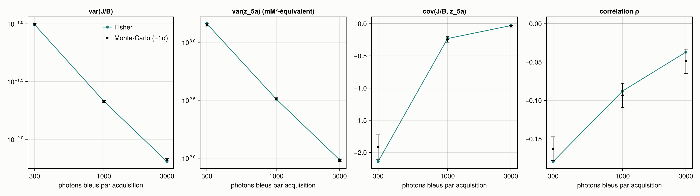
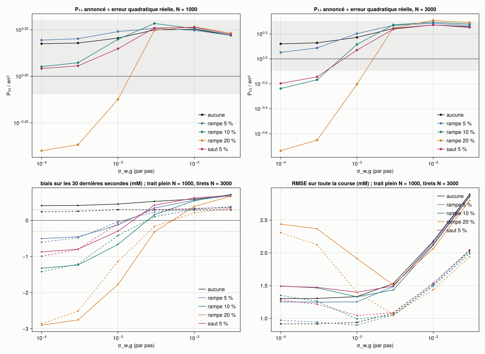
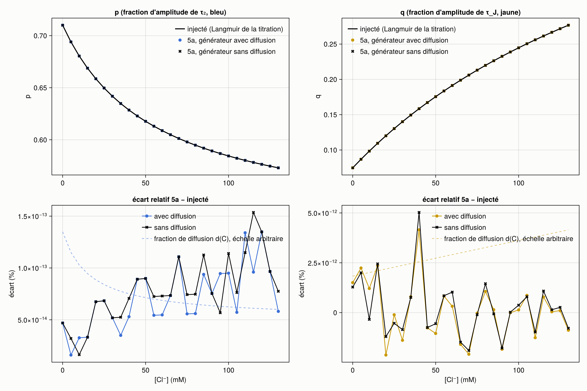
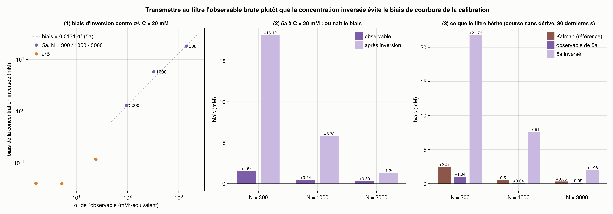
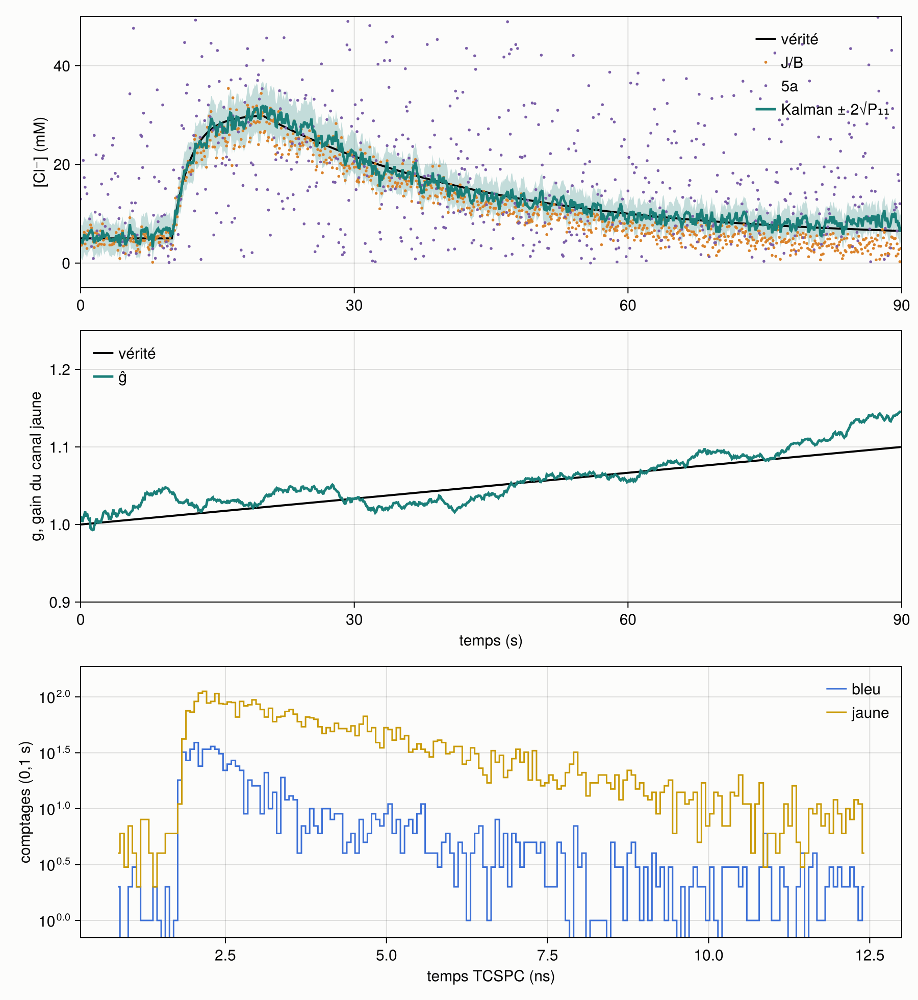

# Simulateur Kalman temps réel — étape 1

Construit le 2026-10-16 d'après « Simulateur Kalman temps réel — étape 1.pdf » (dans ce dossier).
C'est un simulateur neuf, indépendant du simulateur FLIM-FRET à deux canaux. Il génère des histogrammes SCLM à
10 Hz le long d'une montée de Cl⁻ (5 → 30 mM), puis les lit comme des données réelles avec trois lectures
(J/B, 5a et leur fusion par filtre de Kalman étendu), avec et sans dérive du gain du canal jaune.

Révisé le même jour d'après « Simulateur Kalman — corrections de l'étape 1.pdf » : réglage de référence
σ_w,g = 3·10⁻³, balayage étendu aux trois budgets, modèle de dérive (g, ġ), P₁₁/err² comme critère de réglage,
origine du biais de 5a et de l'écart sur les amplitudes, critères de sortie vers l'étape 2. La section
« Corrections » ci-dessous en rend compte ; les résultats de la première course y sont rappelés quand ils changent.

Révisé une seconde fois d'après « Simulateur Kalman — corrections, deuxième passe.pdf » : diffusion dans le modèle
de 5a (correctif A), Ornstein-Uhlenbeck sur ġ comme filtre de référence et table de σ_w,g par budget (correctif B),
verdict de comparaison réécrit condition par condition, figure de la courbure d'inversion, seuils de la relance
évalués automatiquement. **Les chiffres, figures et vidéos actuels sont ceux de cette deuxième passe** (section
« Deuxième passe ») ; les tableaux de la section « Première passe des corrections » sont ceux de la course précédente,
avec 5a sans diffusion.

## Lancer

```bash
# une seule fois : extraire la titration dans params.toml (environnement du simulateur précédent, lecteur .sdt)
julia --project=../FLIM-FRET_2-channels step0_params.jl
# les tests (7 groupes, 43 vérifications ; 3 échouent dans le groupe 4, voir « Deuxième passe »)
julia --project=. -t auto test/runtests.jl
# la course complète (~4 min avec 8 fils d'exécution, vidéos comprises)
julia --project=. -t auto run.jl            # --rapide : 2 répétitions, sans vidéo
```

## Fichiers

| Fichier | Rôle | lignes |
| --- | --- | --- |
| `params.toml` | le seul endroit pour les constantes, critères de sortie compris ; le bloc « step0 » est écrit par `step0_params.jl` | — |
| `step0_params.jl` | le pont unique avec la titration : ajustement global → Langmuir, IRF, fond | 90 |
| `src/params.jl` | lecture de `params.toml`, Langmuir, courbe monotone (valeur, dérivée, inverse) | 107 |
| `src/generate.jl` | trajectoire, dérive, histogrammes (six étapes, mode sans bruit, graine par pas) | 94 |
| `src/estimate.jl` | J/B, 5a (diffusion comprise), calibrations, covariance de Fisher, R attendu | 170 |
| `src/kalman.jl` | prédiction, mise à jour (forme de Joseph), diagnostics ; état (C, g) ou (C, g, ġ) ; aucune photophysique | 74 |
| `run.jl` | les courses (tous les réglages du filtre sur les mêmes lectures), les CSV, les vérifications, les critères, les seuils de la relance | 329 |
| `src/figures.jl` | rendu après simulation : vidéos, résumé, réglage, Fisher, amplitudes, courbure d'inversion | 238 |
| `test/runtests.jl` | les quatre tests du document, deux tests du filtre seul, le test d'amplitudes | 119 |

Les cinq fichiers du document font 774 lignes (plafond fixé à 800 : il est presque atteint), 1 012 avec le rendu.

Sorties dans `sorties/` :

- `courses.csv` : le fichier plat, une ligne par pas (répétition 1 de chaque scénario, aux trois budgets, N = 300
  compris comme borne basse), pour le filtre de référence (OU) et la marche aléatoire au σ_w,g de la table ;
- `resume.csv` : un résumé par budget, scénario et lecture ou réglage du filtre, moyenne sur 8 répétitions ;
- `criteres.csv` : les critères de sortie, pour chaque réglage du filtre, et la comparaison à la référence, une colonne
  par condition ;
- `seuils_relance.csv` : les seuils de la deuxième passe, fixés avant la relance, avec leur verdict ;
- `reglage_par_budget.csv` : σ_w,g de la table contre celui que désigne la course ;
- `verification_R.csv`, `biais_lectures.csv`, `amplitudes.csv`, `coherence.csv` : les vérifications ;
- `fig_resume.png`, `fig_reglage.png`, `fig_fisher.png`, `fig_amplitudes.png`, `fig_courbure.png`, et trois vidéos au filtre de
  référence (`video_sans_derive`, `video_rampe`, `video_saut`) avec leur dernière image en PNG. Les `.mp4` ne sont
  pas versionnés (`.gitignore`) ; `run.jl` les régénère à l'identique.

## Les paramètres

Tout vient de l'ajustement global « libre » de la titration SCLM du 2026-10-16 à 800 nm (étape 15 du simulateur
précédent : `global_parametres.csv`, `global_cellules.csv`). Les IRF sont celles de `IRF_800_16X.sdt`, et le fond
est le niveau plat avant le pic de ces IRF. Le simulateur ne relit jamais les histogrammes de la titration.

| Quantité | Valeur | Langmuir sur les 8 points |
| --- | --- | --- |
| τ₂, τ₃ (bleu) | 0,721 ; 2,722 ns | — |
| τ_J, τ_A (jaune) | 1,059 ; 3,253 ns | — |
| J/B (photons, fond exclu) | 5,95 à 0 mM → 1,65 à 131 mM | K = 28,9 mM, écart max 0,03 |
| p (fraction d'amplitude de τ₂, bleu) | 0,707 → 0,576 | K = 56 mM |
| q (fraction d'amplitude de τ_J, jaune) | 0,077 → 0,278 | K = 219 mM |
| d (fraction d'intensité de la diffusion) | bleu 7,9 → 3,4 % ; jaune < 0,5 % | bleu K = 16 mM ; jaune : une droite |
| fond par acquisition de 0,1 s | bleu 187, jaune 327 photons | — |

Trois remarques sur ces valeurs.

- **Le J/B du document (7,03 → 1,60) ne vient pas de la titration.** Ces valeurs sont celles du banc test_0/test_131
  (étape 14). La titration à 8 points donne 5,95 → 1,65. J'ai pris celles de la titration pour que J/B et les
  amplitudes viennent du même ajustement.
- **La diffusion entre comme une fraction d'intensité d(C) par canal**, soit une copie de l'IRF (τ = 1 ps) comme dans
  l'ajustement global. Elle n'entre pas comme un débit fixe : à 10 kcps, les 8 400 photons/s de diffusion mesurés
  pendant la titration feraient presque tout le signal. La Langmuir du jaune dégénère en droite (K sur sa borne de
  10⁴ mM), parce que les 8 points ne sont pas monotones. Elle reste sous 0,5 % du canal.
- **Le fond pèse lourd** : 187 photons de fond pour 1 000 photons bleus à 10 kcps. C'est le régime réel, et c'est
  pourquoi la lecture J/B soustrait le fond.

## Écarts au document, et pourquoi

1. **Convolution par FFT sur 2n = 512 points, pas 256.** Le TAC couvre 16,4 ns et la période laser 12,5 ns. Une
   convolution circulaire sur les 256 canaux replierait donc à 16,4 ns, pas à la période. Le déclin est périodisé
   analytiquement (série géométrique), y compris pour les retards négatifs (la fin de l'impulsion précédente). La
   convolution linéaire sur 512 points est alors exacte, sans bord, ce qui est le but de l'étape 4.
2. **5a modélise maintenant la diffusion** (deuxième passe, correctif A) : 6 paramètres libres au lieu de 4, une
   amplitude de diffusion par canal, τ_diff figé, comme dans le générateur. Le modèle à 4 paramètres de la
   première passe reste disponible (`diffusion_5a = false` dans `params.toml`). Dans les deux cas l'aller-retour
   est exact et l'invariance à g aussi, au bruit numérique près (test 2).
3. **L'observable de 5a est une combinaison de p et q.** Les deux canaux ne partagent aucun paramètre, donc 5a se
   sépare en un ajustement par canal. Règle écrite d'avance : le jaune entre dans l'observable s'il réduit σ_C d'au
   moins 10 % à 20 mM. Il la réduit de 16 % (p seul : 15,8 mM, q seul : 24,5 mM, combinaison : 13,3 mM à 1 000
   photons), soit 29 % de variance en moins. L'observable est z_S = w_p·p + w_q·q avec w ∝ (p′/σ_p², q′/σ_q²),
   normalisée pour que z_S′ = 1 mM⁻¹ à 20 mM. Les signes opposés des poids (−335, +138) ne demandent pas
   d'explication de plus : p baisse avec le Cl⁻ et q monte, et chaque poids a le signe de sa pente, ce qui fait
   s'additionner les deux sensibilités.
4. **Le filtre reçoit le R de Fisher attendu à son estimation (Ĉ⁻, ĝ⁻), pas celui du tirage.** Avec la variance
   calculée sur chaque histogramme, ĝ se stabilisait à 0,986 au lieu de 1 : var(J/B) ∝ (J/B)², donc les tirages
   hauts pèsent moins que les tirages bas, et des poids corrélés aux mesures biaisent la moyenne que fait le filtre.
5. **Calibration par budget.** Comme 5a est mal spécifié (point 2), son ajustement sans bruit dépend du rapport
   fond/signal. Chaque budget a donc sa courbe, toujours à g = 1.
6. **R diagonal retiré des courses et des figures** (corrections, « ce qui sort »). Le code garde R complet. Pour
   mémoire, la première course donnait un écart R complet / R diagonal de 4 % au plus sur la RMSE et de 8 % sur
   P₁₁/err², avec une corrélation J/B–5a de −0,10 à 1 000 photons : les deux lectures sont quasi orthogonales,
   parce que J/B lit des totaux et 5a la forme du déclin. C'est une ligne de méthodes, pas un résultat.

## Vérifications

**Les quatre tests du document passent**, plus trois autres (32 vérifications) :
1. Aller-retour sans bruit : J/B et 5a retrouvent 20 mM (nœud de la grille) et 23,7 mM (hors nœud) à 0,01 mM près.
2. Invariance de 5a : exacte (< 10⁻⁸) sur un histogramme que 5a décrit exactement, < 10⁻³ σ sur le générateur complet.
3. Sensibilité de J/B : jaune × 1,2 multiplie J/B par 1,2 à 10⁻⁹ près.
4. Filtre à g constant : sur 8 courses, le Kalman est à moins de 5 % de J/B (sur toute la course et sur les 30
   dernières secondes) et ĝ à moins de 2 % de 1, pour la référence comme pour l'ancien défaut. Une course seule
   varie de ±5 % : ĝ erre autour de 1, d'autant plus que σ_w,g est grand.
5. Filtre seul, mesures fabriquées, g = 1,05 inconnu : ĝ et Ĉ tombent dans 3√P de la vérité. Sans 5a, l'erreur sur Ĉ
   est plus de 3 fois plus grande et P₁₁ ne se resserre pas.
6. Modèle (g, ġ), mesures fabriquées, rampe de 10 % : ĝ et la pente tombent dans 3√P de la vérité, et la marche
   aléatoire raide traîne au moins 5 fois plus.
7. Amplitudes : sans diffusion dans le générateur, 5a retrouve p et q injectés à 10⁻⁶ près, à 0, 20, 80 et 131 mM.



Fig. 1 : **le R de Fisher est juste.** Variances de J/B et de 5a, covariance et corrélation, prédites par Fisher
(trait) et mesurées sur 4 000 tirages à 20 mM (points, ±1σ), aux trois budgets. À 1 000 photons : var J/B 0,02139
contre 0,02126 (0,6 %), var 5a 180,2 contre 174,7 (3 %), ρ −0,097 contre −0,098. C'est la validation du socle
statistique (dérivées, convolution, vraisemblance de Poisson).

**Cohérence des calibrations** : à 20 mM, sans bruit, J/B et 5a retrouvent tous deux 20 mM (`coherence.csv`).

## Première passe des corrections (2026-10-16)

Tableaux et chiffres de cette section : la course de la première passe (5a sans diffusion, référence MA
σ_w,g = 3·10⁻³). Les figures du dossier ont été refaites à la deuxième passe ; leurs chiffres diffèrent donc un peu
des tableaux ci-dessous, sans changer les conclusions de cette section.

### Correctif 1 — le réglage de σ_w,g

La référence passe de σ_w,g = 10⁻⁴ à 3·10⁻³ par pas. Le balayage va maintenant de 10⁻⁴ à 3·10⁻², aux trois
budgets, et tous les réglages tournent sur les mêmes histogrammes : les comparaisons sont appariées.



Fig. 2 : **le critère de réglage.** En haut, P₁₁ annoncé ÷ erreur quadratique réelle contre σ_w,g, une courbe par
dérive, avec la bande [0,8 ; 2] des critères de sortie (gris). En bas, le biais des 30 dernières secondes et la RMSE
sur toute la course, à 1 000 (trait plein) et 3 000 photons (tirets).

| σ_w,g (1 000 photons) | RMSE sans dérive | biais, rampe 10 % | biais, rampe 20 % | P₁₁/err² (min → max) | rattrapage du saut (moitié) |
| --- | --- | --- | --- | --- | --- |
| 10⁻⁴ (ancien défaut) | 1,19 | −1,45 | −2,89 | 0,33 → 1,52 | 23 s |
| 3·10⁻⁴ | 1,19 | −1,31 | −2,65 | 0,37 → 1,53 | 18 s |
| 10⁻³ | 1,22 | −0,64 | −1,45 | 0,72 → 1,64 | 8,7 s |
| **3·10⁻³ (référence)** | 1,38 | **−0,03** | −0,31 | 1,61 → 1,80 | 1,6 s |
| 10⁻² | 1,88 | +0,29 | +0,21 | 1,79 → 1,85 | 0,2 s |
| 3·10⁻² | 2,42 | +0,46 | +0,44 | 1,71 → 1,74 | 0,4 s |

- **L'optimum est bien à 3·10⁻³ à 1 000 et 3 000 photons, à 10⁻³ à 300.** Au-delà de 3·10⁻³, le sur-desserrage se
  paie cher : la RMSE sans dérive monte à 1,88 puis 2,42 mM (celle de J/B est 2,00), ρ₁₂ passe de 0,68 à 0,88, et le
  biais change de signe. Il n'y a rien à gagner à 10⁻² : P₁₁/err² est déjà dans la bande à 3·10⁻³.
- **Le critère du correctif 4 désigne le même réglage.** σ_w,g tel que P₁₁/err² sous la dérive la plus forte (rampe
  de 20 %) soit ≥ 1 et le plus proche de 1 : 10⁻³ à 300 photons, 3·10⁻³ à 1 000 et à 3 000. Le réglage dépend bien
  du budget, mais la grille (un facteur 3 entre deux valeurs) ne sépare pas 1 000 de 3 000.
- **Le prix de la référence** : sans dérive, la RMSE passe de 1,19 à 1,38 mM à 1 000 photons (0,82 à 0,97 à 3 000),
  et ĝ erre davantage d'une course à l'autre (±0,04 dans la vidéo du saut). Le Kalman reste sous J/B partout.

### Correctif 2 — modéliser la dérive comme une rampe

`kalman.jl` accepte un état (C, g, ġ) : g_{k+1} = g_k + Δt·ġ_k + w_g, ġ_{k+1} = ρ·ġ_k + w_ġ, avec Q sur g laissé à
10⁻⁴. Trois valeurs de σ_ġ (10⁻⁵, 10⁻⁴, 10⁻³ s⁻¹ par pas), plus la variante Ornstein-Uhlenbeck (ρ = 1 − Δt/τ,
τ = 30 s, σ_ġ = 10⁻⁴). La règle pour retenir le modèle à vitesse était écrite avant la course (`params.toml`) : il
doit battre la référence en RMSE sur les rampes, sans perdre plus de 10 % de RMSE sur le saut et sans dérive, ni
plus de 0,1 mM de biais sur le saut.

| Modèle de g (1 000 photons) | rampe 10 % : biais, RMSE | rampe 20 % : biais, RMSE | saut : biais, RMSE, rattrapage | sans dérive : RMSE | bat la référence |
| --- | --- | --- | --- | --- | --- |
| marche, σ_w,g = 10⁻⁴ | −1,45 ; 1,55 | −2,89 ; 2,49 | −0,99 ; 1,47 ; 23 s | 1,19 | — |
| **marche, σ_w,g = 3·10⁻³** | −0,03 ; 1,36 | −0,31 ; 1,44 | +0,21 ; 1,37 ; 1,6 s | 1,38 | — |
| (g, ġ), σ_ġ = 10⁻⁵ | +0,14 ; 1,34 | +0,12 ; 1,38 | +0,26 ; 1,43 ; 6,3 s | 1,36 | oui à 1 000, non à 3 000 |
| (g, ġ), σ_ġ = 10⁻⁴ | +0,30 ; 1,40 | +0,34 ; 1,42 | +0,59 ; 1,46 ; 3,1 s | 1,41 | non |
| (g, ġ), σ_ġ = 10⁻³ | +0,35 ; 1,85 | +0,36 ; 1,80 | +0,39 ; 1,84 ; 0,7 s | 1,86 | non |
| OU, σ_ġ = 10⁻⁴, τ = 30 s | −0,06 ; 1,30 | −0,35 ; 1,41 | +0,24 ; 1,37 ; 4,8 s | 1,31 | oui à 1 000, non à 3 000 |

- **Le modèle à vitesse supprime bien le traînage** : à σ_ġ = 10⁻⁵, son biais ne dépend plus de la pente (+0,14 à
  10 %, +0,12 à 20 %), là où la marche aléatoire passe de −0,03 à −0,31. Le biais qui reste (+0,1 à +0,2 mM) est
  celui de l'observable de 5a, présent aussi sans dérive.
- **Mais il ne bat pas la marche desserrée partout.** À 1 000 photons, (g, ġ) à σ_ġ = 10⁻⁵ et la variante OU passent
  la règle, de peu (RMSE 1,34 contre 1,36 sur la rampe de 10 %). À 3 000 photons, aucun ne la passe : sur le saut, le
  modèle à vitesse dépasse (biais +0,33 contre +0,13 mM, au-delà de la tolérance de 0,1) et rattrape plus lentement
  (5,2 s contre 1,9 s). C'est le dépassement que le document craignait.
- **Décision, selon la règle écrite d'avance : garder la marche aléatoire à 3·10⁻³.** Elle est plus simple, elle
  passe tous les critères aux deux budgets, et le gain du modèle à vitesse est dans le bruit là où il existe. La
  variante OU est la meilleure des variantes à vitesse ; elle redeviendra intéressante si les dérives réelles
  (expérience de profondeur) s'avèrent plus rapides que 20 % en 90 s.

### Correctif 3 — le biais de 5a

**Le +3,31 mM n'est pas un biais d'estimateur.** `biais_lectures.csv` sépare les deux quantités sur 4 000 tirages à
C fixé : le biais de l'observable brute z_S, que reçoit le filtre, et celui de la concentration inversée, calculé sur
les tirages qui tombent dans la plage.

| 1 000 photons | 5 mM | 10 mM | 20 mM | 30 mM |
| --- | --- | --- | --- | --- |
| biais de l'observable z_S (mM-équivalent) | +0,08 | +0,30 | +0,26 | +0,34 |
| biais de la concentration inversée (mM) | +3,9 | +3,1 | +2,8 | +3,6 |
| tirages hors plage (échecs) | 23 % | 8,6 % | 1,3 % | 0,6 % |

L'observable n'est biaisée que de +0,1 à +0,3 mM-équivalent : c'est le vrai biais d'estimateur à faible comptage,
et c'est lui que le filtre absorbe (le Kalman sans dérive est biaisé de +0,28 mM à 1 000 photons, +0,12 à 3 000).
Les +3 mM viennent de l'inversion. Avec σ ≈ 13 mM par pas, la courbe de calibration s'aplatit vers les fortes
concentrations et étire la queue haute : même à 20 mM, où 1,3 % des tirages seulement échouent, la moyenne des
concentrations inversées est décalée de +2,8 mM. À basse concentration, la troncature (« hors plage = échec »)
s'y ajoute. Le biais de 5a seul ne transfère donc pas 3 mM sur ĝ ; corriger p̂ par bootstrap n'est pas utile
avant l'étape 2.

**L'écart sur les amplitudes vient entièrement de la diffusion.** Le test qui tranche : générer sans bruit sur toute
la plage, avec la diffusion du générateur et sans elle.



Fig. 3 : p et q retrouvés par 5a contre injectés (Langmuir de la titration), générateur avec et sans diffusion ; en
bas, l'écart relatif.

- **Sans diffusion, 5a retrouve exactement p et q injectés** (écart max 10⁻¹⁵, test 7). La normalisation de p est
  donc la même des deux côtés : fractions d'amplitude des deux populations, diffusion à part.
- **Avec diffusion, l'écart est de +9,5 à +10,4 % sur p et de +14 à +6 % sur q.** 5a, qui n'a pas de composante
  pour la copie de l'IRF, la range dans la composante rapide.
- **Le critère proposé par le document se serait trompé.** Il disait : écart constant → normalisation, écart qui varie
  avec la concentration → diffusion. Sur p, l'écart est presque constant (9,5 à 10,4 %) alors que d_bleu passe de
  7,8 à 3,5 % : la composante rapide perd elle aussi du poids quand le Cl⁻ monte, et le rapport des deux bouge peu.
  C'est le test sans diffusion qui tranche, pas la forme de l'écart.
- **Conséquence** : p̂ et q̂ de 5a ne sont pas des fractions de population et ne doivent pas être cités comme telles.
  Pour citer une fraction, il faudrait une cinquième composante, la diffusion, à amplitude libre dans 5a. La
  concentration, elle, n'est pas touchée : la calibration porte la même diffusion.

### Correctif 4 — P₁₁/err² comme critère de réglage

La figure 2 en est la mise en œuvre. Au mauvais réglage, le filtre est faux et confiant (P₁₁/err² = 0,33 à 1 000
photons et 0,15 à 3 000 sous une rampe de 20 %). À la référence, il est entre 1,6 et 1,8 partout : légèrement
sous-confiant, donc sûr. Le critère ne demande ni vérité terrain ni connaissance de la dérive en expérience, à
condition de pouvoir estimer l'erreur réelle, ce que la simulation fait et que l'expérience devra approcher (par
exemple sur un étalon).

### Diagnostics d'innovation, après la relance

- **L'excursion pendant la montée est toujours là** : innovation moyenne du rapport −0,26σ pendant la montée,
  +0,01σ ailleurs, à tous les réglages. C'est la signature du modèle de prédiction trop rigide sur C, laissée
  telle quelle pour l'étape 2 (Q dépendant de u).
- **La variance des innovations du rapport ne s'est pas resserrée** : 0,72 à 1 000 photons et 0,51 à 3 000, pour
  tous les σ_w,g de 10⁻⁴ à 3·10⁻³, contrairement à ce que le document attendait. Ce n'est pas σ_w,g qui la fixe
  mais σ_w,C = 1,2 mM par pas : trop large hors de la montée, il gonfle la covariance prédite du rapport. Même
  remède qu'au point précédent.

## Deuxième passe (2026-10-16)

Une seule relance, avec quatre changements : diffusion dans 5a, OU par défaut et table de σ_w,g par budget, deux
figures, R diagonal retiré. Les seuils étaient fixés avant la relance (`params.toml`, `[seuils_relance]`) ; ils
sont évalués par `run.jl` dans `seuils_relance.csv`.

| Quantité | Avant | Après | Seuil | Tenu |
| --- | --- | --- | --- | --- |
| écart relatif max sur p, avec diffusion | 10,4 % | 1,3·10⁻¹³ % | < 0,5 % | oui |
| écart relatif max sur q, avec diffusion | 14,2 % | 4,2·10⁻¹² % | < 0,5 % | oui |
| non-régression sans diffusion | 1,3·10⁻¹⁵ | 8·10⁻¹⁵ | < 10⁻¹² | oui |
| biais d'observable 5a, C = 20, N = 1 000 | +0,26 mM | +0,44 mM | < 0,10 | **non** |
| biais d'observable 5a, C = 20, N = 300 | +1,30 mM | +1,54 mM | < 0,40 | **non** |
| σ de 5a, C = 20, N = 1 000 | 13,2 mM | 18,0 mM (+36 %) | hausse ≤ 10 % | **non** |
| biais d'inversion 5a, C = 20, N = 1 000 | +2,81 mM | +5,78 mM | 2,8 ± 0,3 | **non** |
| biais du Kalman de référence, 5 phases, N = 1 000 | +0,28 / +0,15 / −0,03 / −0,31 / +0,21 | +0,51 / +0,32 / +0,13 / −0,37 / +0,39 | tous < ±0,30 | **non** |
| P₁₁/err², 5 phases, N = 1 000 | 1,78 … 1,61 | 1,56 / 1,59 / 1,70 / 1,51 / 1,48 | 0,5 – 2,0 | oui |
| accord Fisher / Monte-Carlo (var J/B, var 5a, cov) | 0,6 / 3,2 / 0,8 % | 0,6 / 0,4 / 5,8 % | < 5 % | non, mais voir ci-dessous |
| échecs de 5a, C = 20, N = 300 | 17,8 % | 30,1 % | à rapporter | — |
| biais du Kalman à N = 300, dérive 0 / 5 / 10 / 20 % | +1,19 / +0,77 / +0,48 / −0,11 | +2,41 / +1,78 / +1,42 / +0,42 | monotone | oui |

### Correctif A : la diffusion dans 5a corrige les amplitudes et dégrade la concentration

- **Les amplitudes sont exactes.** Avec la diffusion dans 5a, p et q retrouvés sans bruit tombent sur les valeurs
  injectées à 10⁻¹³ près, sur toute la plage (test 7, `fig_amplitudes.png`). La diffusion du générateur et celle de
  l'ajustement sont bien la même. p̂ et q̂ peuvent maintenant se lire comme des fractions d'amplitude des deux
  populations.
- **Le biais d'observable de 5a ne venait pas de la diffusion.** Il monte au lieu de tomber : +0,26 → +0,44 mM à
  1 000 photons, +1,30 → +1,54 mM à 300. C'est donc bien le biais du maximum de vraisemblance à faible comptage,
  et un paramètre libre de plus l'aggrave. L'hypothèse du document (« le biais d'observable vient en partie de la
  diffusion non modélisée ») est réfutée.
- **Le prix est la précision.** L'amplitude de la diffusion, une copie de l'IRF, est très corrélée à celle de la
  composante rapide (τ₂ = 0,72 ns, τ_J = 1,06 ns). L'inverser comme nuisance (information de Fisher complète,
  comme demandé) élargit σ de 5a de 36 % à 1 000 photons (13,2 → 18,0 mM). Les échecs montent aussi (17,8 → 30 %
  à 300 photons, 1,3 → 7,2 % à 1 000).
- **Le biais d'inversion reste de la courbure.** Il passe de +2,81 à +5,78 mM parce que σ² a doublé : le seuil
  « reste à 2,8 ± 0,3 » supposait σ inchangé. Le rapport biais/σ² vaut maintenant 0,0128 / 0,0178 / 0,0136 aux trois
  budgets (0,0166 / 0,0161 / 0,0176 avant) : proportionnel à σ² à ±16 % près, moins net qu'avant, la troncature à
  N = 300 (30 % d'échecs) s'y mêlant. La courbure explique l'ordre de grandeur, pas chaque décimale.
- **Le filtre en pâtit, sans casser les critères de sortie.** Sur les mêmes histogrammes, avec OU : RMSE +5 à
  +11 %, biais déplacé de 0 à +0,25 mM selon la phase (le plus sans dérive, rien sous la rampe de 20 %). Le biais sans dérive passe à +0,51 mM (N = 1 000) et dépasse le
  seuil de la relance. Les trois critères de sortie tiennent encore (tableau suivant).
- **Le test 4 échoue désormais** : sur 8 courses sans dérive, le Kalman s'écarte de J/B de 5,3 à 6,8 % sur les 30
  dernières secondes (seuil 5 %), pour les trois filtres testés. C'est la même cause. Je n'ai pas relâché le seuil.
- **Recommandation, à trancher par toi** : garder les deux modèles de 5a, chacun pour ce qu'il sait faire. Le
  modèle à 6 paramètres pour rapporter des fractions d'amplitude (hors ligne, à fort comptage) ; le modèle à 4
  paramètres pour l'observable transmise au filtre, plus précise et moins biaisée, dont la calibration absorbe déjà
  la diffusion. Le commutateur `diffusion_5a` le permet ; je ne l'ai pas rebasculé, puisque les seuils étaient
  fixés avant la relance.

### L'accord Fisher / Monte-Carlo tient, le seuil était mal posé pour la covariance

L'information de Fisher est maintenant la matrice complète, amplitude de diffusion comprise. Les variances
s'accordent mieux qu'avant (var 5a : 0,4 % contre 3,2 %). La covariance s'écarte de 5,8 % à N = 1 000, soit 0,3 σ
de Monte-Carlo (−0,231 prédit contre −0,245 ± 0,042 mesuré) ; à 300 et 3 000 photons, 1,2 et 0,8 σ. Un seuil
relatif n'a pas de sens pour une quantité presque nulle mesurée sur 4 000 tirages : l'écart est dans le bruit de la
mesure. `fig_fisher.png` porte les barres d'erreur.

### Correctif B : OU par défaut, verdict lisible

- **OU est la référence** (σ_ġ = 10⁻⁴, τ = 30 s, σ_w,g = 10⁻⁴ sur g). Il bat la marche aléatoire réglée en RMSE sur
  toutes les rampes, aux deux budgets (1,37 contre 1,43 à 1 000 photons, rampe 10 % ; 0,97 contre 1,05 à 3 000), et
  il est mieux calibré (P₁₁/err² de 1,48 à 1,70 contre 1,77 à 1,92). Son coût : il rattrape un saut de 5 % en
  4,3 s au lieu de 1,8 s à 1 000 photons (3,9 s au lieu de 1,9 s à 3 000).
- **Le verdict « non » de la première passe n'était pas un bogue.** La règle comparait aussi le biais sur le saut, à
  0,1 mM près ; à 3 000 photons, OU était à +0,29 mM contre +0,13 pour la marche, d'où « non ». Le temps de
  rattrapage n'en faisait pas partie. `criteres.csv` écrit maintenant chaque condition dans sa colonne
  (`vs_ref_rmse_rampes_le`, `vs_ref_rmse_saut_dans_10pct`, `vs_ref_biais_saut_dans_0p1mM`,
  `vs_ref_rmse_sans_derive_dans_10pct`, puis `vs_ref_bat_les_4_conditions`), avec le biais, la RMSE et le temps de
  rattrapage du saut à côté. Aucun autre réglage ne bat OU sur les quatre conditions.
- **La table de σ_w,g par budget** (10⁻³ à 300 photons, 3·10⁻³ au-dessus) est figée dans `params.toml` et sert à la
  marche aléatoire de comparaison. Le critère du correctif 4, recalculé sur cette course, désigne d'autres valeurs
  (3·10⁻⁴ à 300, 3·10⁻² à 1 000, 3·10⁻³ à 3 000, `reglage_par_budget.csv`) : avec 5a plus bruité, P₁₁/err² sous la
  rampe de 20 % dépasse 1 dès les petits σ_w,g et le critère ne discrimine plus. La table n'a pas été retouchée.
  En boucle fermée, ce réglage devra suivre le budget réellement collecté.

### Correctif C : N = 300 et la compensation

Le biais du Kalman à N = 300 est maintenant monotone en dérive (+2,41 / +1,78 / +1,42 / +0,42 mM), comme le test le
demandait. Mais il n'est pas tombé : il a doublé. La monotonie ne prouve d'ailleurs pas qu'il ne reste qu'un
mécanisme. À 1 000 photons, le biais de la référence passe aussi de +0,51 à −0,37 mM entre 0 et 20 % de dérive, en
traversant zéro : un biais positif hérité de 5a, indépendant de la dérive, s'y ajoute à un retard de poursuite
négatif qui grandit avec elle. Les deux mécanismes existent à tous les budgets ; à N = 300 le premier domine.

**N = 300 est hors du domaine de validité** : biais de +2,4 mM sans dérive, 5a en échec 30 % du temps à 20 mM et
42 % à 5 mM, inutilisable comme ancre indépendante. Il reste dans `courses.csv` et `resume.csv` comme borne basse
du régime utilisable, et hors des figures de conclusion.

### La courbure d'inversion



Fig. 6 : (1) biais de la concentration inversée contre σ² de l'observable, 5a et J/B, trois budgets, C = 20 mM,
avec la droite par l'origine ajustée sur 5a ; (2) à C = 20 mM, biais de l'observable contre biais après
inversion ; (3) sur la course sans dérive (30 dernières secondes), biais du Kalman, de l'observable de 5a et de 5a
inversé.

- **Où naît le biais** : l'observable de 5a est biaisée de +0,44 mM à 1 000 photons, la concentration inversée de
  +5,8 mM, treize fois plus. À 300 photons : +1,5 contre +18 mM.
- **Ce que le filtre hérite** : +0,51 mM à 1 000 photons, quand 5a inversé est à +7,6 mM sur la même fenêtre. Il
  n'hérite pas du biais d'inversion. Il ne suit pas non plus exactement le biais local de l'observable (+0,04 mM
  sur cette fenêtre, où C ≈ 7–10 mM) : ĝ, qui a une longue mémoire, garde le biais accumulé quand la concentration
  était plus haute.
- **La recommandation de conception tient** : transmettre au filtre l'observable brute plutôt que la concentration
  inversée évite un biais dix fois plus grand que celui qu'il garde, à bas photons. Elle vaut pour tout capteur à
  calibration non linéaire.

## Critères de sortie vers l'étape 2

Chiffrés d'avance (`params.toml`, section `[criteres]`), vérifiés automatiquement (`criteres.csv`) aux deux budgets
de fonctionnement, sur la course de la deuxième passe (5a avec diffusion, référence OU).

| Critère | 1 000 photons | 3 000 photons |
| --- | --- | --- |
| 1. biais du Kalman sous rampe de 10 % sous 0,3 mM | **oui** (+0,13) | **oui** (+0,12) |
| 2. P₁₁/err² entre 0,8 et 2 sous toutes les dérives | **oui** (1,48 à 1,70) | **oui** (1,29 à 1,58) |
| 3. RMSE du Kalman sous celle de J/B partout | **oui** (au plus 0,73 × J/B) | **oui** (au plus 0,92 × J/B) |
| 4. écart sur les amplitudes de 5a expliqué | **oui**, et corrigé : la diffusion, maintenant modélisée (test 7) | idem |

**Les quatre critères tiennent avec OU.** La marche aléatoire à 3·10⁻³ les passe aussi (biais +0,16 et +0,10 mM).
Aucun autre réglage ne passe le critère 1 aux deux budgets ; les modèles (g, ġ) passent les critères 2 et 3 mais
gardent un biais de +0,35 à +0,70 mM sous rampe. Les seuils plus fins de la relance (biais sous ±0,3 mM dans les
cinq phases) ne tiennent plus, à cause du correctif A.

## Résultats


Fig. 4 : (a) biais des 30 dernières secondes contre la dérive, référence et ancien défaut ; (b) le même biais pour
chaque modèle de g ; (c) RMSE contre le budget sous rampe de 10 % ; (d) ĝ autour du saut de 5 %, moyenne de 8
courses, pour chaque modèle de g. 1 000 photons sauf en (c).



Fig. 5 : dernière image de `video_rampe.mp4` (rampe de 10 %, référence, 1 000 photons). Les deux autres vidéos :
`video_sans_derive.mp4` et `video_saut.mp4`.

### La prédiction du document, au filtre de référence (1 000 photons, 8 répétitions)

| | J/B | 5a | Kalman OU (référence) | Kalman, marche σ_w,g = 3·10⁻³ | Kalman, premier défaut 10⁻⁴ |
| --- | --- | --- | --- | --- | --- |
| **Sans dérive** : RMSE | 2,00 mM | 17,7 mM | 1,46 mM | 1,53 mM | **1,30 mM** |
| biais, 30 dernières s | −0,01 | +7,6 (inversion) | +0,51 ± 0,54 | +0,53 ± 0,57 | +0,41 ± 0,45 |
| **Rampe 10 %** : RMSE | 3,07 | 17,6 | **1,37** | 1,43 | 1,49 |
| biais, 30 dernières s | −3,23 | +7,4 | **+0,13 ± 0,39** | +0,16 ± 0,43 | −1,32 ± 0,35 |
| **Rampe 20 %** : biais | −5,62 | +7,0 | −0,37 | −0,32 | −2,90 |
| **Saut 5 %** : biais | −2,03 | +7,4 | +0,39, rattrapé à moitié en 4,3 s | +0,42, en 1,8 s | −0,87 |
| erreur max pendant la montée | 7,7 | 80 | 3,7 | 4,0 | 3,5 |

(± : écart-type entre les 8 courses ; l'erreur-type du biais moyen est 2,8 fois plus petite.)

### Ce que disent les résultats

**1. Les deux volets de la prédiction tiennent.** Sans dérive, la fusion fait mieux que J/B (RMSE 1,46 contre
2,00 mM). Sous dérive, elle retire l'essentiel du biais : +0,13 mM sous une rampe de 10 % contre −3,23 pour J/B,
−0,37 contre −5,62 sous une rampe de 20 %. À 3 000 photons, même tableau.

**2. Le réglage de g compte plus que tout le reste.** Une marche aléatoire raide (10⁻⁴) ne suit pas une rampe et
devient fausse et confiante (P₁₁/err² = 0,18 à 3 000 photons, rampe de 20 %). Un OU sur ġ suit la rampe sans
desserrer g et donne la meilleure RMSE sous dérive ; la marche desserrée rattrape plus vite un saut.

**3. Le filtre ne ment pas sur sa précision.** P₁₁/err² est entre 1,3 et 1,7 dans toutes les conditions, avec OU :
légèrement sous-confiant (barres d'erreur annoncées environ 20 % trop larges).

**4. Il n'y a pas de retard de poursuite pendant la montée** : erreur max 3,7 mM pour le Kalman contre 7,7 pour J/B.

**5. 5a est une ancre, pas une lecture.** Seul, il est 7,8 fois plus bruité que J/B avec la diffusion (5,8 fois
sans), et sa concentration inversée est biaisée de +6 à +8 mM par la courbure. Son observable brute, celle que
reçoit le filtre, est rigoureusement insensible à g et biaisée de +0,3 à +0,5 mM-équivalent.

### Réserves

- Les valeurs absolues dépendent des Langmuir, ajustées sur 8 points dont deux (5 et 10 mM) sortaient du mélange à
  deux états à l'étape 15. Les rapports entre lectures et le rôle de Q sont plus robustes que les mM.
- La dérive simulée démontre le mécanisme, pas l'amplitude réelle en tranche, qui viendra de l'expérience de
  profondeur. Le choix entre marche aléatoire et modèle à vitesse en dépend : il a été fait ici sur des rampes de
  5 à 20 % en 90 s et un saut de 5 %.
- La référence 3·10⁻³ vient du document, et le critère du correctif 4 la confirme sur la même course. Le balayage
  ayant été vu avant ce choix, il reste à la confirmer sur une autre trajectoire (une autre montée, une autre
  dérive).
- 8 répétitions par scénario : les biais de ±0,3 mM sont à environ 1σ de 0 (écarts-types dans `resume.csv`).

## Pour l'étape 2

Le générateur et les lectures ne bougent pas, à une décision près : quel modèle de 5a transmet l'observable au
filtre (voir la recommandation du correctif A). Le filtre de référence est OU sur ġ ; la marche aléatoire et sa
table de σ_w,g par budget restent disponibles.

Ce qui passe tel quel, volontairement, parce que la boucle ouverte ne permet pas de le régler correctement :

- **Les innovations ne sont pas blanches** (autocorrélation −0,21, excursion −0,26σ pendant la montée, variance
  0,72 au repos). Le modèle de C ne sait pas qu'un flux est en cours. C'est la motivation du Q qui dépend de la
  commande u : quand eNpHR est pilotée, Q doit le savoir. Un Q global plus large dégraderait les plateaux.
- **σ_w,g dépend du budget**, et le budget variera en boucle fermée (profondeur, blanchiment, mouvement) : ce
  réglage devra s'adapter en ligne. La table reste figée pour l'instant.
- **Le plancher photonique est posé** : 5a échoue 30 % du temps à 20 mM et 300 photons (42 % à 5 mM), 7 % à
  1 000 photons. La boucle ne doit pas se fermer sous le millier de photons bleus par acquisition à 10 Hz.
- **Le filtre est sous-confiant** (P₁₁/err² ≈ 1,5). Prudent en boucle ouverte ; en boucle fermée, si le
  régulateur règle son gain sur P, il deviendra mou. À revoir avec le critère de performance de la boucle.

Ce qui ne bouge plus : l'architecture de fusion (deux lectures dans l'espace des observables, état augmenté (C, g),
le zéro de H qui rend g observable) et R complet, validé et gratuit.

Hors périmètre du simulateur, côté banc : la dérive de τ₂ avec la longueur d'onde d'excitation (artéfact
d'ajustement à diagnostiquer en liant τ₂ entre longueurs d'onde) et le contrôle de force ionique, jamais fait.
