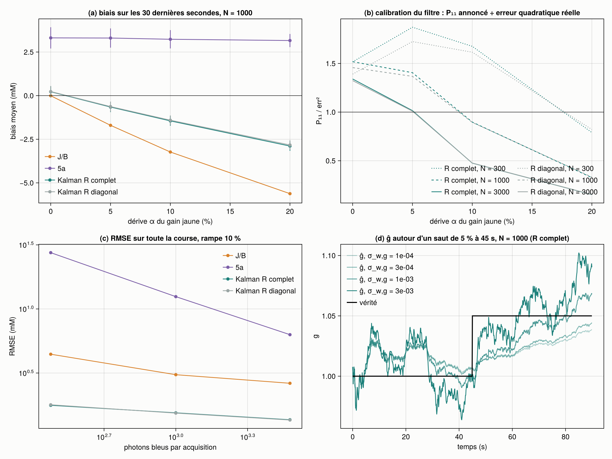
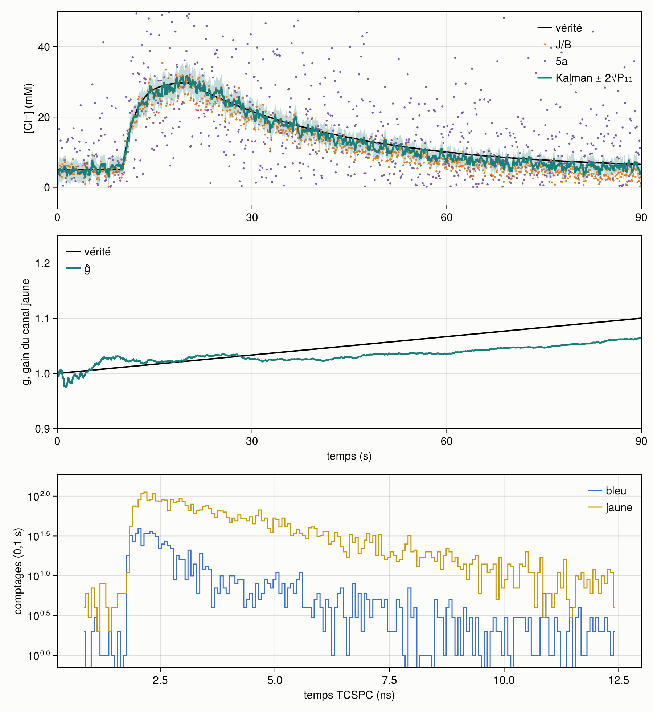
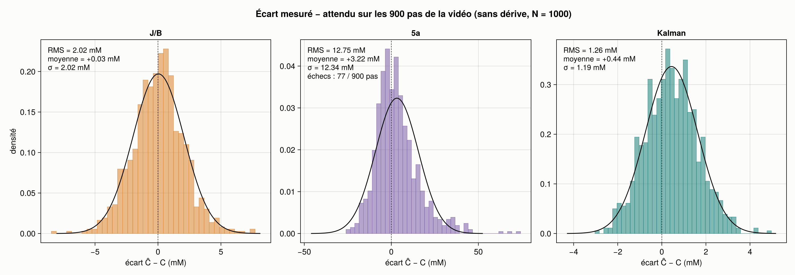
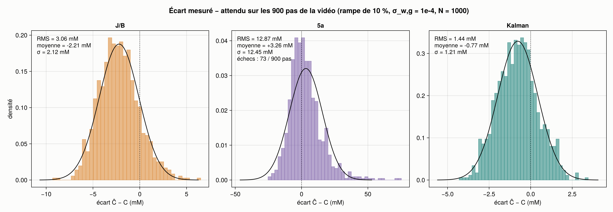

# Simulateur Kalman temps réel — étape 1

Construit le 2026-10-16 d'après « Simulateur Kalman temps réel — étape 1.pdf » (dans ce dossier).
C'est un simulateur neuf, indépendant du simulateur FLIM-FRET à deux canaux. Il génère des histogrammes SCLM à
10 Hz le long d'une montée de Cl⁻ (5 → 30 mM), puis les lit comme des données réelles avec trois lectures
(J/B, 5a et leur fusion par filtre de Kalman étendu), avec et sans dérive du gain du canal jaune.

## Lancer

```bash
# une seule fois : extraire la titration dans params.toml (environnement du simulateur précédent, lecteur .sdt)
julia --project=../FLIM-FRET_2-channels step0_params.jl
# les tests (5 groupes, 21 vérifications)
julia --project=. -t auto test/runtests.jl
# la course complète (~3 min avec 8 fils d'exécution, vidéos comprises)
julia --project=. -t auto run.jl            # --rapide : 2 répétitions, sans vidéo
```

## Fichiers

| Fichier | Rôle | lignes |
| --- | --- | --- |
| `params.toml` | le seul endroit pour les constantes ; le bloc « step0 » est écrit par `step0_params.jl` | — |
| `step0_params.jl` | le pont unique avec la titration : ajustement global → Langmuir, IRF, fond | 90 |
| `src/params.jl` | lecture de `params.toml`, Langmuir, courbe monotone (valeur, dérivée, inverse) | 107 |
| `src/generate.jl` | trajectoire, dérive, histogrammes (six étapes, mode sans bruit, graine par pas) | 94 |
| `src/estimate.jl` | J/B, 5a, calibrations, covariance de Fisher, R attendu | 158 |
| `src/kalman.jl` | prédiction, mise à jour (forme de Joseph), diagnostics ; aucune photophysique | 62 |
| `run.jl` | les courses, les CSV, le résumé | 172 |
| `src/figures.jl` | rendu après simulation : vidéos, écarts, figure de résumé | 123 |
| `test/runtests.jl` | les quatre tests du document, plus un test du filtre seul | 81 |

Les cinq fichiers du document font 593 lignes, 716 avec le rendu (plafond fixé à 800).

Sorties dans `sorties/` :

- `courses.csv` : le fichier plat, une ligne par pas (répétition 1 de chaque scénario au σ_w,g du document) ;
- `resume.csv` : un résumé par scénario et par lecture, moyenne sur 8 répétitions (± écart-type pour la RMSE et le biais) ;
- `coherence.csv`, `verification_R.csv` : les vérifications ;
- `fig_resume.png` et trois vidéos avec leur dernière image en PNG. Les `.mp4` ne sont pas versionnés (`.gitignore`) ; `run.jl` les régénère à l'identique.

## Les paramètres

Tout vient de l'ajustement global « libre » de la titration SCLM du 2026-10-16 à 800 nm (étape 15 du simulateur
précédent : `global_parametres.csv`, `global_cellules.csv`). Les IRF sont celles de `IRF_800_16X.sdt`, et le fond
est le niveau plat avant le pic de ces IRF. Le simulateur ne relit jamais les histogrammes de la titration.

| Quantité | Valeur | Langmuir sur les 8 points |
| --- | --- | --- |
| τ₂, τ₃ (bleu) | 0,721 ; 2,722 ns | — |
| τ_J, τ_A (jaune) | 1,059 ; 3,253 ns | — |
| J/B (photons, fond exclu) | 5,95 à 0 mM → 1,65 à 131 mM | K = 28,9 mM, écart max 0,03 |
| p (fraction d'amplitude de τ₂, bleu) | 0,707 → 0,576 | K = 56 mM |
| q (fraction d'amplitude de τ_J, jaune) | 0,077 → 0,278 | K = 219 mM |
| d (fraction d'intensité de la diffusion) | bleu 7,9 → 3,4 % ; jaune < 0,5 % | bleu K = 16 mM ; jaune : une droite |
| fond par acquisition de 0,1 s | bleu 187, jaune 327 photons | — |

Trois remarques sur ces valeurs.

- **Le J/B du document (7,03 → 1,60) ne vient pas de la titration.** Ces valeurs sont celles du banc test_0/test_131
  (étape 14). La titration à 8 points donne 5,95 → 1,65. J'ai pris celles de la titration pour que J/B et les
  amplitudes viennent du même ajustement.
- **La diffusion entre comme une fraction d'intensité d(C) par canal**, soit une copie de l'IRF (τ = 1 ps) comme dans
  l'ajustement global. Elle n'entre pas comme un débit fixe : à 10 kcps, les 8 400 photons/s de diffusion mesurés
  pendant la titration feraient presque tout le signal. La Langmuir du jaune dégénère en droite (K sur sa borne de
  10⁴ mM), parce que les 8 points ne sont pas monotones. Elle reste sous 0,5 % du canal.
- **Le fond pèse lourd** : 187 photons de fond pour 1 000 photons bleus à 10 kcps. C'est le régime réel, et c'est
  pourquoi la lecture J/B soustrait le fond.

## Écarts au document, et pourquoi

1. **Convolution par FFT sur 2n = 512 points, pas 256.** Le TAC couvre 16,4 ns et la période laser 12,5 ns. Une
   convolution circulaire sur les 256 canaux replierait donc à 16,4 ns, pas à la période. Le déclin est périodisé
   analytiquement (série géométrique), y compris pour les retards négatifs (la fin de l'impulsion précédente). La
   convolution linéaire sur 512 points est alors exacte, sans bord, ce qui est le but de l'étape 4.
2. **5a n'a que ses 4 paramètres et ne modélise pas la diffusion**, que le générateur contient. À 20 mM, sans bruit,
   5a lit p̂ = 0,721 alors que la titration donne p = 0,659. La calibration, construite avec le même générateur,
   absorbe cet écart, et l'aller-retour est exact. En revanche, l'invariance à g n'est exacte qu'au bruit numérique
   près sur un histogramme que 5a décrit exactement. Sur le générateur complet, il reste un déplacement
   d'environ 0,002 mM-équivalent pour g = 1,2, soit 10⁻⁴ du bruit d'un pas (test 2, en deux volets).
3. **L'observable de 5a est une combinaison de p et q.** Les deux canaux ne partagent aucun paramètre, donc 5a se
   sépare en un ajustement par canal. Règle écrite d'avance : le jaune entre dans l'observable s'il réduit σ_C d'au
   moins 10 % à 20 mM. Il la réduit de 16 % (p seul : 15,8 mM, q seul : 24,5 mM, combinaison : 13,3 mM à 1 000
   photons). L'observable est z_S = w_p·p + w_q·q avec w ∝ (p′/σ_p², q′/σ_q²), normalisée pour que z_S′ = 1 mM⁻¹
   à 20 mM.
4. **Le filtre reçoit le R de Fisher attendu à son estimation (Ĉ⁻, ĝ⁻), pas celui du tirage.** La première version
   passait la variance calculée sur chaque histogramme. ĝ s'est alors stabilisé à 0,986 au lieu de 1, et le test 4
   échouait (Kalman à 6 % de J/B). La raison : var(J/B) ∝ (J/B)², donc les tirages hauts sont moins pesés que les
   tirages bas. Des poids corrélés aux mesures biaisent la moyenne que fait le filtre. Avec R évalué à l'estimation
   du filtre (tabulé sur la grille de calibration), le biais de ĝ tombe de −1,4 % à +0,6 %. Ce reste s'explique
   par le biais de l'estimateur de 5a à 1 000 photons (+0,3 à +0,6 mM-équivalent, mesuré sur 4 000 tirages).
5. **Calibration par budget.** Comme 5a est mal spécifié (point 2), son ajustement sans bruit dépend du rapport
   fond/signal. Chaque budget a donc sa courbe, toujours à g = 1.
6. **Ajouts** : un balayage de σ_w,g (10⁻⁴, 3·10⁻⁴, 10⁻³, 3·10⁻³) au budget de 1 000 photons, une troisième vidéo
   au σ_w,g que ce balayage désigne, et un test 5 du filtre seul sur des mesures fabriquées à la main.

## Vérifications

**Les quatre tests du document passent**, plus le test 5 (21 vérifications) :
1. Aller-retour sans bruit : J/B et 5a retrouvent 20 mM (nœud de la grille) et 23,7 mM (hors nœud) à 0,01 mM près.
2. Invariance de 5a : exacte (< 10⁻⁸) sur un histogramme que 5a décrit exactement, < 10⁻³ σ sur le générateur complet.
3. Sensibilité de J/B : jaune × 1,2 multiplie J/B par 1,2 à 10⁻⁹ près.
4. Filtre à g constant : le Kalman est à moins de 5 % de J/B (sur toute la course et sur les 30 dernières secondes), avec ĝ à moins de 2 % de 1.
5. Filtre seul, g = 1,05 inconnu : ĝ et Ĉ tombent dans 3√P de la vérité. Sans 5a, l'erreur sur Ĉ est plus de 3 fois
   plus grande et P₁₁ ne se resserre pas : avec g dans l'état, le filtre avoue son ambiguïté au lieu de la taire.

**Le R de Fisher est juste** (`verification_R.csv`, 4 000 tirages à 20 mM) : les variances de Fisher sont à moins de
4 % de la dispersion réelle pour J/B comme pour 5a, à tous les budgets.

**Cohérence des calibrations** (la vérification à faire avant de construire) : à 20 mM, sans bruit, J/B et 5a
retrouvent tous deux 20 mM (`coherence.csv`). Les deux lectures ne mesurent pourtant pas la même chose. Les
Langmuir de la titration ont des K apparents très différents (J/B 29 mM, p 56 mM, q 219 mM). Le générateur
interpole chaque quantité séparément, comme le demande le document, et cette différence passe telle quelle dans
les courbes de calibration. Elle ne crée donc aucune incohérence entre les lectures.

## Résultats



Fig. 1 : (a) biais sur les 30 dernières secondes contre la dérive ; (b) P₁₁ annoncé ÷ erreur quadratique réelle,
R complet et R diagonal ; (c) RMSE contre le budget ; (d) ĝ autour d'un saut de 5 % à 45 s, pour les quatre σ_w,g
(une répétition). Sauf mention contraire : 1 000 photons bleus par acquisition, σ_w,g = 10⁻⁴ (le document).



Fig. 2 : dernière image de `video_avec_derive.mp4` (rampe de 10 %, σ_w,g = 10⁻⁴, 1 000 photons). Les deux autres
vidéos : `video_sans_derive.mp4` et `video_avec_derive_sigma_wg_regle.mp4` (σ_w,g = 10⁻³).





Fig. 3 : distribution de l'écart Ĉ − C (mesuré − attendu) sur les 900 pas de chaque vidéo, avec la gaussienne de
même moyenne et même écart-type, et l'erreur RMS. Les trois figures : `ecarts_sans_derive.png`,
`ecarts_avec_derive.png`, `ecarts_avec_derive_sigma_wg_regle.png`. J/B et le Kalman sont proches d'une gaussienne.
Sous dérive, celle de J/B se décale (moyenne −2,2 mM) sans s'élargir : c'est un biais, pas du bruit. 5a ne l'est
pas : sa distribution est asymétrique, avec une queue vers le haut, parce que les tirages sous 0 mM sont des échecs
exclus (77 pas sur 900) et que la courbe de calibration s'aplatit aux fortes concentrations. Une course est une
seule réalisation : ces chiffres diffèrent un peu des moyennes sur 8 répétitions du tableau ci-dessous.

### La prédiction du document, confrontée (1 000 photons, R complet, 8 répétitions)

| | J/B | 5a | Kalman, σ_w,g = 10⁻⁴ | Kalman, σ_w,g = 10⁻³ |
| --- | --- | --- | --- | --- |
| **Sans dérive** : RMSE | 2,00 mM | 12,5 mM | **1,19 mM** | 1,22 mM |
| biais, 30 dernières s | −0,01 | +3,3 (troncature) | +0,22 ± 0,32 | +0,24 ± 0,25 |
| **Rampe 10 %** : RMSE | 3,07 | 12,5 | 1,55 | **1,31** |
| biais, 30 dernières s | **−3,23** | +3,2 | −1,45 ± 0,28 | −0,64 ± 0,24 |
| **Rampe 20 %** : biais | −5,62 | +3,2 | −2,89 (P₁₁/err² = 0,33) | −1,45 (0,72) |
| **Saut 5 %** : biais | −2,03 | +3,3 | −0,99, rattrapé à moitié en 23 s | −0,29, en 8,7 s |
| erreur max pendant la montée | 7,7 | 71 | 3,4 | 3,4 |

### Ce que disent les résultats

**1. Le premier volet tient : sans dérive, la fusion ne coûte rien, elle gagne.** Le Kalman fait une RMSE de 1,2 mM
contre 2,0 mM pour J/B, et l'erreur maximale pendant la montée tombe de 7,7 à 3,4 mM. Son biais résiduel
(+0,2 mM) est celui de l'estimateur de 5a à bas photons.

**2. Le second volet ne tient qu'à moitié avec le réglage du document.** Avec σ_w,g = 10⁻⁴, le Kalman retire environ
55 % du biais de J/B (−1,45 contre −3,23 mM à 10 %), pas tout. ĝ prend du retard sur la rampe (−0,036 en fin de
course) : une marche aléatoire de 10⁻⁴ par pas ne peut pas suivre une rampe de 1,1·10⁻⁴ par pas. La dérive passe
alors dans Ĉ, qui a bien plus de jeu (σ_w,C = 1,2 mM). C'est le mode d'échec annoncé, « le filtre ne corrige g que
s'il l'apprend plus vite que g ne dérive ». Ce n'est pas 5a qui manque d'information : c'est Q qui interdit à g
d'aller assez vite.

**3. Le mode « faux et confiant » existe, et il empire avec les photons.** À 20 % de dérive, P₁₁ annoncé ÷ erreur
réelle vaut 0,79 à 300 photons, 0,33 à 1 000 et 0,15 à 3 000 (σ_w,g = 10⁻⁴). Plus les photons sont nombreux, plus
le filtre se croit précis, alors que son biais, fixé par Q, ne bouge pas (−2,6 à −2,9 mM). Le paradoxe va dans le
même sens : à 300 photons, le Kalman est moins biaisé sous dérive (−0,96 à 10 %), parce qu'un P₂₂ plus large laisse
g bouger.

**4. Q est bien le seul vrai réglage, et σ_w,g ≈ 10⁻³ le règle.** En montant σ_w,g, le biais sous dérive disparaît.
On paie en bruit sans dérive et en corrélation C–g :

| σ_w,g | RMSE sans dérive | biais, rampe 10 % | biais, rampe 20 % | rattrapage du saut (moitié) | P₁₁/err² (sans → 20 %) | ⟨\|ρ₁₂\|⟩ |
| --- | --- | --- | --- | --- | --- | --- |
| 10⁻⁴ | 1,19 | −1,45 | −2,89 | 23 s | 1,52 → 0,33 | 0,39 |
| 3·10⁻⁴ | 1,19 | −1,31 | −2,65 | 18 s | 1,53 → 0,37 | 0,41 |
| 10⁻³ | 1,22 | −0,64 | −1,45 | 8,7 s | 1,63 → 0,72 | 0,51 |
| 3·10⁻³ | 1,38 | −0,03 | −0,31 | 1,6 s | 1,78 → 1,61 | 0,68 |

10⁻³ garde la précision sans dérive et divise le biais par 2 à 3,5. 3·10⁻³ supprime le biais jusqu'à 20 % au prix
de 15 % de RMSE. Même à 3·10⁻³, |ρ₁₂| reste loin de 1 (0,68) : le filtre sépare encore C de g.

**5. R complet ou diagonal : aucune différence ici, parce que J/B et 5a sont presque décorrélés.** La corrélation
de Fisher entre les deux observables vaut −0,10 à 1 000 photons (−0,17 à 300, −0,06 à 3 000), confirmée par les
tirages (−0,10). Les deux filtres donnent la même RMSE et le même biais à quelques pour cent près (4 % au plus,
à 300 photons), et P₁₁/err² ne diffère que de 8 % au plus. L'hypothèse du document, une information « et demie » qui rendrait le filtre surconfiant avec un R
diagonal, ne se vérifie pas pour 5a. La raison est structurelle : avec une échelle libre par canal, 5a lit la
forme du déclin, et la forme est (presque) orthogonale aux totaux dont J/B est fait. Le terme croisé ne vient que
du fond. La figure « que personne n'a » montre donc l'absence d'effet. La surconfiance observée (point 3) vient
de Q, pas de R.

**6. 5a seul est inutilisable à ces budgets, mais il sert de témoin.** 5a est 5,6 à 5,9 fois plus bruité que J/B
(σ_C à 20 mM : 13,3 contre 2,3 mM à 1 000 photons), un peu au-delà des « 3 à 5 fois » du document. Ses biais
apparents (+3,3 mM) ne sont pas un défaut de la lecture : la règle « hors plage = échec » élimine les tirages
sous 0 mM (8,7 % des pas à 1 000 photons, 25 % à 300), ce qui tronque la distribution vers le haut. Le filtre, lui,
reçoit l'observable brute, sans troncature.

**7. Diagnostics du filtre.** P₂₂ tombe sous sa moitié en 0,6 s à 1 000 photons (3,2 s à 300, 0,1 s à 3 000) :
g est observé vite. Les innovations de 5a ont une variance de 0,98 (le modèle de mesure est juste). Celles du
rapport n'ont qu'une variance de 0,72, avec une autocorrélation de −0,21 : σ_w,C = 1,2 mM par pas est trop large
hors de la montée, et le filtre surréagit. Pendant la montée, l'innovation du rapport reste en moyenne à −0,27σ,
une petite excursion systématique : le modèle de propagation, qui ramène C vers le repos, est trop rigide pendant
la transitoire.

### Réserves

- Les valeurs absolues dépendent des Langmuir, ajustées sur 8 points dont deux (5 et 10 mM) sortaient du mélange à
  deux états à l'étape 15. La Langmuir les lisse. Les rapports entre lectures et le rôle de Q sont plus robustes
  que les mM.
- La dérive simulée démontre le mécanisme (un gain que voit J/B et que 5a ne voit pas), pas l'amplitude réelle en
  tranche, qui viendra de l'expérience de profondeur.
- 8 répétitions par scénario : les écarts-types sont dans `resume.csv`. Les biais de ±0,3 mM sont à environ 1σ
  de 0.
- Le réglage σ_w,g = 10⁻³ est choisi après avoir vu les courbes. Il faut le confirmer sur une autre trajectoire
  (une autre montée, une autre dérive) avant d'en faire la valeur par défaut.

## Pour l'étape 2

Le générateur et les lectures ne bougent pas. Deux leçons pour le filtre : régler σ_w,g sur la vitesse de dérive
qu'on veut rattraper (10⁻³ par pas, soit environ 3 % en 90 s de marche aléatoire, suit des rampes de 10 %), ou
l'adapter à la volée sur les innovations ; et rendre σ_w,C dépendant de la commande u, puisque les innovations
montrent qu'une valeur fixe est trop large au repos et trop étroite pendant la transitoire. Sur ce point, le
« Q dépend de u » du document va dans le bon sens.
