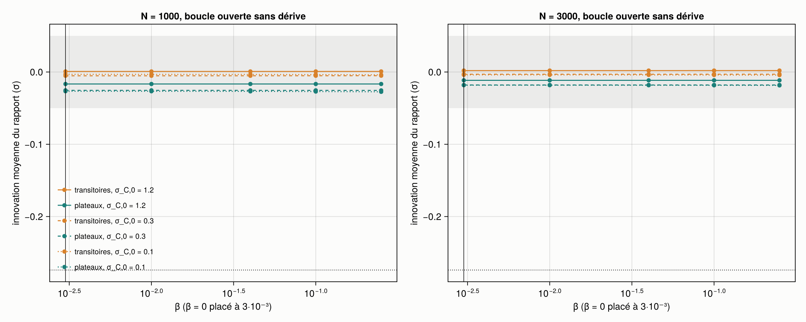
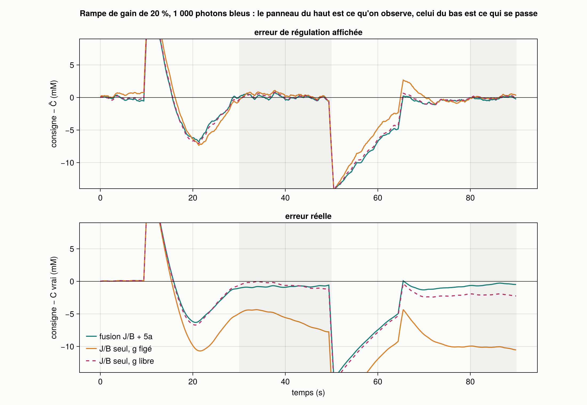
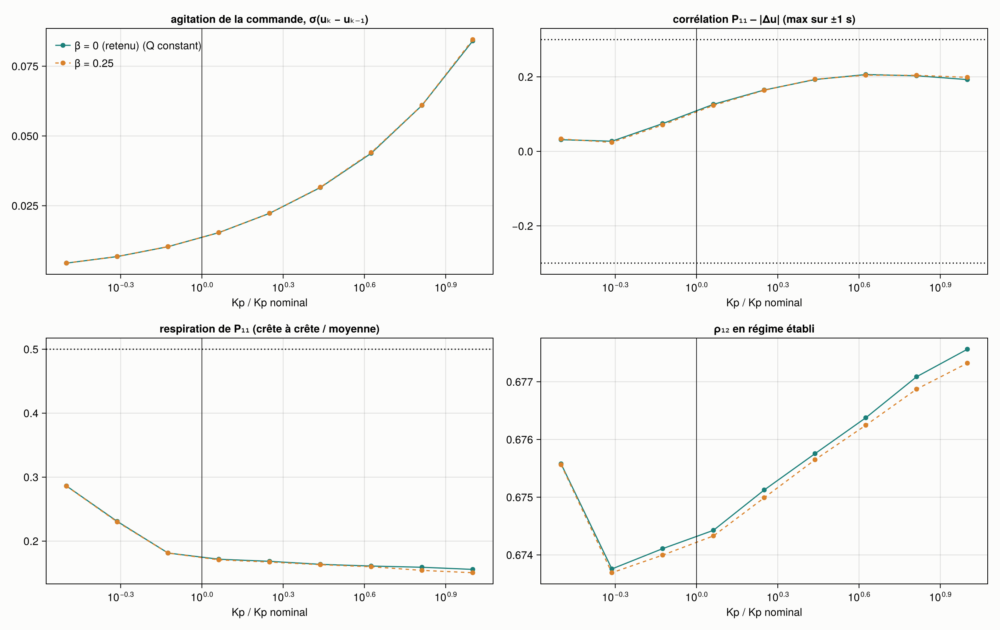
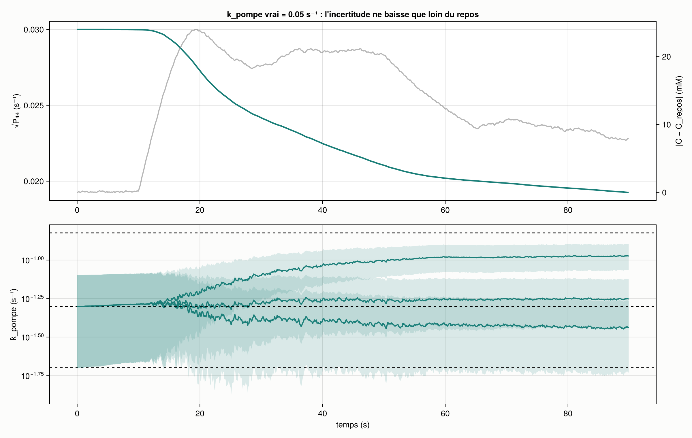

# Simulateur Kalman temps réel — étape 2 : la boucle fermée

Construit le 2026-10-18 d'après « Simulateur Kalman — étape 2 la boucle fermée.pdf » (dans ce dossier), à
partir de la V1 (`../real-time_Kalman_V1`, étape 1 et ses deux passes de corrections). eNpHR devient une commande ;
un régulateur PI agit sur les estimations du filtre ; on regarde si la boucle poursuit ses propres erreurs.

**En une phrase : issue A, la fusion gagne.** Sous une rampe de gain de 20 %, les deux boucles affichent une
erreur de régulation sous 0,3 mM ; l'erreur réelle vaut −0,70 mM avec la fusion et −7,20 mM avec le J/B seul.
La boucle sur le ratio seul a l'air parfaite en clampant le chlore 7 mM trop bas.

## Lancer

```bash
julia --project=. -t auto test/runtests.jl     # 5 groupes, 124 vérifications
julia --project=. -t auto run.jl               # les sept courses, ~15 min avec 8 fils ; --rapide : 2 répétitions
```

Le bloc « step0 » de `params.toml` (titration du 2026-10-16, 800 nm) vient de l'étape 1 sans changement ;
`step0_params.jl` le régénère au besoin (`julia --project=../FLIM-FRET_2-channels step0_params.jl`).

## Ce qui est repris, ce qui est neuf

| Fichier | Rôle | |
| --- | --- | --- |
| `src/params.jl`, `src/estimate.jl` | constantes, J/B, 5a (avec diffusion), calibrations, Fisher, R attendu | repris tels quels |
| `src/generate.jl` | histogrammes, dérive de g | repris, sans la trajectoire imposée de l'étape 1 |
| `src/physio.jl` | dC/dt = J(u) − k_pompe·(C − C_repos) + ξ ; J(u) = J_max·u/(u + u_½) ; consigne | neuf |
| `src/kalman.jl` | EKF qui connaît u : états (C, g, ġ), (C, g, ġ, k_pompe) ou (C, g) ; Q(u) ; observabilité | réécrit |
| `src/regulateur.jl` | PI, anti-emballement par intégration conditionnelle, variantes A, B, C | neuf |
| `src/boucle.jl` | une course : cellule, histogrammes, lectures, filtres, régulateur | neuf |
| `run.jl` | les sept courses, les métriques, les critères, les CSV | neuf |
| `src/figures.jl` | les quatre figures du plan, Fisher, une vidéo | neuf |

Sorties dans `sorties/` : `boucle_ouverte.csv` (courses 1–2), `boucle_fermee.csv` (3–4), `couplage.csv` (5),
`variantes.csv` (6), `k_pompe.csv` et `observabilite.csv` (7), `robustesse.csv`, `verification_R.csv`,
`criteres.csv`, `resume.csv`, les figures `fig1` à `fig4`, `fig_fisher.png`, et `video_rampe20.mp4` (non versionnée).

## Écarts au plan, et pourquoi

1. **Le « ratio seul à deux états » a g figé à 1.** Un filtre (C, g) sans 5a n'a aucune information sur g : g
   n'est pas observable, il absorbe les écarts du modèle pendant les transitoires et ne les rend jamais. Sans
   dérive, ce filtre est biaisé de +4,6 mM (boucle fermée, N = 1000). Ce n'est pas une référence honnête pour la
   question 2. La référence est donc le ratio calibré une fois (g = 1 figé), ce que fait la pratique ; le filtre
   à g libre est gardé dans les sorties (`ratio_libre`) comme pathologie.
2. **La variante C du régulateur suit l'intention du plan, pas sa formule.** La formule Kp·P₁₁/(P₁₁ + σ₀²)
   augmente le gain quand le filtre doute ; le texte dit l'inverse (« ralentit la boucle quand le filtre
   doute »). J'ai codé Kp·σ₀²/(P₁₁/c + σ₀²), avec σ₀² = la médiane de P₁₁/c en régime établi (course 3) et un
   Kp doublé pour que le gain moyen reste nominal.
3. **Q par pas, comme à l'étape 1.** σ_C,0 = 1,2 mM par pas (le σ_C de l'étape 1, comme demandé), et le terme de
   commande s'écrit β·(J(u)·Δt)² pour garder β comme erreur relative sur le flux.
4. **Kp en u par mM.** Le plan donne Kp en s⁻¹ ; avec e en mM et u sans dimension, Kp est en mM⁻¹. Kp nominal =
   0,0139 mM⁻¹, tiré de τ_BF = 3 s au maintien de 25 mM (1/τ_BF ≈ k_pompe + Kp·∂J/∂u) ; Ki = Kp/τ_BF.
5. **La boucle est inactive pendant le repos** (u = 0 avant 10 s), comme le dit le tableau du scénario.
6. **Transitoires et plateaux** sont définis par la pente du vrai C (au-dessus de 0,5 mM/s, sous 0,1 mM/s) ; le
   régime établi (erreurs de régulation, signatures de couplage) est 30–50 s et 80–90 s.
7. **Ajouts** : un balayage diagnostique de σ_C,0 (0,3 et 0,1) dans la course 2, le filtre `ratio_libre`, une
   vidéo de la boucle fermée sous rampe de 20 %. Les germes sont fixés par condition (le pas k de la répétition r
   a toujours le même bruit), donc fusion et ratio voient la même réalisation du bruit photonique.

## Les sept courses

Paramètres : C_repos 5 mM, k_pompe 0,05 s⁻¹, J_max 8 mM·s⁻¹, u_½ 0,3, σ_ξ 0,05 mM par pas. Budgets 1000 et 3000
photons bleus (300 abandonné). Huit répétitions pour la performance, quarante pour les innovations et les signatures.
Consigne : 5 mM (0–10 s), 25 mM (10–50 s), 10 mM (50–65 s), 15 mM (65–90 s).

### Courses 1 et 2 — boucle ouverte, nouvelle dynamique, Q(u)

Le régulateur agit sur le vrai C (la commande ne dépend d'aucun filtre) ; tous les filtres regardent les mêmes
histogrammes.



Fig. 2 : innovation moyenne du rapport contre β, transitoires et plateaux, aux deux budgets, pour σ_C,0 = 1,2
(plein), 0,3 (tirets) et 0,1 (pointillés). La bande grise est le seuil ±0,05 ; le pointillé à −0,274, le défaut de
l'étape 1.

- **Le défaut de l'étape 1 a disparu sans Q(u).** L'innovation moyenne sur les transitoires vaut +0,001 (N = 1000)
  à β = 0, contre −0,274 à l'étape 1. Ce n'était pas Q qui manquait, c'était le flux : un modèle de marche
  aléatoire ignorait qu'eNpHR poussait ; un modèle qui connaît u n'a plus de retard systématique.
- **β n'a aucun effet.** Avec σ_C,0 = 1,2 mM par pas, le terme β·(J·Δt)² vaut au plus 0,1 mM² contre 1,44 :
  les cinq valeurs de β donnent les mêmes chiffres au millième. Le β retenu est donc 0 (règle : le plus petit β qui
  corrige l'innovation de transitoire).
- **L'autocorrélation ne passe pas, et ce n'est pas β qui la règle, c'est σ_C,0.** Elle vaut −0,18 (transitoires)
  et −0,19 (plateaux) à N = 1000, −0,29 et −0,35 à N = 3000 : négative, donc un filtre qui surréagit. Avec
  σ_C,0 = 0,3 elle tombe à −0,05 / −0,06 à N = 1000 (le seuil de 0,10 passe) et la RMSE passe de 1,80 à 1,01 mM.
  σ_C,0 = 1,2 était le bon réglage pour une marche aléatoire ; le modèle physiologique demande nettement moins.
  Je n'ai pas changé la référence après coup ; c'est la première chose à régler pour la suite.

### Courses 3 et 4 — boucle fermée : la fusion contre le ratio seul



Fig. 1 : rampe de gain de 20 %, N = 1000, moyenne de huit courses lissée sur 1 s. En haut, ce qu'on observe ; en
bas, ce qui se passe. Bandes grises : régime établi.

Erreur moyenne en régime établi (mM, moyenne ± écart-type entre les huit courses) :

| N = 1000 | fusion : affichée | fusion : réelle | J/B seul : affichée | J/B seul : réelle |
| --- | --- | --- | --- | --- |
| aucune dérive | −0,07 | +0,35 ± 0,94 | +0,02 | −0,08 ± 0,12 |
| rampe 10 % | −0,05 | −0,17 ± 0,97 | +0,17 | **−3,55** ± 0,14 |
| rampe 20 % | −0,02 | −0,70 ± 0,99 | +0,26 | **−7,20** ± 0,15 |
| saut 5 % | +0,12 | +0,11 ± 0,96 | +0,29 | −1,21 ± 0,12 |

À N = 3000, même tableau : rampe 20 %, fusion −0,27 ± 0,19, J/B seul −7,12 ± 0,12 mM.

- **La question 2 répond oui.** L'intégrateur annule l'écart affiché dans tous les cas (|affichée| ≤ 0,3 mM) ; il
  ne voit pas la dérive. Le J/B seul clampe le chlore 3,6 mM trop bas sous rampe de 10 %, 7,2 mM sous rampe de
  20 %, et l'expérimentateur n'en sait rien. La fusion reste sous 1 mM.
- **Le prix de la fusion, sans dérive.** Son erreur réelle varie de ±0,95 mM d'une course à l'autre, contre ±0,12
  pour le J/B parfaitement calibré : ĝ erre, et le régulateur suit. Sa RMSE sans dérive est de 1,69 mM contre 1,13.
  La fusion n'est utile que s'il y a une dérive à corriger — ce qui est le cas réaliste en tranche.
- **Le J/B à g libre se compense par accident.** Biaisé de +4,6 mM sans dérive, il tombe à −1,1 mM sous rampe de
  20 % : le biais positif et la dérive négative se croisent. Exactement le résultat qu'on présenterait par erreur
  comme une réussite.

### Course 5 — le coude de couplage



Fig. 3 : les quatre signatures contre Kp/Kp nominal (0,32 à 10), à β = 0 (Q constant, plein) et β = 0,25 (tirets).

- **Pas de coude jusqu'à dix fois le gain nominal.** L'agitation de la commande croît moins vite que Kp
  (agitation/Kp passe de 1,01 à 0,61) ; la corrélation P₁₁–agitation plafonne à 0,21 (seuil 0,3) ; la respiration
  de P₁₁ reste sous 0,3 (seuil 0,5) ; ρ₁₂ ne bouge pas (0,674 à 0,678). Marge de gain : plus de 10.
- **Le couplage par Q n'existe pas dans cette configuration** : β = 0,25 et β = 0 donnent les mêmes courbes.
  Avec σ_C,0 = 1,2, Q(u) ne fait rien ; la boucle parasite décrite par le plan n'a pas de prise. À revoir si
  σ_C,0 descend vers 0,3, où le terme de commande pèsera.
- **Ce qui change avec Kp n'est pas le couplage, c'est la saturation.** À gain élevé, l'erreur affichée devient
  négative (−1,1 mM à ×10) : la commande ne peut pas descendre sous 0, donc le bruit d'estimation est redressé et Ĉ
  reste au-dessus de la consigne. L'erreur réelle, elle, traverse zéro vers ×5, parce que ce redressement compense
  le biais positif du filtre. Une autre compensation à ne pas prendre pour une qualité.

### Course 6 — les variantes B et C

| N = 1000, sans dérive | agitation | corrélation P₁₁–Δu | erreur affichée | erreur réelle |
| --- | --- | --- | --- | --- |
| A — aveugle | 0,0135 | +0,11 | −0,04 | +0,86 |
| B — zone morte √(P₁₁/c) | 0,0132 | +0,02 | −0,23 | +0,70 |
| C — gain pondéré | 0,0142 | −0,01 | −0,06 | +0,82 |

P₁₁ est corrigé par c = 1,47 (P₁₁/err² mesuré à la course 3). **A suffit** : les écarts sont dans le bruit,
puisqu'il n'y a pas de couplage à atténuer. B et C sont de la complexité gratuite à ce stade.

### Course 7 — k_pompe est-il estimable ?



Fig. 4 : en haut, √P₄₄ et |C − C_repos| (k_pompe vrai 0,05 s⁻¹) ; en bas, k̂ ± √P₄₄ pour les trois valeurs vraies
(tirets).

- **La condition d'observabilité se vérifie.** Le rang de la matrice d'observabilité vaut 3 à C = C_repos et 4
  ailleurs (`observabilite.csv` ; conditionnement 68 à 5,5 mM, 9 à 10 et 25 mM). √P₄₄ reste plat pendant le repos
  et ne baisse que pendant les excursions.
- **Mais une course de 90 s ne suffit pas à mesurer la pompe.** k̂ final : 0,037 / 0,056 / 0,108 s⁻¹ pour 0,02 /
  0,05 / 0,15, avec ±0,02 annoncé. Les estimations sont tirées vers l'a priori (0,05) ; le filtre annonce une
  incertitude du bon ordre (l'erreur est de 1 à 2 σ). Il faudrait plusieurs excursions, ou plus longues.
- P₄₄ ne remonte pas sur les plateaux, comme le plan l'attendait, parce que σ_k est presque nul (k est une
  constante de la cellule) : sans bruit de processus, l'incertitude ne peut que rester ou baisser.

### Robustesse — k_pompe et J_max balayés (rampe 20 %, N = 1000)

| k_pompe, J_max | fusion : réelle | J/B seul : réelle |
| --- | --- | --- |
| 0,02 s⁻¹, 8 | **−1,84** | −8,00 |
| 0,05, 8 (nominal) | −0,70 | −7,20 |
| 0,15, 8 | −0,80 | −7,11 |
| 0,05, 4 | −0,98 | −7,63 |
| 0,05, 16 | −0,70 | −7,21 |

**La conclusion survit au balayage** : le J/B seul se trompe de 7 à 8 mM partout, la fusion d'au plus 1 mM sauf à
k_pompe = 0,02 s⁻¹. Là, la relaxation du chlore (τ = 50 s) rejoint l'échelle du gain (τ_OU = 30 s) et la séparation
des échelles se dégrade, exactement comme le plan l'annonçait : −1,84 mM, au-dessus du seuil de 1,5.

## Critères de sortie

Tous adossés à une référence ou marqués « opinion », fixés avant la course (`params.toml`, `[criteres]`).

| Critère | Valeur | Seuil | Tenu |
| --- | --- | --- | --- |
| innovation moyenne, transitoires, N = 1000 | +0,001 | < 0,05 | oui |
| autocorrélation d'innovation, transitoires / plateaux | −0,18 / −0,19 | < 0,10 | **non** (σ_C,0, pas β) |
| hausse de la RMSE sur les plateaux, β retenu | 0 % | ≤ 5 % | oui (β = 0) |
| P₁₁/err² par phase, boucle fermée | 2,27 / 1,49 / 2,13 / 1,99 / 1,55 | [0,5 ; 2] | **non**, de peu (sous-confiant) |
| biais du filtre, 5 phases, sans dérive | +0,51 / +1,30 / +0,31 / +0,64 / +0,59 | < ±0,30 | **non** |
| erreur de régulation établie, sans dérive | −0,07 / +0,09 | < 0,5 | oui |
| erreur réelle, rampe 20 %, fusion | −0,70 / −0,27 | < 1,5 | oui |
| erreur réelle, rampe 20 %, J/B seul | −7,20 / −7,12 | > 4 attendu | oui |
| accord Fisher / Monte-Carlo, var J/B et var 5a | 0,7 / 0,4 % ; 3,5 / 1,2 % | < 5 % | oui |
| ρ₁₂ boucle fermée contre boucle ouverte | 0,68 contre 0,68 | ≤ BO + 0,1 | oui |
| marge de gain avant le coude | > 10 | ≥ 3 (opinion) | oui |
| échecs de 5a, C = 5 mM, N = 1000 | 32,8 % | à rapporter | — |

(Deux valeurs : N = 1000 / N = 3000 ; cinq valeurs : repos, créneau haut, plateau, descente, créneau bas.)

**Les deux lignes qui portent la question 2 tiennent.** Les trois critères ratés ont une seule source : le
filtre de fusion est biaisé de +0,3 à +1,3 mM sans dérive. ĝ monte d'environ 1,3 % au repos et pendant la montée,
là où 5a est le plus faible (33 % d'échecs à 5 mM) et où son observable est biaisée vers le haut ; le biais se
reporte sur Ĉ, et la boucle clampe le chlore autant sous la consigne. C'est le biais résiduel de l'étape 1,
remesuré contre la bonne dynamique comme le plan le demandait : il ne disparaît pas avec le bon modèle.
Deux leviers déjà identifiés, à essayer dans cet ordre : σ_C,0 ≈ 0,3 (biais en plateau de +1,02 à +0,36 mM en
boucle ouverte) et 5a à 4 paramètres pour l'observable du filtre (biais réduit d'environ moitié sur 24 courses).

## Issue

**Issue A — la fusion gagne**, déterminée par les règles posées d'avance : l'écart entre erreur affichée et erreur
réelle est net pour le J/B seul (−7,2 mM sous une erreur affichée de +0,3) et petit pour la fusion (−0,7 mM). Le
couplage ne domine pas (pas de coude jusqu'à ×10, alors que τ_BF = 5 s ne demande que ×0,53).

Réserves :
- Le biais de la fusion sans dérive (+0,35 mM en régime établi, jusqu'à +1,3 pendant la montée) dépasse le seuil
  du plan ; la fusion vaut le coup sous dérive, et coûte en précision sans dérive.
- Q(u) et le couplage n'ont pas été testés dans un régime où ils agissent : avec σ_C,0 = 1,2, le terme de commande
  est négligeable. La conclusion « pas de couplage » vaut pour ce σ_C,0.
- k_pompe, J_max, σ_ξ sont posés ; la conclusion de la course 4 survit à leur balayage, sauf la marge de la fusion à
  k_pompe = 0,02 s⁻¹.

## Pour la suite

1. Refaire les courses 2, 3 et 5 avec σ_C,0 ≈ 0,3 : c'est là que Q(u) et le couplage auront une prise, et que le
   biais de la fusion devrait tomber sous le seuil.
2. Choisir l'observable de 5a transmise au filtre (4 ou 6 paramètres) — question ouverte depuis l'étape 1.
3. Hors simulateur, comme prévu : l'expérience nulle en tranche, le test p contre q sur la titration, la mesure
   d'autofluorescence.
